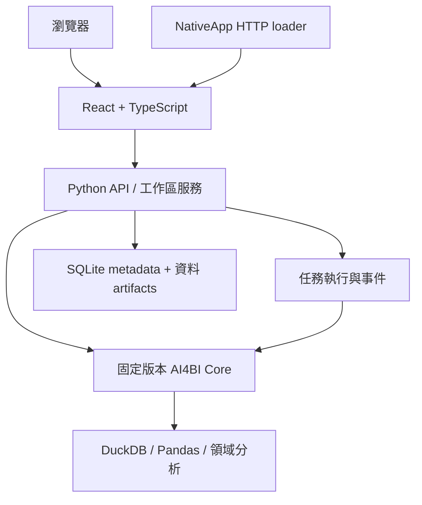

# AI4BI React Web 與 NativeApp 實作計畫

## React 遷移進度（2026-11-03）

目前在隔離工作樹 `codex/react-web-ai4bi`（基準 `d9fa0a0`）整合 React Web、Python API、建置腳本、NativeApp 接入包與瀏覽器驗收。React build 已嵌入 API 套件；執行期已移除 Streamlit 依賴，舊 UI 僅供開發測試比較，不再是支援的啟動路徑。README 已切換為 React 本機流程。此處記錄來源驗證，不代表完整功能遷移或 NativeApp 發布驗收完成。

本輪驗證：`npm run test:web` **34 通過**，React build 與 `scripts/build_app.py --wheel` 通過；API 專項 **4 通過**，Streamlit 依賴抽離後目標進度／AI 問答回歸 **16 通過**、報表 API 回歸 **1 通過**。另以 import hook 阻擋 Streamlit 後成功載入 API、AI service 與共用目標進度模組。本輪 wheel 為 2,100,221 bytes，SHA-256 `dee7c7732ecb6cf57a8a1a94cea5cd768c4b33ff5069490415c35e667987f4e0`。完整 API 套件曾為 **943 通過、1 失敗**（idle-worker 到期測試），該單一案例隔離重跑通過。Playwright 完整輪初次為 **33/36**；之後原先 2 個 PDF 下載等待案例單獨重跑通過，長篇本機工作區旅程在同步修正後單獨通過。三個失敗案例均有後續單案通過紀錄，但不是單次完整 36/36 回歸。`npm audit --omit=dev` 為 0 個弱點；開發相依鏈仍有 3 個 moderate findings。尚未執行乾淨離線安裝或用新版 NativeApp 驗證；完整 React／舊版逐功能 parity 及發布 gate 保持未完成。

告警更新（2026-11-03）：React 已由 KPI-only 比較切換為完整事實指標清單及 worker 快照評估，支援明確欄位／值範圍，並將相同規則送入摘要。`test_workspace_api.py` **152 通過**、`npm run test:web` **34 通過**、真實工作區 Playwright 告警／週月摘要旅程 **1 通過，33.8 秒**、`scripts/build_app.py --wheel` 通過；wheel 為 2,106,433 bytes，SHA-256 `4cbc80714c1441da942bb61e5ea0cd3c92e133265aefede5ccf54eb90e7cb2c7`。完整 API 套件只覆蓋此 API 測試檔，未代表全部 943 項回歸重跑；未執行離線安裝或新版 NativeApp 驗收。

RFM 完整交付已接入開發來源，驗收進行中：一般查詢新增嚴格布林 `include_rfm`，發布及四格式匯出強制執行全部保存 RFM 並核對完整性，提交發布另核對保存設定收據；過渡版 `RFM_DELIVERY_UNAVAILABLE` 已移除。執行契約升為 `web-query-v7`，v6 或更早發布保持可讀，執行須使用相容環境或重新發布，既有相容性拒絕矩陣已加入 v6。CSV／Excel／PDF 共用完整 summary／customers 資料表，JSON 保留原始結果；PDF 空客戶明示，不能使用 UI 100 列分頁上限截斷。新增 `RfmResultView.tsx` 歸屬共用結果呈現，由探索面板與發布唯讀頁使用，避免維護兩套數值格式／分頁邏輯。

目前正式建置及 RFM／發布專項 **91 通過，53.13 秒**，已驗四格式實際文件讀回、保存設定與版本、固定發布在草稿刪除後重播／匯出。另於本工作樹重建 React package assets 後，重跑 `tests/e2e/workspace.spec.ts` 的 RFM 完整旅程 **1 通過，23.5 秒**：真實查詢、設定保存／重載／套用、空結果、600 客戶六頁瀏覽、接受後取消、刪除草稿設定後發布重播，以及 JSON／CSV／XLSX／PDF 實際下載；旅程逐值核對 JSON 設定與結果，其他三格式核對下載成功及非空檔案，截圖已目視檢查。`test_rfm.py`、`test_publications.py`、`test_exports.py` 後端專項重新執行 **181 通過，87.97 秒**；以 Python 3.11 安裝 `services/api/pyproject.toml` 所列的 `pypdf==6.0.0` 測試 extra 與 `statsmodels==0.15.0` runtime dependency 後通過。這些是 RFM／發布／匯出範圍驗證，完整 API 與瀏覽器套件仍在進行；尚未更新 wheel、離線安裝及 NativeApp。不把這些專項當作完整交付驗收完成；下段過渡拒絕及尚未串接敘述保留為歷史。

React 告警增量：`AlertPanel` 現列出所有已就緒 fact／snapshot_fact／target_fact 的資料指標，不再受限於目前頁面的 KPI。React 透過新增的 `/alerts` 背景工作提交規則，worker 以接受時報表與資料快照呼叫既有 `evaluate_alerts`；可選欄位／值範圍沿用既有 `AlertRule.filter_column`／`filter_value` 查詢語義。規則仍存於目前瀏覽器工作階段，跨頁／工作區全域共用尚未加入；不執行背景排程或寄送。摘要請求保留提醒範圍。API **152 通過**、前端 **34 通過**、建置／wheel 通過；真實工作區旅程 **1 通過，33.8 秒**，使用 KPI 清單以外的 `unique_lots`、`step_name=Etch`，驗證觸發、重載、週／月摘要及下載內容。規則編輯與 worker 快照評估已接入；排程執行器／outbox 配送仍未接入，因此 P05 告警與排程整組未完成。

React 業務摘要增量：新增 `POST /summaries` 背景工作，依接受時的報表／資料快照呼叫既有 `ai4bi.analysis.summary.generate_summary`，從目前頁面的第一個資料來源取得摘要，支援舊 Streamlit 提供的週報／月報、前三名與已觸發提醒；後端核對提醒規則僅引用現有 fact／snapshot_fact／target_fact 指標。React 可呈現結果並下載 Markdown；daily／weekly 排程頻率與摘要週期保存於目前瀏覽器工作階段，介面明示只記錄偏好，尚未自動執行或寄送。`scripts/build_app.py`（含 OpenAPI 型別生成／靜態資產封裝）及 React build 通過；摘要核心與 API 專項 **7 通過**，涵蓋舊支援週期、運算子拒絕及未註冊事實指標拒絕。真實工作區 Playwright 旅程 **1 通過，24.0 秒**，實際跑週報／月報、確認提醒出現在摘要、讀回下載 Markdown，並驗證排程與告警設定重載保存。此切片不等於告警全指標／任意範圍遷移、排程執行器／outbox 配送或完整 P05 驗收。

RFM 交付完整性增量已完成：沿用 `rfm.py` 與對應測試，新增 `delivery_checks`／`validate_delivery_checks`。核對保存設定及頁面／圖表身分、分析版本、截止日、完整且唯一的客戶集合、母體／納入／排除筆數守恆、UTC 最近購買日與天數、購買日數及精確金額編碼。R／F／M 以整數平均排名公式獨立重算分位，並核對分群與相對風險；數字格式不允許不安全大整數改成浮點或安全數值任意改成字串。提交收據綁定保存設定 digest、版本、截止日與客戶數。來源授權及實際資料範圍仍由快照執行器保證，不以結構驗證取代來源查核。

保存分析批次返回前已呼叫完整性檢查；發布／匯出的 `RFM_DELIVERY_UNAVAILABLE` 過渡拒絕仍保留，尚未解除或串接文件輸出。專項 **60 通過，5.53 秒**，含完整／空結果、遺漏／重複身分、日期／分位／風險／設定竄改與大整數轉浮點拒絕。來源 API 建置 `21c24a833a2fba3ee1249fb97a377b75350c0f9fff107696506d41c55aea6174` 通過，前端產物沿用；證據 `.artifacts/rfm-integrity-evidence/evidence.json`。下一步將完整結果接入一般查詢選項、發布／提交與四格式文件及唯讀畫面，升版執行契約並重驗相容性。全套 API／瀏覽器／安裝包未於本增量重驗，完整 RFM gate 不勾選。

RFM 設定保存增量完成來源驗證：沿用既有 `rfm.py`、ReportExtensions、命令生命週期、RfmPanel 與測試，不新增維護目錄。SavedRfmAnalysis 保存來源、三個欄位及型別、截止日、名稱、頁面與選取圖表，版本 `rfm-v1`；每份報表最多 30 組，識別碼／名稱去重，支援 CRUD、Undo／Redo、複製頁面的引用重映射與刪頁清理。改名／刪除不需載入來源，保留失效設定的修復入口。保存分析批次先驗全部定義，再按各自頁面／所選圖表執行，臨時條件只作用目前探索頁面，鑽取限制於所屬頁面。固定快照在草稿刪除定義後仍可重播。

建置 `6975fcab1d8520aa0760aa98f06327667445d1b9330173845baef9d34ebc915e` 通過，RFM／報表擴充 **220 項通過，41.10 秒**（一項既有 OLS 退化案例警告）；瀏覽器 **1 案通過，8.6 秒**，涵蓋設定保存、保存報表、整頁重載、套用／重算金額，以及既有空範圍、600 客戶分頁與取消競態。證據 `.artifacts/rfm-saved-evidence/evidence.json` 含來源／測試／日誌副本與雜湊。發布／匯出完整結果尚未接入，過渡版本在任何查詢前以 `RFM_DELIVERY_UNAVAILABLE` 拒絕含保存 RFM 的交付，不靜默漏掉分析；面板已明示。一般查詢契約仍為 `web-query-v6`，下一步完整交付須更新契約與相容性驗證。下段「設定保存待串接」由本段取代；完整分析範圍矩陣、全套 API／瀏覽器、新版離線安裝與 NativeApp 尚未全部完成。

RFM React 入口已接入：`apps/web/src/components/RfmPanel.tsx` 負責設定、背景任務與完整結果分頁，沿用既有 API 輪詢、App 頁面資料來源與 style.css 分析樣式，沒有新增平行前端目錄。只列本頁使用的事實來源；選擇客戶／日期／金額及明確截止日，顯示納入／排除筆數、R／F／M、相對風險與資料版本，金額字串不轉 Number。每頁 100 列，條件或報表範圍變更清除結果並取消追蹤；接受回應尚未返回時取消，也會在取得 job_id 後送出取消請求，阻擋舊結果回填。面板明示尚未納入保存／發布／匯出，不假裝探索結果已交付。

來源建置 `a6161e905751b2a32aa0094069e2329cb8aef5d340090f2055ef3d0561e26461` 通過 OpenAPI／TypeScript／Vite。真實瀏覽器 **1 個完整 RFM 案例通過，6.8 秒**：100 列／5 群結果逐列金額對照、更改日期清除與空結果、600 位識別碼的六頁首尾對照／末頁按鈕停用，以及延遲真實接受回應後取消，不回填結果。取消測試只延遲 HTTP 回應，未偽造計算資料；不據此宣稱 worker 一定在計算完成前停止。截圖已檢視，證據 `.artifacts/rfm-ui-evidence/evidence.json` 與 `.artifacts/rfm-ui-browser-expanded.log`，CLI exit=0。初次建置因 OpenAPI 不獨立輸出未引用的 RfmSettings 而失敗，已改從生成的 RfmRequest 選取設定欄位，未手寫另一份 schema。下段「React 未接入」由此取代；設定保存、發布、匯出、完整回歸及新版安裝／NativeApp 仍待完成。

RFM API 增量已完成：`POST /analyses/rfm` 沿用既有 `submit_report` 的原子快照、revision 及冪等接受，worker 以 `rfm-v1` 執行並拒絕不相容契約。設定包含事實來源、客戶／日期／金額欄位及必要截止日；解析目前頁面、選取圖表、書籤範圍、探索條件與鑽取，拒絕未用於目前頁面的來源及不相容欄位型別。結果含設定、快照／資料／執行版本及範圍資訊。`assistant_source_contracts` 新增預設關閉的精度保留選項，RFM 篩選路徑以 DuckDB fetchall／object DataFrame 保留 HUGEINT／DECIMAL，原分析路徑不變。此增量沒有改變一般報表查詢語義，`web-query-v6` 不變。

來源建置 `fa58e19b76a94baa158448fe923584e8a9b4fdb432c275afd22aca6a3efde8ba`、OpenAPI／TypeScript／Vite 通過。RFM／SPC／共同性 **134 項通過，86.26 秒**；真實 RFM HTTP 工作完成並重送去重，以原始範例逐客戶金額核對；篩選後大整數加總、欄位／版本拒絕亦通過。首輪兩個測試預期修正（標準化篩選包含 source_visual_id、晶圓來源列數須由原始資料推導）保留 `.artifacts/rfm-api.xml`；最終證據 `.artifacts/rfm-api-evidence/evidence.json`。這取代下段「API 尚未接入」狀態，React 面板、設定保存、發布／匯出與新版交付仍未完成；尚未重跑全套 API／瀏覽器或更新 wheel，完整 gate 不勾選。

RFM 計算邊界已實作，操作入口尚未接入：新增 `services/api/src/ai4bi_web_api/rfm.py`，呼叫固定 wheel 的 `analysis.rfm.compute_rfm`，測試歸入 `services/api/tests/test_rfm.py`，不複製或修改舊核心。`rfm-v1` 強制明確截止日，以 UTC 購買日計算距離與不同購買日數；缺客戶／日期及截止日後交易分別計數排除。有效範圍內的無效日期、非數值／非有限金額、混合客戶識別型別均拒絕。退款保留為淨額，金額以足夠精度 Decimal 加總，大整數／不可精確往返的金額以字串輸出；金額位階最多 308、小數尺度最多 1000，以限制序列化與計算資源。客戶最多 10,000，不截斷；同值以客戶識別碼穩定排序。R／F／M 沿用固定核心平均排名分位分數，流失風險僅表示相對 recency 分位，不是流失機率。

專項 **19 通過，0.76 秒**；包含可人工核算的五客戶分數、同日多筆、退款、截止日／UTC 日界、缺值、空範圍、金額精度、相鄰大整數排名、識別型別與欄位名稱碰撞。`.artifacts/rfm-boundary-evidence/evidence.json` 記錄核心／轉接／測試副本與日誌雜湊。尚未接入受治理來源與探索範圍、固定快照背景任務、React 面板、保存／發布／匯出；呼叫端必須提供已授權且套用範圍的資料，不能直接暴露任意 DataFrame 載入入口。未變更 `web-query-v6` 或重建交付包，不能以此勾選完整 RFM gate。

發布桌面保存／重啟補驗已完成：既有 Runtime 工具擴充為兩次完整程序生命週期，**14 步通過**。第一次修改並保存圖表標題，原生關窗後確認 20 個程序及服務埠回收，再以新的 WebView 設定目錄啟動、重新配對並開啟原工作區；標題及五圖查詢恢復，第二次關窗亦回收 20 個程序。`.artifacts/nativeapp/webview2-change-restart/evidence.json` 保存兩輪程序身分與關閉結果；driver 雜湊一致、未強制清理、發布檔案未變。此項把下段 6 步基礎驗證擴充為保存重啟驗證；仍不代表 Setup、新機、升級回滾或完整產品驗收完成。

發布平台接入增量：0.1.8 發布 ZIP 的 WebView2 EXE／Host 與 Kit 內嵌 Python 逐檔核對後，已實際載入 v6 AI4BI。沿用 Host 驗證工具建立新 Store，依賴安裝 99.09 秒、launch 1.81 秒、stop 5.19 秒；新增 `scripts/validate_nativeapp_runtime.cjs` 負責發布 EXE／CDP／原生程序生命週期，與 Electron 來源殼工具的執行責任分開，產物仍集中 `.artifacts/nativeapp/`。桌面 6 步通過：配對、建置、工作區／五圖查詢、原生關窗後 20 個程序退出且 Host／App 埠關閉；發布檔案未變，無強制清理。證據及命令見 `integrations/nativeapp/README.md`。這是發布元件組合的基礎驗證，尚非完整 Setup／新機或發布版完整分析、下載、升級回滾驗收；P00–P06 完整 gate 維持未完成。

v6 NativeApp 接入增量完成：來源與安裝版相同 b0b32e45 建置，发布 Kit 的 87 個檔案重新核對；新包 **195 檔、168,518,139 bytes**，validate／pack／逐檔雜湊一致。Host 從封存檔建立新 Store 環境 **101.02 秒**，launch **1.80 秒**、stop **5.19 秒**，launcher 退出與埠關閉皆已確認。既有 scripts/validate_nativeapp_desktop.cjs 加入變化拆解保存、Host 重載後套用計算、工作／發布結果及下載核對，Electron 來源殼 **32 步驟通過**，5 個受監測外部殼來源檔未變；沒有修改外部平台。JSON 工作／發布四種分析設定與資料列一致，變化拆解 CSV／Excel 五群及 PDF **35 頁**讀回核對，發布截圖已檢視。詳細雜湊及證據見 integrations/nativeapp/README.md。本段取代下方新版 NativeApp 待驗的中途狀態；正式發布 Runtime、新機、Host 身分與自動配對、OS 存檔對話框、升級回滾及其他 P00–P06 項目仍待完成，完整 gate 不勾選。

變化拆解 v6 的離線及安裝瀏覽器驗證已完成：b0b32e45 wheel 2,091,972 bytes，專案外離線安裝／HTTP／重啟後刪除草稿再重播固定發布通過。安裝版首輪 **33 通過／1 失敗，7.0 分鐘**；圖表格式案例改為等待新工作區查詢後，**1 案補驗通過，14.5 秒**。兩輪同一安裝環境、產品未改、其餘 33 案測試未變，完整 34 案為分次驗證；未放寬 timeout。實際下载四格式另核對五群、設定、數值、資料版本及 PDF 11 頁，發布畫面已檢視。`.artifacts/release/offline-change-delivery/browser-coverage.json` 與 docs/validation/app-release.md 保存細節。下方安裝瀏覽器「驗證中」已由本段完成；下一步更新 NativeApp 封裝、Host 啟停及桌面結果／下載驗證，完整產品仍未完成。

變化拆解文件邊界補驗：新增 16 個文件投影案例（四格式 × 160 群／大整數／精細小數字串／空結果），專項 **133 通過，36.57 秒**。JSON／CSV 原值、Excel 字串儲存型別及全部列、PDF 所有群組與完整數字逐项核對，未因 UI 的 100 群分頁截斷。投影案例固定查詢結果，真實 HTTP／背景任務證據仍見前輪來源驗證；`.artifacts/change-document-boundary-evidence/evidence.json` 明確區分兩者，產品未改，build 仍為 b0b32e45。

離線安裝探測沿用 scripts/probe_app_wheel.py，加入變化拆解保存、實際分析、CSV 全列／設定／資料版本、發布與服務重啟後刪除草稿再重播；不建立另一套安裝流程。新版 wheel 與專案外離線安裝已通過，詳見 docs/validation/app-release.md；安裝版全部瀏覽器案例正在執行，NativeApp 封裝／Host／Electron 尚待更新。完整產品與 P06 gate 維持未完成。

變化拆解 v6 來源交付驗證完成：同一建置 `b0b32e45c68bff975b72517b6782ce5686ffd6cfbc0fe4b094b6ff5a7cfe8983`，完整 API **865 通過，347.05 秒**（既有退化 OLS 警告一則），前端 **34 通過**，全部 **34 個瀏覽器案例同輪通過，7.0 分鐘**。新增發布案例 12.6 秒，使用真實保存／發布／查詢／四格式下載，刪除草稿後重開原發布仍有五群；完整流程保留既有 timeout。瀏覽器下载文件另讀回：JSON／CSV 的設定、群組及資料版本一致，Excel 五群數值與 JSON 以浮點容許誤差核對，PDF 11 頁包含全部群組、分析 ID 與 v6。發布畫面已檢視，良率差異為百分點、缺期為「—」。證據 `.artifacts/change-delivery-browser-results/evidence.json` 綁定來源副本、XML、日誌、文件與截圖，並確認瀏覽器期間 driver／manifest 未變。下方「完整 API 與新版瀏覽器待核對」為歷史中途狀態。下一步補驗交付完整性的長表／空值／精確字串等邊界，再更新離線安裝、NativeApp 封裝與桌面驗證；完整產品 gate 仍未完成。

變化拆解交付串接（驗證中）：QueryRequest 增加嚴格布林 `include_change`，ExportRequest 固定為 true；core 回傳 `change_analyses`，發布檢查及所有匯出固定執行全部保存設定，發布提交再次驗證摘要。移除過渡交付拒絕，執行契約升為 `web-query-v6`；舊 v5 納入不可執行的歷史發布測試，仍可讀內容。exports.py 共用完整設定／群組投影，CSV 放入 change/、Excel 使用 CH_ 工作表、PDF 顯示完整群組及空結果狀態，JSON 保留原始結構及精確字串。前端新增既有 components 下的 ChangeResultView，從 ChangeAnalysisPanel 抽出相同精確值顯示與 100 群分頁，探索及發布共用；發布頁只顯示本頁結果並沿用取消、切換範圍清除及快照查詢生命週期。新檔責任與既有 SPC／共同性／跨表 ResultView 相同，不另設重複結果實作。

建置 `b0b32e45c68bff975b72517b6782ce5686ffd6cfbc0fe4b094b6ff5a7cfe8983` 通過；變化拆解／發布專項 **145 通過，62.17 秒**，證據 `.artifacts/change-delivery-publication.xml`。真實 worker 四格式下載讀回設定、完整五群、欄位與 v6；發布後刪除草稿，既有發布查詢與 JSON 匯出仍保留設定、數值及資料版本。v5 快照在來源讀取前拒絕。完整 API 與新版瀏覽器仍待核對；安裝、NativeApp、所有完整性邊界與全產品 gate 不在此處宣稱完成。

變化拆解交付檢查準備：在既有 change_analysis.py 增加 `delivery_checks` 與 `validate_delivery_checks`，分別供完整結果投影與發布提交摘要使用。核對保存設定、analysis_id／名稱／頁面／所選圖表、UTC／日期策略、快照／revision／執行契約／資料版本一致；群組不得缺少、重複或超限，期間須符合保存設定，數值須符合 change-v2 的 canonical JSON 編碼，不能把大整數或十進位字串轉回浮點。以 Decimal 核對每組及整體差異、相對百分比、加總貢獻與整體合計，非加總缺期保留 null；此檢查不代替固定快照、來源讀取與受治理指標執行的真實性驗證。提交摘要綁定完整保存設定 digest 並再次核對版本、列數與期間。

本增量專項 **115 通過，22.00 秒**，包含真實 SQL 大整數差異 1、加總／加權／空結果、缺少或多出分析、重複群組、篡改值／版本／資料版本／設定／期間、布林與非有限數字、非 canonical 字串及摘要篡改。僅既有 change_analysis.py 與對應測試變更；`--skip-web` 建置 `ecae76433b6e4846294f35e455f3957c4387d7443727948bc2236c604e56ae86` 與 manifest 核對通過，前端產物雜湊與 bb3894d8 完全相同。證據 `.artifacts/change-delivery-integrity-evidence/evidence.json` 保存來源與日誌；未宣稱新增完整 API／瀏覽器回歸。公開發布／匯出尚未调用此檢查，過渡拒絕仍保留，web-query-v5 未改。下一步將檢查接入 core 查询、發布驗證與提交、四格式完整投影及唯讀結果 UI，同步升版 v6 並驗證舊發布相容性；完整產品仍未完成。

保存變化拆解範圍补驗完成：既有測試檔新增 8 個雙頁／目前頁／加總或加權／鑽取矩陣案例與 1 個真實命令書籤重播案例，專項 **76 通過，18.74 秒**。以原始資料獨立套用所選查詢、頁面及圖表保存條件、目前頁臨時條件，計算兩期加總與加權值；鑽取案例的目前頁保留兩種產品，確實由鑽取路徑縮小母體，另一頁不受影響。書籤保存 Logic-A 後，現行條件改成 Logic-B，重播仍保留原產品、篩選內錨點與期間值；快照不變、資料版本一致。初輪 71 通過／4 失敗是手製快照漏掉 datasets 契約，補上後通過，未繞過鑽取验证。證據 `.artifacts/change-saved-scope-evidence/evidence.json` 保存初輪與最終結果、測試及產品來源副本。產品未改，沿用 `bb3894d8…`；不是新增完整 API／瀏覽器回歸。接續實作發布／四格式完整結果、提交前完整性與 v6 執行契約，完整產品 gate 仍未完成。

變化拆解保存增量（本輪來源驗證完成）：沿用既有 ReportExtensions、命令生命週期、ChangeAnalysisPanel 與對應測試，不新增維護目錄。定義保存兩個欄位型別及指標公式／可加總性／單位簽章，支援報表計算指標、30 組上限、名稱去重、CRUD／Undo／Redo、頁面複製引用重映射與刪頁清理。更新設定直接解析目前契約；改名／刪除不依賴來源查詢。固定快照批次先驗證所有定義再執行，避免第二份不相容時先執行第一份。尚未串接完整發布與四格式結果，過渡版本明確拒絕含保存變化拆解的交付，不靜默漏掉分析；一般執行契約維持 web-query-v5，後續交付仍須升版。

目前來源建置 `bb3894d8fce4ac2271bf093ac5b814fabbcb10488b3ea2c16cf15e737f5a40ef` 通過，完整 API **815 通過，334.62 秒**、前端 **34 通過**，變化拆解專項 **67 通過，16.00 秒**。保存／更新／改名／保存報表／重載／套用加權分析／刪除／復原真實流程通過，保存畫面已檢視。完整瀏覽器初輪 **29 通過／4 失敗，8.0 分鐘**，四案修正後 **4 通過，1.0 分鐘**。日期粒度案例改為等待新工作區查詢；Plotly 切換圖形時等待 trace；零售圓餅圖與地圖案例先把預設最近 30 天的營收 KPI 設為全期間，再與全期間分類／城市數值比較。未放寬 timeout；產品 manifest 及其餘 29 案測試不變，33 案為分次驗證。證據 `.artifacts/change-saved-evidence.json` 保存日誌雜湊與來源副本。多頁／書籤完整矩陣、发布匯出與安裝／NativeApp 尚待完成，完整 gate 不勾選。下方精度及入口段落均屬先前版本歷史。

變化拆解固定重播前的精度增量（`change-v2`，本輪來源驗證完成）：變化相同時依群組型別與原始值排序，null 放在同值群組末端，不依 SQL／來源列順序。查詢沿用固定核心的來源註冊、指標公式、聚合、篩選、RLS 與期間 spec；`ComparisonExecutor.exact_metric_output` 僅在變化拆解視窗內把最終指標轉成 SQL VARCHAR，避免固定核心 `.df()` 把 HUGEINT／DECIMAL 聚合轉成浮點而先失真。離開 context 或查詢失敗後會恢復原模式，其他查詢路徑不改。變化拆解 adapter 以 Decimal 計算差異、加總與百分比，精度隨數值位數和群組數保留餘裕；百分比仍 round half-even 到一位小數。可精確往返的數值輸出 number，超過 JavaScript 安全範圍的整數與不能精確往返的十進位數以字串保留，React 原樣顯示、不轉回 Number。v1 的 pandas merge／float 差異計算由此取代，舊 change-v1 工作在來源讀取前拒絕。一般報表／發布 `web-query-v5` 不變，因保存分析尚未接入其執行結果。

此輪沿用既有 change_analysis.py、comparison.py、types.ts、API 與 E2E 測試檔，未建立新維護目錄。精度／變化拆解專項 **54 通過，7.14 秒**，真實 SQL 驗證 `2^53+1` → `2^53+2` 的差異為 1、SUM 超過 int64、負差異、精細 Decimal 和缺期群組、來源排列變更後同值群組順序一致、精度 context 成功／失敗皆復原。正式建置 `7358113870f1e8acac562f2013f03f7455f338553d6ae02a3cd20f070703b405` 通過；完整 API **802 通過，327.57 秒**，前端 **34 通過**；瀏覽器 **14 案通過，另 1 案 CSV 補驗通過，7.3 秒**，真實匯入至顯示已核對大整數與差異 1。保留兩次測試定位失敗與修正，產品未改；證據 `.artifacts/change-precision-evidence.json` 核對同一 manifest、其餘 14 案測試不變，未宣稱全套 15 案同次全綠。設定保存、發布匯出及新安裝／NativeApp 套件仍待完成，不以精度準備宣稱已完成保存。

變化拆解操作入口已完成本輪來源驗證：`POST /analyses/change` 透過既有 `submit_report` 原子接受快照與重送去重，worker 使用 `change-v1` 並先拒絕不相容執行版本；HTTP 不接受前端指定 additive。來源限目前頁面使用的事實來源，指標包含報表計算指標，可加總性由固定合約判定。日期支援 DATE／timestamp／datetime，以 UTC 日界半開視窗執行；可明確指定截止日，或使用原始篩選內最新日期。keep 取交集；replace 只移除可分離的日期條件，混合 OR 拒絕。報表／頁面／所選圖表保存條件、所選查詢原始條件、探索與鑽取均進入查詢；HAVING／Top-N 不裁切分析母體。回傳範圍 metadata、設定、公式、資料版本與完整群組。來源 `ChangeAnalysisPanel.tsx` 歸屬既有 components；類型沿用 types.ts／生成 OpenAPI，樣式沿用既有分析面板。支援取消接受中工作、篩選／設定變動清除舊結果與每頁 100 群的完整分頁。尚未保存分析設定、發布或匯出，因此一般查詢／發布 `web-query-v5` 未改；後續交付串接時須再升版與驗證舊發布。

入口專項 **48 通過，6.89 秒**；完整 API **796 通過，331.37 秒**，前端 **34 通過**，正式 OpenAPI／TypeScript／Vite 建置通過。首輪建置 `a960c419…` 的 **13 個真實瀏覽器案例通過，3.2 分鐘**；完整報表 1.4 分鐘。檢視畫面後將良率絕對差異改標「百分點」，新建置 `989da9ce…` 的前端 34 通過、後端全部檔案雜湊不變，新版 **13 個瀏覽器案例全部通過，3.2 分鐘**，完整報表 1.4 分鐘；另有 **1 個 600 群分頁補驗通過，6.8 秒**，逐頁核對六頁及最後一列、末頁停用按鈕與改設定後重設。證據 `.artifacts/change-entry-verified-browser-results/evidence.json` 與 `.artifacts/change-pagination-browser-results/evidence.json`，兩者產品 manifest 相同，截圖已檢視。本段不宣稱安裝版／NativeApp 已更新。初輪 API 35 通過／3 失敗是測試誤把整數 good_die 當不可分組欄位、預期錯誤的範例群組數及 runtime 錯誤碼，已修正為實際型別／來源獨立聚合／既有錯誤契約，證據保留於 `.artifacts/change-entry-initial.xml`。本段取代下方「尚無公開入口」的歷史狀態。

變化拆解內部計算增量：`services/api/src/ai4bi_web_api/change_analysis.py` 歸屬既有 API 核心轉接責任，`services/api/tests/test_change_analysis.py` 歸屬對應數值與錯誤邊界驗證，不另建分析專案或複製原核心。直接呼叫固定 wheel 的 `compute_grouped_comparison`，使用受治理的單一指標查詢與明確 DATE 錨點，週／月／季／年分別為尾隨 7／30／90／365 天，回傳實際起訖日期；不把 365 天稱為日曆同比。以私有欄位別名避免 `current` 等輸出名稱碰撞，保留空維度身分。加總指標的新增／消失群組沿用零基期；非加總指標缺期時保留 null，不顯示加總貢獻率，整體值由核心另跑未分組指標，不加總各組比率。既有群組的未定義指標、非有限值、溢位、查詢例外、重複群組及超過 10,000 群組均明確失敗，不回傳截斷或假零結果。此函式不是 HTTP 邊界；來源／欄位型別與指標可加總性須由後續快照 adapter 根據契約驗證，不能信任前端傳入的 additive。

本增量專項 **25 通過，2.33 秒**（含真實核心加總／加權良率與原始資料獨立聚合對照），既有期間比較 **21 通過，4.67 秒**；證據 `.artifacts/change-adapter-evidence.json` 綁定來源／測試副本、XML 與日誌。未新增公開 route、未修改現行查詢結果，`web-query-v5` 保持不變；未重建靜態 manifest／wheel／NativeApp 包，最近交付仍為下方 `9b5ef223…`。不得以本增量勾選完整變化拆解 gate。

變化拆解接續工作：精度增量通過完整驗證後，保存設定、書籤重播、多頁隔離；發布與四格式匯出完整性及契約升版；最後重驗完整瀏覽器、離線安裝與 NativeApp。保存定義放入既有 ReportExtensions，記錄 analysis_id／名稱／頁面／所選圖表、ChangeSettings、兩個欄位型別，以及指標公式／可加總性／單位簽章。計算指標須從同一報表的 calculated_metrics 解析；不能因保存設定已不相容而封死更新／刪除修復入口。CRUD 沿用 revision、idempotency、保存點與 Undo／Redo，最多 30 組；複製／刪除頁面同步處理定義。批次執行先驗證全部定義，再依各自頁面範圍計算；臨時篩選只作用目前頁面，鑽取只使用本頁圖表。發布／匯出必須完整交付所有保存分析，並在提交前核對設定身分、群組完整性、數值編碼與資料版本；不能靜默省略已保存變化拆解。固定快照、UTC timestamp／keep／replace、背景任務及 React 探索入口已接入，完整變化拆解與全產品 gate 仍不勾選。

跨表範圍補驗（產品仍為 `9b5ef223…`，未改產品程式）：新增 12 案，跨表專項 **139 通過，66.69 秒**。涵蓋兩頁各自的 page／visual 保存條件、selected query 條件、B 側 report 條件、只作用目前頁面的 transient filter、A 側鑽取與 B 側選取鑽取；aggregate／weighted ratio 均直接篩選原始 DataFrame 後獨立聚合對照，核對每列數值與相關性。書籤保留舊條件，不受現行條件更新影響；全部設定須先驗證，第二份分析失敗不得回傳第一份部分結果。來源共用、快照與資料不變亦驗證。證據 `.artifacts/crossfact-scope-evidence.json`，保留測試來源副本與兩輪測試假設修正；未把 139 專項當作新增完整 API／瀏覽器回歸，整體功能矩陣仍待完成。

跨表安裝與 NativeApp 驗證完成於同一 `9b5ef223…`／v5 建置：專案外離線安裝與 HTTP probe 通過，200 列來源／20 組跨表配對、CSV 數值及重啟後刪除草稿再重播固定發布一致；安裝版 **11 個瀏覽器案例通過，3.0 分鐘**，完整報表 1.4 分鐘，四格式讀回與畫面檢視完成。NativeApp 新包 195 檔，從封裝建立新環境、Host 啟停與實際程序／連線埠回收通過；Electron 來源殼 **28 步驟通過**，三種分析的設定重載、工作／發布結果和五個下載文件均核對，PDF 29 頁。證據入口為 `docs/validation/app-release.md` 與 `integrations/nativeapp/README.md`；本段取代先前「新版安裝／桌面待驗」狀態。正式發布 Runtime、新機、自動配對／身分、OS 存檔對話框、升級回滾、完整探索矩陣與剩餘 P00–P06 項目仍未完成。

跨表來源交付驗證完成（`9b5ef22386ad3942202c88f62c5a688b755a9f7a1d9b80d8ffae3d258f297e76`）：完整 API **736 通過，300.23 秒**，前端 **34 通過**、正式建置、**11 個瀏覽器案例全部通過，3.0 分鐘**；完整報表 1.4 分鐘，維持既有 180／45 秒限制。跨表發布案例 13.8 秒，包含加權設定、發布頁 Etch 篩選、四格式下載及刪除草稿後重開固定版本。實際文件讀回 20 組對齊資料、相關性、5 個分位群組、設定／篩選與資料版本一致，PDF 16 頁。發布畫面因首次長區塊截圖被對話框裁切，改為可視範圍摘要與末列截圖，單例補驗通過（14.8 秒），兩張截圖已檢視。證據在 `.artifacts/crossfact-delivery-browser-results/evidence.json` 與 `.artifacts/crossfact-publication-view-results/evidence.json`；下方本輪中途狀態與失敗紀錄保留供追溯。完整探索矩陣、新版離線安裝／NativeApp 及完整 P00–P06 仍待完成。

跨表完整交付串接（`9b5ef223…`，驗證進行中）：一般查詢新增嚴格布林 `include_crossfact`，預設不執行保存分析；發布與匯出強制包含全部保存分析，不能 opt out。`web-query-v5` 取代 v4，舊版本可讀但不得使用新環境執行。查詢結果新增 `crossfact_analyses`，發布檢查與提交均核對分析完整性；移除 `CROSSFACT_DELIVERY_UNAVAILABLE` 過渡限制。`CrossFactResultView.tsx` 歸入既有 components，探索與發布共用呈現，型別由 types.ts 集中管理。真實 HTTP 五種交付、發布後刪除草稿再查詢／匯出、失敗不產生部分文件等專項 **152 通過，83.60 秒**；正式建置通過。完整 API、瀏覽器與四格式下載驗證待本輪結果，不以本段勾選完整 P05／P06。

跨表交付內部準備（`1cb9b45a46ce2589b491b483a834a1d7180650342d0bee6cbf62ca6e1410b150`）：四組文件資料表已接入既有 CSV／Excel／PDF writers；保存分析返回前新增完整性核對。專項 **117 通過，35.86 秒**，跨表／共同性／全部匯出／發布回歸 **292 通過，134.76 秒**。API 素材建置（沿用前端）與 manifest 校驗通過，證據 `.artifacts/crossfact-document-integrity-evidence.json`。尚未接入一般查詢、正式發布與發布頁面，原交付 guard 保留；v4 未升版，完整 API／瀏覽器、安裝與桌面仍需後續驗證。

跨表保存驗證完成（`e0dd342c644a57cf689083dc9df4e81c1cbec86b817b0aa084f84facec7f6d2d`）：完整 API **669 通過，274.71 秒**、前端 **34 通過**、正式建置及 **10 個瀏覽器案例全部通過**（2.8 分鐘，完整報表 1.5 分鐘）。新增保存案例 6.1 秒，實際加權分子／分母、倍率、差額設定保存、更新、改名、刷新、套用、計算、刪除與 Undo 通過；截圖已檢視。來源／driver／測試證據在 `.artifacts/crossfact-saved-browser-results/evidence.json`。此結果取代下方本輪中途「驗證進行中」，保留各次失敗與修正。跨表完整探索矩陣、發布／匯出、安裝／桌面及全產品驗收仍待完成。

跨表保存增量（`964b684e…`）：設定歷史、頁面複製／移除、型別檢查、離線 metadata 修復、重啟與固定快照重播已實作；React 支援保存與套用兩種指標方式。專項 **88 項通過**，完整回歸與瀏覽器驗證進行中。首輪完整回歸 667 通過／2 失敗，為新增交付 guard 先讀取 report，遮蔽舊快照版本拒絕；已先驗證契約再查設定，保留失敗證據。跨表正式發布／匯出及安裝／桌面仍待完成，不將過渡拒絕當作完成。

跨表操作入口更新（`ff41eca0…`）：API 接受時快照、共享探索範圍與 worker 已接入；React 可操作聚合／加權比率、三種組合、分位組數、取消及結果分頁。完整 API **654 通過**、前端 **34 通過**及正式建置通過，9 個瀏覽器案例重驗全部通過（runner 2.6 分鐘，完整報表 1.4 分鐘），保留原 180／45 秒限制。證據 `.artifacts/crossfact-entry-verified-browser-results/evidence.json` 含來源 manifest、driver 與截圖雜湊；跨表截圖已檢視。初跑跨表與七項既有分析／契約案例通過，完整報表因測試保留捲動前滑桿座標而失敗，證據及修正見 P00。此更新取代下方 b0 計算階段「無操作入口」狀態；保存／發布／匯出、安裝／桌面與完整 P00–P06 仍待完成。

跨事實表計算增量（`b0b8c3b899b725d690aef3b7750072f88e15c92b266ac32172eeb0d4c53cd09a`）：已實作第 P05 節 `crossfact-v1` 計算轉接與參數型別，44 項跨表專項及既有 SPC／共同性共 **152 項通過，65.15 秒**。數值含手算無 fan-out、五種聚合、三種組合、加權比率、零分母／空值、型別／容量／溢位／統計完整性及固定核心對照。來源 manifest 已更新，前端素材沿用；一般查詢／發布契約 v4 未變。證據 `.artifacts/crossfact-calculation-evidence.json`。Web API／worker／操作面板、保存／發布／匯出及安裝／桌面接入仍待完成，不勾選完整跨表分析。

共同性交付進度更新：來源 `43275411…` 已進入離線安裝與 NativeApp 接入包。專案外離線安裝、共同性發布後重啟重播、安裝版 8 項瀏覽器案例（2.8 分鐘）與實際四格式下載讀回均通過；新版接入包 195 檔已由發布 Kit 核對，從封存檔建立全新 Store 環境與 Host 實際啟停通過。Electron 來源殼 24 項流程、四格式下載與發布 JSON 內容核對亦通過；正式發布 Runtime／新機等完整桌面驗收仍待完成。證據見 app-release／P00／integrations/nativeapp/README；此狀態取代下方同版安裝待辦，完整 P00–P06 範圍與未完成項目保持不變。

Commonality 正式交付來源驗證完成（`43275411e9f62e979609096ea9880c27955fb0b885c22f8a93b0618f98f6f57d`）：完整 API **605 通過，260.93 秒**，前端 **34 通過**，正式建置與 **8 個瀏覽器案例全通過**。共同性發布／四格式下載案例 15.1 秒；完整報表本次 2.8 分鐘，runner 3.9 分鐘，維持原 180／45 秒限制，仍需後續完整效能矩陣驗收。實際發布版下載的 JSON、CSV、XLSX 讀回核對設定、資料版本及 Etch 篩選後的 ETCH-02（母體 100、目標 11、lift=1.82、p=0.0008）；PDF 12 頁含相應分析與版本。刪除草稿設定後重新開啟發布版，原 11 實體結果仍在，截圖已檢視。證據 `.artifacts/commonality-publication-browser-results/evidence.json` 與案例目錄內 download-verification.json；安裝包與 NativeApp 尚未更新，未據此勾選完整 P05／P06。下方 1baf、0d8、86dc 的「未接入／拒絕保護」為歷史前置狀態，已由本輪完整結果驗證取代。

Commonality 正式交付接入：Web 執行契約升為 `web-query-v4`。QueryRequest 新增嚴格布林 `include_commonality`，預設 false；明確開啟時，使用同一份已核對資料契約執行全部保存分析。發布與四格式匯出強制 include_spc／include_commonality，不接受匯出略過共同性分析。移除過渡版 COMMONALITY_DELIVERY_UNAVAILABLE，改為核對所有保存分析 ID、分析契約、母體／符合門檻／對照數量、數量加總與狀態；發布提交再次核對收據，不接受缺失、額外或不一致結果。任一分析失敗整份交付失敗，不輸出部分文件。原 v3 與更早快照可讀取，但在接受與執行時拒絕不相容版本。

共同性發布檢視與探索面板共用 `components/CommonalityResultView.tsx`；此新增檔案只負責唯讀結果，型別歸入既有 types.ts，編輯／保存仍由 CommonalityPanel 負責。發布查詢明確開啟共同性分析並在範圍改變時清除前次結果。CSV／JSON、Excel 與 PDF 使用前輪完整 writer，保存定義、群體與實體數值、狀態及資料版本隨固定發布重播。API、發布提交檢查、舊契約拒絕、分析失敗無產物、四格式內容讀回及真實瀏覽器發布／下載均列入本輪驗證；未完成前不宣稱交付驗收。

Commonality 文件投影前置（`1baf4404…`）：沿用 `exports.py` 增加 `commonality_tables`，提供 summary 與 entities 完整表。summary 含保存參數／欄位型別、母體／目標／對照及排除數、統計狀態、版本、快照、篩選、鑽取與 p 值解讀；複合 metadata 使用 JSON 字串，entities 保留全部實體的涵蓋率、lift 與 p 值。CSV 與 SPC 共用既有寫入／文字公式防護，使用 `commonality/001-summary.csv`、`001-entities.csv` 等固定路徑；analysis.json 保留原始型別與 null，名稱不進入路徑。Excel 共用 `analysis_excel`，以 CM_001_summary／CM_002_entities 編號工作表、大小寫不敏感避重名，保留 analysis ID 註解及文字型別。PDF 使用既有完整分頁表格、狀態與版本頁尾，空實體表仍輸出明確狀態，名稱不解析數學式。

文件投影與既有匯出回歸 **185 通過，78.14 秒**；涵蓋真實 CSV ZIP／JSON、XLSX、PDF 寫入與讀回、全實體数值、欄位型別／資料版本、工作表撞名、防公式，以及無目標／無對照狀態。CSV／Excel／PDF 測試直接使用固定核心重播結果呼叫文件 writer，沒有繞過公開 API guard 宣稱端到端交付。證據 `.artifacts/commonality-document-evidence.json`。本輪 API manifest 已驗證，前端素材未變，未重跑完整 API／瀏覽器，也未重打安裝包。query／publish 尚未產生 commonality 結果，公開交付仍拒絕保存的共同性分析；此時公開 web-query-v3 語義不變。下一步仍需共同完成版本契約、完整結果檢查與發布 UI 後才能解除保護。沿用既有 exports、commonality 測試與文件，未新增目錄。

Commonality 固定重播前置（`0d8cec3c…`）：沿用 `commonality.py`，將單次計算拆為 `scan_snapshot(snapshot, contracts)`，`run_commonality` 保留執行契約與鑽取狀態在讀取來源前檢查。新增內部 `run_saved_analyses`，先核對全部保存定義，再共用呼叫端已核對的資料契約；每組設定固定自己的頁面／選取圖，臨時條件只套用於原探索頁，鑽取狀態限定於該組所屬頁。結果保留完整保存定義、分析 ID／名稱、快照 ID 與資料版本；任一分析失敗不回傳部分集合。

此步 **39 項專項通過，16.78 秒**：固定 fixture 的 ETCH-02 為 11／100 晶圓、lift=1.82、p=0.0008；草稿刪除設定與服務重啟後，原快照重播結果完全一致。跨頁案例一頁套用 Etch 臨時條件，另一頁維持原範圍，兩者共用快照及資料版本，資料來源各讀取一次；第二組定義不相容時第一組也不先計算，第二組執行失敗時無部分回傳。證據 `.artifacts/commonality-replay-evidence.json`，包含原始檔與測試雜湊；使用 `build_app.py --skip-web` 更新 API manifest，前端素材未變更，未將前版完整測試數字當作本輪回歸。

尚未將保存分析接入一般查詢、發布或匯出，現有交付拒絕保護仍在。下一步接入時須一次完成執行契約升版與舊快照拒絕、發布檢查／提交的完整分析 ID 與狀態核對、固定版本 UI，以及 JSON／CSV／Excel／PDF 完整結果；完成前不移除保護。目前 `web-query-v3` 的公開查詢與交付行為未變，不因新增未接入的內部 helper 升版。所有變更沿用既有 commonality 模組、測試與文件，沒有新增職責目錄。

Commonality 保存設定增量（來源建置 `86dcf7a8…`）：新增可省略的 `web_extensions.commonality_analyses`，每份報表最多 30 組，ID 與不區分大小寫的名稱唯一。`CommonalitySettings` 共用 API 與保存參數，伺服器產生 analysis ID 並擷取兩來源四個角色欄位的型別。設定含 page／selected component；群體鍵宣告型別須一致，數值欄位須為數字，引用與來源型別在報表驗證時重新檢查。新增 save／update／rename／delete_commonality_analysis，沿用 revision、冪等、唯讀、undo／redo 及保存點；改名／刪除支援來源離線時修復。

保存增量驗證：完整 API **582 通過，233.32 秒**，前端 **34 通過**、正式建置通過，**7 個瀏覽器案例全通過，約 2.3 分鐘**。新增共同性保存流程 6.7 秒，實際另存、門檻 80→85、改名、保存、刷新並選回工作區、套用、重新計算、刪除與 Undo；截圖已人工檢視。API 含服務重新啟動、離線 metadata 修復、型別變更、重名、四種命令唯讀拒絕、複製頁面引用重映射與超限原子拒絕。發布與四格式匯出目前明確拒絕含共同性設定的報表，五項專項驗證沒有部分產物；這是待完整接入前的過渡行為，不代表交付完成。證據 `.artifacts/commonality-saved-browser-results/evidence.json` 含 manifest、driver 與測試／截圖雜湊。下方 e82 段落為保存功能接入前的歷史證據；其保存待辦已由本輪補上，發布／匯出、完整探索矩陣及安裝版／NativeApp 驗收仍未完成。

頁面複製共用 SPC 與 commonality 的既有複製流程，產生新 ID／唯一名稱並重映射選取圖；超限整筆拒絕。刪除頁面會移除所屬分析並可復原，刪除被引用圖表須先修正分析。React 面板提供另存、更新、改名、刪除與套用，保存參數及結構範圍，臨時篩選／鑽取仍由書籤保存。沿用 commonality、schemas、report_extensions、CommonalityPanel 與既有 tests／文件，不新增目錄。發布／匯出尚待完整接入；過渡版本遇到已保存共同性設定會以 COMMONALITY_DELIVERY_UNAVAILABLE 明確拒絕，禁止交付漏掉分析的報表。未含共同性設定的既有報表流程不變，正式接入重播時仍須重新評估執行契約。

Commonality 操作入口增量（來源建置 `e82c98c3…`）：`POST /api/v1/workspaces/{wid}/reports/{rid}/analyses/commonality` 已接既有 report job、冪等交易、接受時快照及 worker。指定曝光／結果兩個來源、各自群體鍵、實體、結果數值、mean／sum 及門檻；先各自套用保存條件、選取圖 query.filters、鑽取及同來源臨時條件，再以有效群體交集計算。HAVING／Top-N 不裁切母體。回傳 snapshot、revision、資料版本、完整參數與探索條件；錯誤與取消沿用既有任務機制。

本輪完整 API **567 項通過（226.31 秒）**、前端 **34 項**、正式建置及 **6 個瀏覽器案例**通過（runner 約 2.1 分鐘）。共同性案例 7.4 秒，驗證真實兩來源 worker、100 晶圓母體、ETCH-02、跨圖 Etch 條件、改設定清除結果與無目標狀態；另含既有 SPC 掃描、保存重開、發布／四格式匯出、舊契約拒絕及完整報表流程。API 另驗證保存與臨時條件交集、接受後報表修改仍重送原任務、無效欄位無部分結果及舊分析契約在讀來源前拒絕。證據 `.artifacts/commonality-panel-browser-results/evidence.json`，已核對 manifest 與來源、複製 E2E driver 並記錄雜湊。新面板尚未完成保存／發布／匯出、完整篩選與鑽取矩陣、安裝版及 NativeApp 驗收，完整 P05／P06 仍未完成。

頁面／鑽取／跨圖條件驗證移至 `analysis_scope.py`，由 SPC 與 commonality 共用，SPC 錯誤碼維持原值。React `components/CommonalityPanel.tsx` 負責參數與結果呈現；更改參數或探索範圍清除舊結果並取消任務，工作區／資料版本切換重設面板，接受回應尚未抵達的取消也會在取得 job ID 後送出。門檻使用來源原始單位（範例 yield_pct：80，而非 0.8）。新增來源與面板分別歸入既有 API 與 components 目錄，測試沿用 commonality、SPC 與 workspace E2E 文件，不另建平行架構。保存設定、發布／匯出及安裝包驗收仍待完成；目前一般查詢／发布語義不變，web-query-v3 不升版。

安裝／NativeApp 更新（同一 `b5dd13a3…`）：新版 wheel 已通過專案外離線安裝、來源隔離與 SPC 保存／發布／重啟 HTTP probe；安裝版五個瀏覽器案例通過。195 檔接入包已通過本輪發布 Kit 檢查，從封存檔在全新 Store 建立環境，並以同一 Host API 驗證啟停與實際 PID／連接埠退出。Electron 來源殼最新 20 項流程通過，涵蓋 SPC 保存／重載／掃描、工作報表四格式下載與發布重播／JSON 下載；各格式數值與資料版本已讀回。證據入口為 app-release、NativeApp 接入文件及 P00。

本輪使用指定相容 CPython 作新環境基礎；不是無前置 Runtime 的新機驗收。正式發布 Electron Runtime、自動配對／Host 身分綁定、原生 OS 存檔對話框、版本升級／回滾、授權證據及其餘功能矩陣仍待完成。下載測試是 will-download＋setSavePath，工具已明記 native_save_dialog_exercised=false；不因此勾選完整 P02／P05／P06。

SPC 發布／匯出來源驗證完成（`b5dd13a3…`）：Web 執行契約升為 `web-query-v3`，SPC 統計語義維持 `spc-entity-v2`。查詢增加明確 `include_spc` 選項，預設不掃描保存分析；開啟時執行全部保存定義。發布驗證與匯出強制執行全部定義，任一分析失敗則整筆拒絕。每組使用自己的頁面／選取圖；臨時探索條件只套用至原探索頁，其他頁維持保存條件。重用同一份已核對資料契約，不為每組重新讀 Parquet。發布查詢採固定報表與資料版本，發布後草稿修改不影響結果。

JSON 保存完整 SPC 結果；CSV ZIP 格式版本 2 增加分析索引與 summary／points／outliers 表；Excel 增加對應工作表；PDF 增加界限圖、設定／條件、完整實體及離群表，空資料／不足實體／零變異明示狀態。分析名稱只作顯示，不用於檔案路徑，文字維持 CSV／Excel 防公式處理。發布 UI 與探索 UI 共用獨立的唯讀 SpcResultView；此共用責任新增於既有 components/，其他變更沿用 spc、core、exports、publications、schemas、現有測試與文件。

本版完整 API **544 通過（219.35 秒）**、前端 **34 通過**及正式建置通過。五項瀏覽器全部通過：原 SPC 8.3 秒、保存重開 5.5 秒、發布／四格式下載 12.2 秒、舊契約拒絕 5.4 秒、完整報表約 1.4 分鐘，runner 約 2 分鐘；原 180／45 秒限制保留。驗證涵蓋舊 v2 接受前／執行前拒絕、固定版本重播／重啟、跨頁範圍、資料一次讀取、四格式內容讀回與分析失敗整筆拒絕。證據 `.artifacts/spc-delivery-browser-results/evidence.json`。安裝與殼內後續驗證見本文開頭；完整 P05／P06 仍不勾選。

<details>
<summary>先前版本驗證摘要（歷史紀錄，不代表目前版本狀態）</summary>

SPC 設定保存已驗證（`4f598752…`）：報表 `web_extensions.spc_analyses` 與保存／更新／改名／刪除命令、React 選取／套用、保存點與 undo／redo 已接入。完整 API 532 項（211.36 秒）、前端 34 項及正式建置通過。同版瀏覽器原 SPC 8.5 秒、完整報表約 1.4 分鐘通過；新保存案例初輪因精確 label 定位選單失敗，改用 combobox 角色／名稱後 6.1 秒通過。兩輪 product build 未變，保留失敗 trace 與 driver；證據見 P00 與 `.artifacts/spc-settings-save-browser-results/evidence.json`。當時發布／匯出整合及新版安裝仍待驗證，P05／P06 整組未勾選。以下 35a89577 為更早版本證據。

35a89577 最終驗證：`.artifacts/spc-exploration-identity-browser.log` 兩項通過（SPC 8.3 秒、完整流程約 1.5 分鐘、runner 1.7 分鐘、exit 0），包含新工作區身分核對後的原鍵盤／DOM 保留驗證。88 項相關 API 回歸通過；本輪未重新執行全部 API。證據、driver、建置核對與 SPC 母體列數／條件保存在 spc-exploration-identity-results/evidence.json。此為目前來源操作驗證，尚未重新封裝或 NativeApp 驗收；P05 整組仍不勾選。

目前來源 `35a89577…` 已接入 SPC 探索 v2（詳見 P05），88 項 SPC／AI／鑽取／書籤相關回歸與建置通過。SPC 真實操作已驗證跨圖條件及取消；完整流程初跑發現測試過早操作舊工作區，已從建立回應核對本次 workspace／report 身分後重跑，未改產品或延長原時限。完整產品、SPC 設定保存／發布／匯出及新安裝版仍待完成。

bd432448 最新驗證已完成：完整 API 504 通過（225.80 秒），真實瀏覽器 SPC 約 5.3 秒及完整操作流程約 1.4 分鐘，兩項皆通過（runner 1.6 分鐘），原 180／45 秒限制未變。證據位於 `.artifacts/source-index-browser-results/evidence.json`，包含建置、API 結果、driver hash 與任務分段時間；舊失敗保留。這完成目前來源的指定回歸，不等於完整 P05／P06、大資料量 UI 或新版離線／NativeApp 驗收。

目前來源 `bd432448…`：在上述分段量測後，新增最多 32 筆的 worker 來源索引，把已核對的 Parquet SHA-256 對應至核心 DataFrame key。每次仍重新讀取／核對來源、解析 Parquet 並以 DataFrame.equals 檢查內容與型別；只有一致時略過重算核心內容 hash。核心快取遺失會重建，被修改或型別碰撞則維持原 inline fallback。沒有保留第二份 DataFrame、重用查詢結果或改寫固定核心；既有工作區隔離、八任務與 768 MiB 退役規則保留。14 項轉接專項通過，完整 API 回歸 504 項通過（225.80 秒，既有退化 OLS 警告一項）。數值與型別語義保持一致，因此 `web-query-v2` 不變。

同資料基準的新量測：十萬列首次 596.13 ms、同程序後續 228.31／222.74 ms；百萬列首次 3,587.26 ms、後續 492.23／513.80 ms。後續載入／轉接約 39–42／277–279 ms。首次耗時也受機器狀態影響，不把前後首次差異全部歸因於索引；百萬列 benchmark 峰值 working set 887.6 MiB 超過正式 worker 的完成後退役門檻，不能把同程序第二、三次速度宣稱為百萬列正式 API 重用速度。仍需完整 HTTP／UI、高基數／寬表與冷啟動驗收。

最新來源 `b4583637…`（2026-09-06）：加入 coordinator 分段耗時；61 項 worker／接受／SPC 回歸、建置及兩項瀏覽器通過（SPC 5.4 秒、完整流程約 2.4 分鐘）。十萬／百萬列六圖基準各三次通過數值對照，百萬列約 6.73–7.25 秒，其中載入／轉接約 6.21–6.80 秒；下一步優化這個已量測的瓶頸。既有 180 秒失敗保留，不能用本輪重跑成功宣稱根因已解決；大資料量 UI、冷啟動、寬表／高基數等 gate 仍待驗。

前版驗證限制：`f583b974…` 已拆出 SPC 專用樣式，修正与助理區塊共用類別造成的定位衝突。SPC 瀏覽器通過（19.8 秒），完整流程於發布檢視後段達 180 秒總時限，尚不能勾選完整流程 gate。`.artifacts/spc-panel-browser-results/evidence.json` 記錄結果及任務耗時；85 個任務中沒有 failed，較慢 worker 的 import 達 9.78／10.44 秒，須持續分析啟動與查詢累積延遲，不提高原時限。

前版來源 `f583b974…`（2026-09-06）新增 SPC 明確操作入口，15 項 API 專項、建置及真實瀏覽器操作通過，完整 API 回歸 501 項通過（430.35 秒，既有退化 OLS 案例產生一項警告）。下方安裝／NativeApp 證據最新仍為前版 `ef4e0b16…`，不包含 SPC；P05 尚未完成。

前版來源與目前安裝包（2026-09-06，ef4e0b16）：受認證 artifact／blob 下載已通過 34 項前端測試、建置、來源完整瀏覽器流程、專案外離線安裝與指定 Electron 來源殼流程。後端未變更，486 項 API 證據仍屬 1363c750。`.artifacts/nativeapp/electron-download-lifecycle/` 證明配對、五圖查詢、保存／重載、四格式下載及關閉取消／確認，實際程序退出與埠關閉；內容讀回確認 KPI 600 與執行契約。這輪接用已驗證安裝環境，沒有從新包另建環境，也不是發布殼或自動 bootstrap 驗收；P02／P06 複合 gate 不勾選。各輪證據與工具修正見 app-release／NativeApp 接入文件。

最新來源（2026-09-06，1363c750）：已實作 NativeApp 分區 session cookie 模式；完整 API 回歸 486 通過（206.86 秒，一項刻意退化 OLS 警告）、正式建置、專案外獨立離線安裝與 HTTP／重啟 probe 通過。新版 195 檔 NativeApp 包已核對，正從封存檔建立全新 Store 環境。舊版 iframe 診斷確定 SameSiteStrict 拒絕，攔截回應的 CHIPS spike 可重載但 Excel 下載逾時；產品修正尚待真實殼驗收，P02／P06 不勾選，正式契約見第 12 節與接入文件。

桌面驗證更新（2026-09-06）：依平台 D27 改以 Electron 正式殼為主、Tauri 選配。新增公開 Kit＋安裝 App＋外部來源 Electron 殼驗證工具；真實配對與五圖查詢通過，但擴充流程在殼內重新載入後出現 session 401，Excel／關閉後續案例未執行。P02／A21 不勾選，須先完成可信 Host session 重建契約；詳見 integrations/nativeapp/README.md，證據 `.artifacts/nativeapp/electron-report-flow/`。

交付進度更新（2026-09-06）：46dffae6 專案外離線安裝與 installed HTTP probe 已全部通過，含 web-query-v2 發布後重啟查詢。安裝版六項瀏覽器案例全部通過（2.2 分鐘，完整報表 1.4 分鐘），證據 `.artifacts/installed-execution-contract-browser/`，runner／驗證器 exit 0，保留 18 份下載雜湊，未放寬測試時限。新版 195 檔 NativeApp 包已通過 Kit 及內容驗證；從封存檔建立全新 Store 環境並透過同一持續 Host API 啟停也通過，確認 launcher 退出與埠關閉，證據 `.artifacts/nativeapp/host-execution-contract/evidence.json`。此更新取代以下同版較早狀態，詳細證據見 app-release；真實 WebView、自動配對及完整 P00–P06 仍未完成。

目前來源（2026-09-06，`46dffae6…`）：Web 執行契約已接入工作快照、發布接入／列表／執行前檢查及匯出追溯。完整 API 回歸 483 通過（260.25 秒，一項刻意退化 OLS 警告），不相容呈現瀏覽器案例與正式建置通過；新版 wheel 已完成，獨立離線驗證中。以下日期分組與更早段落為各版歷史，不表示新來源已完成相同範圍驗收。

日期分組版本（2026-09-06，`be016e34…`）：日／週／月／季／年／星期／小時設定與 UTC 查詢已接入；41 項相關 API 回歸、1 項快照 Excel 匯出與瀏覽器保存／復原案例通過，正式建置通過。完整流程本輪通過（2.8 分鐘），本版尚未離線封裝；發布的 Web 執行契約相容性仍待補上。NativeApp e9fe06de 的原獨立 CLI 停止成功紀錄已撤回，改用持續 Host API 後確認程序與埠均已退出；新環境建立、實際停止及 WebView 驗收仍分別記錄，詳見 P00 與交付文件。

最新來源（2026-09-06，`e9fe06de…`）：Windows assignment 讀取拒絕已加入 1 秒有限重試，45 項相關回歸與獨立離線安裝／HTTP 查詢／匯出／重啟驗證通過。安裝版瀏覽器 3 通過／1 失敗：完整流程已走過原讀檔失敗位置，但在發布報表時達 180 秒總時限；98 個工作沒有 failed。新版 195 檔 NativeApp 包已通過 Kit validate／pack 與雜湊核對，從封存檔建立新 Store 環境及啟停驗證正在執行。完整互動、真實 WebView 與全產品交付尚未完成，詳見 P00 與 app-release。

來源更新（2026-09-06，`666431ce…`）：KPI 逐日趨勢小圖已接入設定、受治理日聚合、SVG／原值表、PDF 趨勢頁與 Excel 序列；9 項 API／匯出專項、31 項前端測試（含 4 項小圖邊界呈現）及 TypeScript／正式建置通過；瀏覽器專項通過（18.0 秒），PDF 已讀回核對。主數字仍由原純量查詢計算。完整 API 回歸 459 通過（369.70 秒，一項刻意退化 OLS warning）；新版已通過獨立離線安裝、HTTP／查詢／匯出／重啟驗證，195 檔 NativeApp 接入包亦已通過封装完整性驗證，安裝版瀏覽器 3 通過／1 工作失敗，後續修正見最新紀錄，詳見 P00「KPI 逐日趨勢小圖」。

來源增補（2026-09-06，`d633ea9a…`）：期間比較已改為保留大整數與 Decimal 的原查詢表格；兩項轉接層回歸先重現 null 遺失，修正後報表／匯出回歸 253 通過（137.90 秒，一項刻意退化 OLS warning）。下方 448 項完整 API 與瀏覽器 2 通過／1 逾時屬前一版 052f8f04。新版尚未離線封裝，詳見 P00「期間比較保留精確原值」。

</details>

初始設計基線日期：2026-09-05。狀態：**依計畫持續實作中**；最新驗證見本文開頭，未勾選項目仍待完成，非全產品完成報告。

本版經 API／資料一致性、React 互動、NativeApp 交付三個代理獨立唯讀審查，再由主代理交叉核對與整合。新增內容仍是待實作契約；審查不代表功能或測試已完成。

## 1. 目標、範圍與決策

建立可獨立使用的 React Web BI 工作區，保留既有 AI4BI 的資料治理與分析語義，並以同一套前端及 Python API 在 NativeApp 內運作。

使用者已確認 React 遷移與 NativeApp 接入方向，並要求每次產生檔案都檢查結構。後續確認採用半導體工程師優先、本機瀏覽器＋NativeApp、先垂直流程後完整遷移，以及保留分析語義但重新設計 UI，並開始 P00。技術選擇仍須依驗證定案，後續階段不因列在文件就視為已完成。

主要決策：

1. React 負責互動與呈現；Python 保留查詢、語義驗證、分析與 AI 意圖處理。
2. 瀏覽器與桌面共用同一 App，不把平台私有能力混入核心。
3. 先完成本機單使用者、多工作區版本；遠端多人服務另設安全與部署驗收，不能直接公開本機服務宣稱支援企業使用。
4. 先完成垂直流程，再擴充至功能對照表全部項目。MVP 不等於完整遷移完成。
5. Streamlit UI 僅保留為遷移期間的內部回歸參考，不再作為支援的使用或啟動選項；舊資料格式只能經明確匯入／遷移，不覆寫來源。
6. NativeApp 首先採現有 HTTP loader；跨 App broker 不作基本桌面接入前置。
7. 不承諾像素分析、影像標註、企業 SSO、任意 SQL、未治理的 fact 明細 join 或多人即時協作。

## 2. 來源基準與已知限制

本機已閱讀 AI4BI 的 README、CLAUDE.md、spec、核心程式、UI、測試清單，以及 NativeApp v2 的 AGENTS、架構文件、HTTP loader 與 schema。

| 現況觀察 | 對實作的影響 |
|---|---|
| AI4BI 最新觀察提交 `d9fa0a0`，Round 186；README 停在 Round 166 | P00 重新固定 SHA、dirty diff 與功能清單，不以 README 數字作验收 |
| AI4BI 有使用者未提交修改與未追蹤檔案 | 不 reset、不自動打包；辨識哪些內容納入基準 |
| `blocks`、`planning`、`analysis`、`report`、`ai` 多數可獨立於 Streamlit | 可重用，但需實測 import、資料與路徑依賴 |
| `ui/workspace.py`、`ui/cache.py` 依賴 session_state／Streamlit cache | 必須建立新的工作區服務與快取 |
| `blocks/datastore.py` 使用程序全域 DataFrame 字典 | 必須補持久化、存取範圍及重啟恢復，不能直接當多人資料庫 |
| NL service 在 instance 保存 executor 與對話記憶 | 不跨 request 共用可變 service；每工作階段明確傳入狀態 |
| React field-well 元件已存在，但使用 Streamlit bridge | 可重用互動概念或元件，需移除 bridge 與補測試 |
| NativeApp 有 `http` loader、動態 port、health 與停止程序樹 | 適合包裝獨立 Python HTTP App |
| NativeApp broker／worker SDK 文件部分仍是規劃 | 接入測試須依當時發布 Kit，不能把設計示意當可用 API |

本次未執行舊版或 NativeApp 測試。NativeApp 現行整合政策保留原 UI；AI4BI Web 是獨立演進的 App，不能以本计划授權平台改寫 LV／其他應用。若接入要求變更平台規則，先同步該專案權威文件。

## 3. 使用者流程與互動規格

### 3.1 工作區與資料

- 首頁可新增／重開工作區、選擇半導體／零售／CV demo、匯入資料。
- 資料工作區顯示來源名稱、欄位型別、筆數、版本、新鮮度、品質與載入狀態。
- CSV／Excel／JSON 先預覽再確認型別、指標及維度；REST／DB connector 後續沿用相同匯入契約。
- 預覽有取樣與分頁標示；大型資料不預設完整掃描。
- 關聯編輯先驗鍵值、唯一性、基數與語義，再核准；未核准關聯不能直接改變分析。

### 3.2 報表編輯

- 左側頁面／資料欄位，中間畫布，右側圖表與格式設定；可折疊面板。
- 拖拉欄位、圖表排序與大小調整；鍵盤也能移動、選取及編輯。
- 格式變更立即本地預覽；有效的規格仍經後端驗證保存。
- 分析定義變更顯示載入狀態，保留上一份有效結果；失敗顯示重試，不清空整份報表。
- 點擊／框選圖表可 cross-filter；標明作用範圍與清除方式，避免多圖事件反覆互相觸發。
- 縮放、hover 等短暫互動與報表內容分開；重查結果時可保留相容的視角。
- 支援多頁、鑽取、全域／頁面／元件篩選、書籤、What-if、Undo／Redo。

### 3.3 自然語言

- 問資料、修改分析、修改外觀有清楚範圍；選取圖表與工作區上下文明確傳送。
- 顯示 AI 理解、變更前後、影響資料與否、理由、來源及限制。
- 外觀可樂觀預覽；分析 proposal 在驗證後套用；有歧義則澄清，不猜關鍵指標。
- Mock 模式離線可用；Anthropic API key 只存在後端。API 失敗與 mock fallback 必須在 UI 可見。
- 對話跟工作區綁定，切換不串線；不共用 service instance 的可變 executor／conversation state。

### 3.4 保存與交付

- 有未保存提示、明確保存、版本紀錄及重啟恢復；自動保存不得覆蓋衝突版本。
- 匯出 CSV／Excel／PDF 與報表包；匯出顯示資料版本及篩選範圍。
- 本機唯讀報表與正式遠端分享分開：本機網址不能當作他人可開啟的分享連結。

## 4. 技術架構與依賴方向



工程預設：React、TypeScript、Vite；Plotly.js 為第一批圖表；FastAPI／Pydantic 為 API；SQLite 儲存 metadata，Parquet 儲存匯入表格。實作開始時確認受支援版本、授權、Python 3.11 與目標 CPU 架構並固定 lock，本文件不預設套件最新版。

前端採 query cache 管理伺服器資料，小型 UI store 管理選取、面板與拖拉草稿；不得在兩個 store 維護各自可修改的 ReportSpec。具體 state、拖拉、表格套件在 P00 用小型 spike 選定，避免未驗證即鎖定大型付費依賴。

核心重用採版本化 Python 發布物：P00 先驗證原 `ai4bi` wheel 是否可直接呼叫，再決定最小 extraction。若原套件強制帶 Streamlit，可先接受依賴作過渡；正式 headless 包須在來源專案拆分 optional UI，保留來源追蹤與相容測試。不得整包複製並各自修改，也不得透過 `sys.path` 指到固定兄弟目錄。

依賴方向：React → 公開 API；API → services → core adapter → 核心。NativeApp adapter → App 公開啟動介面。核心不反向 import API／UI／平台。

## 5. 目錄責任與建立時機

前端純呈現邏輯的單元測試放 `tests/web/`，以既有 Node runtime 的內建 test runner 執行（目前驗證環境 Node 24.13）；不啟動 Python 或瀏覽器，也不新增測試套件。真實使用者操作仍放 `tests/e2e/`。小倍數圖的型別身分、空值、分頁及刻度驗證由 `tests/web/small-multiples.test.mjs` 負責，避免為純函式檢查開啟完整瀏覽器；此處取代先前將純函式案例也放 E2E 的暫定安排。執行入口 `npm run test:web`，產生物沿用 `.artifacts/`。

以下是預定結構，**不是立即建立所有目錄的要求**。每次產生前仍須按 AGENTS.md 檢查實際結構。

```text
AI4BI_Web/
  AGENTS.md                         # 持續協作規則
  README.md                         # 狀態、入口、實際啟動方式
  docs/
    implementation-plan.md          # 本計畫，階段／架構權威
    validation/                     # 各階段驗證摘要；P00 有證據後建立
  apps/
    web/
      src/
        app/                        # 啟動、路由、provider、shell
        features/                   # workspace/data/report/assistant 等功能
        components/                 # 跨功能共用且已出現重用需求的元件
        lib/                        # API transport、格式化等小型共用程式
        generated/                  # 從 OpenAPI 產生的型別，禁止手改
      public/                       # 維護的靜態素材
      tests/                        # 前端跨功能整合測試
  services/
    api/
      src/ai4bi_web_api/
        routes/                     # HTTP 驗證／回應，無分析商業邏輯
        schemas/                    # 公開 API DTO，OpenAPI 的程式來源
        services/                   # 工作區、proposal、查詢協調
        adapters/                   # 原 AI4BI 核心與 connector 邊界
        storage/                    # repository、artifact、migration
        jobs/                       # 背景任務、取消、事件
        __main__.py                 # 公開啟動 CLI
      tests/                        # 後端單元／整合測試
  integrations/
    nativeapp/                      # manifest、Sheet、launcher、打包 include
  tests/
    web/                            # Node 內建 runner 的前端純呈現單元測試
    e2e/                            # 瀏覽器與桌面使用者流程
    parity/                         # 舊版與 Web 數值／語義對照
    fixtures/                       # 小型固定資料、預期結果及來源說明
  scripts/                          # 可重現的產生／檢查／打包入口
```

配置原則：前端 feature 內就近放元件、hook、測試；真正跨 feature 共用後才移至 components／lib。不先建通用 framework。後端 route 不直接操作 session 字典或執行分析 SQL。

實作結構補充：根目錄 `package.json` 管理 npm workspace 與單一 lock，讓 `tests/e2e` 使用相同的 Playwright 依賴。API 第一批以 `app.py`、`storage.py`、`jobs.py`、`core.py` 等單一責任模組實作；內容有拆分需求後再展開同名子目錄，避免空骨架。`validation_cache.py` 單獨承接既有純 Python 成功指紋快取，避免 API 啟動為了建立快取就載入 pandas；`core.py` 重匯出原類別以維持呼叫相容性，不保留第二份實作。`static_assets.py` 共用正式建置的雜湊清單生成與啟動就緒驗證；清單由 `scripts/build_app.py` 產生在既有 package `static/`，與 JS／CSS 一起打包及排除手動維護，測試延伸既有 API 測試檔。`openspec/changes/react-web-foundation/proposal.md` 只追蹤本次變更與引用本計畫，不複製契約。

`recovery.py` 歸屬 API 持久化維護，負責備份引用、校驗與新目錄還原；`storage.py` 保持一致快照的交易責任，既有 `__main__.py` 提供維護命令。沒有另建重複的備份腳本或 HTTP 路由。

發布功能由 API `publications.py` 負責檢查、不可變版本記錄與讀取，沿用 `jobs.py` 的接受／取消／完成仲裁。`migrations.py` 集中 SQLite 版本升級，第一個升級為 schema 1→2 的 publications 表與不可修改保護；DDL 與版本更新同交易。前端 `components/PublicationPanel.tsx` 使用既有 Modal／VisualChart 提供發布、版本選擇、唯讀探索及匯出；不複製編輯器。API 發布測試放 `services/api/tests/test_publications.py`；瀏覽器沿用 `tests/e2e/workspace.spec.ts` 的已配對 session 與完整工作區流程，避免在同一一次性配對 server 建立互相衝突的第二套登入流程。產物維持既有忽略目錄。

任務接受交易沿用 `jobs.py`，HTTP 入口統一呼叫 `submit_report`；`make_snapshot` 可使用呼叫端已取得的交易，避免擷取後另開交易留下競態。新增 `services/api/tests/test_job_acceptance.py` 集中測試 ACK 遺失、並行重送、交易回滾、額度及跨版本重啟；不混入真實程序退出測試。此模組使用 SQLite、HTTP 邊界與測試自己的暫存資料；測試報告維持 `.artifacts/`。

工作程序生命週期沿用 `jobs.py`／`worker.py`：每個 worker 使用獨立的父程序存活管線，在載入計算核心前啟動監聽。Windows 每 100 ms 透過 `PeekNamedPipe` 檢查專用管線，避免阻塞 CRT stdin 讀取；其他平台使用底層 EOF 讀取。管線無其他讀取或 I/O 請求；不能把此設計描述成所有同步管線都保證不阻塞（[Microsoft API 文件](https://learn.microsoft.com/en-us/windows/win32/api/namedpipeapi/nf-namedpipeapi-peeknamedpipe)）。父端消失後 worker 以 70 結束，不發布結果；程序退役時由 coordinator 關閉父端 handle；同工作區重用期間保留管線。監聽仍依賴 Python 執行緒取得執行機會，未驗證永久占用 GIL 的原生呼叫或外部孫程序清理。實際程序退出測試放 `services/api/tests/test_worker_lifetime.py`，與 API 資料狀態測試分開，測試建立的程序與暫存檔只屬於該測試。

交付環境驗證由 `scripts/validate_app_release.py` 組合已固定的 App／核心 wheel、相依套件雜湊鎖及獨立虛擬環境；`scripts/probe_app_wheel.py` 在安裝環境執行實際 HTTP／查詢／匯出／重啟檢查，與 P00 的核心數值 probe 分責。wheelhouse、鎖檔與日誌產生於 `.artifacts/`；隔離安裝在系統暫存目錄，避免 checkout 與已安裝套件路徑重疊，保留供診斷。正式維護位置沿用 scripts，不另建重複測試框架。

NativeApp 接入來源集中於 `integrations/nativeapp/`，以平面 `app.json`、`launch.json`、`sheet.json`、`launcher.py` 維護目前唯一入口，不為單一 launch／Sheet 預建子目錄。`scripts/build_nativeapp_package.py` 使用明確指定的發布版 Kit CLI 驗證與打包；來源只包含 launcher，已驗證 wheelhouse 與雜湊鎖列入接入包產物，輸出與 Kit 副本留在 `.artifacts/nativeapp/`。不複製平台私有模組至本專案。

`report_extensions.py` 負責版本化的報表局部參數與計算指標，避免改寫固定核心或資料集契約。Web 報表使用 `web_extensions.version=1`、`parameters` 與 `calculated_metrics`；擴充內容與報表 revision 同存，進入不可變查詢／匯出快照，並在核心 AI 提案序列化後明確保留。參數名稱、有限數值及指標重名由 Web 邊界檢查，公式依舊經核心 Executor 編譯與執行；不接受直接 SQL。舊報表省略擴充時維持原行為。

探索書籤由 `services/api/src/ai4bi_web_api/bookmarks.py` 負責型別、欄位相容性與保存／解析操作，`apps/web/src/components/BookmarkPanel.tsx` 負責書籤清單與命令入口。與參數情境分開，避免持續擴大不相干編輯器；不新增目錄。API 整合測試延伸 `test_workspace_api.py`，純契約測試沿用 `test_report_extensions.py`，瀏覽器測試沿用 `tests/e2e/workspace.spec.ts`。測試資料與產物維持既有暫存／忽略位置。

前端 `apps/web/src/components/ScenarioEditor.tsx` 管理報表參數與計算指標輸入，透過既有報表命令保存；不直接計算結果。指標選擇器合併資料來源指標與當前報表的計算指標，參數變更納入 query fingerprint 以觸發重新計算。獨立驗證放 `services/api/tests/test_report_extensions.py`，涵蓋固定快照、Undo、AI 提案保留、有限數值與惡意公式拒絕。

`apps/web/src/components/DatasetPreview.tsx` 負責資料來源的伺服器分頁與取消過期讀取；`VisualChart.tsx` 內既有 `DataTable` 負責已載入查詢結果的顯示分頁。兩者分清來源總列數與實際載入列數，不以載入全部資料來模擬伺服器分頁。分組或多指標 KPI 沿用完整表格，單一數字才使用 KPI 大字呈現。

匯出文件內容驗證放在 `services/api/tests/test_exports.py`，與 API／背景 worker 的整合測試分開；該測試直接讀回 PDF／Excel 產物。`pypdf` 僅為開發測試依賴；文字讀回方式依 [pypdf 官方文件](https://pypdf.readthedocs.io/en/6.12.0/user/extract-text.html)。PDF 分頁沿用 `exports.py`，不另建競爭的 renderer。

跨建立工作區、建圖與匯入流程共用的 modal 放在 `apps/web/src/components/Modal.tsx`，採原生 dialog 的背景 inert 與焦點約束，負責 Escape、組字保護及關閉後的焦點恢復。對話框業務內容仍在各流程內，驗證沿用現有瀏覽器使用者流程。

鍵盤實作補充：原生 dialog 之外，明確處理 Tab／Shift+Tab 首尾循環，避免焦點進入瀏覽器工具列；停用或不可見欄位不納入循環。圖表卡片本身可用 Enter／Space 選取，內部按鈕保留本來的鍵盤行為。瀏覽器測試的 composition 事件屬於組字事件模擬，不等同實體 Windows 中文輸入法的完整驗收。

匯入入口使用可聚焦的按鈕呼叫 file input，取代原本不能用 Tab 操作的 label。E2E 以鍵盤開啟檔案選擇器，再由 Playwright 提供測試 CSV；不把這一步宣稱為實體作業系統檔案視窗的鍵盤自動化。

原始碼不放使用者資料。執行資料依設定根目錄保存；開發測試使用臨時目錄；`dist`、coverage、Playwright trace、log、venv、node_modules 為排除產物。依賴 lock、必要 migration、fixture 納入版本控制。

正式 API schema 以 Pydantic 產生的 OpenAPI 為權威；前端型別以固定工具生成並在 CI 檢查漂移。核心模型與公開 DTO 用 adapter 映射，不人工複製兩套語義。NativeApp schema 以指定版本 Kit 為權威，本專案只維護自身 manifest。

## 6. API 與資料契約

以下為擬定介面，不是現有可呼叫 API。除 `/health`、`/ready` 外使用 `/api/v1`；業務資源需驗 workspace 與 session 存取範圍。

| 方法／路徑 | 行為 |
|---|---|
| `GET /health` | 服務存活、版本；不回傳祕密或完整檔案路徑 |
| `GET /ready` | migration、恢復掃描、資料鎖與靜態資產就緒，含公開 build／instance 身分 |
| `GET /api/v1/capabilities` | 實作支援的圖表、分析、connector 與版本 |
| `POST /api/v1/workspaces` | 建立工作區 |
| `GET /api/v1/workspaces` | 列出可存取工作區 |
| `GET /api/v1/workspaces/{wid}` | 工作區 metadata、資料與報表摘要 |
| `POST /api/v1/workspaces/{wid}/imports` | multipart 上傳或已核准來源描述，回 job |
| `GET /api/v1/workspaces/{wid}/imports/{iid}` | 取得匯入草稿、取樣、解析設定與驗證狀態 |
| `POST /api/v1/workspaces/{wid}/imports/{iid}/validate` | 依修訂的解析／型別設定完整驗證，回 job |
| `POST /api/v1/workspaces/{wid}/imports/{iid}/commit` | 發布已完整驗證的資料版本，冪等操作 |
| `DELETE /api/v1/workspaces/{wid}/imports/{iid}` | 取消草稿；清理不影響已發布資料 |
| `GET /api/v1/workspaces/{wid}/datasets/{did}` | 欄位、品質、新鮮度、版本 |
| `GET /api/v1/workspaces/{wid}/datasets/{did}/preview` | 有上限的 cursor 分頁預覽 |
| `POST /api/v1/workspaces/{wid}/model/proposals` | 指標／關聯的驗證提案 |
| `POST /api/v1/workspaces/{wid}/model/proposals/{pid}/apply` | 依 model revision 套用已驗證提案 |
| `POST /api/v1/workspaces/{wid}/reports` | 建立報表／由模板建立 |
| `GET /api/v1/workspaces/{wid}/reports/{rid}` | 取得規格與 revision |
| `POST /api/v1/workspaces/{wid}/reports/{rid}/commands` | GUI 編輯、undo、redo、保存命令 |
| `POST /api/v1/workspaces/{wid}/reports/{rid}/queries` | 查詢指定 visual 或批次 visual，回 job |
| `POST /api/v1/workspaces/{wid}/reports/{rid}/assistant` | NL 分類與回答／proposal，長任務回 job |
| `POST /api/v1/workspaces/{wid}/reports/{rid}/proposals/{pid}/apply` | revision 驗證後套用 proposal |
| `POST /api/v1/workspaces/{wid}/reports/{rid}/exports` | 固定報表與資料版本的匯出 job |
| `GET /api/v1/jobs/{jid}` | 查狀態與結果引用 |
| `POST /api/v1/jobs/{jid}/cancel` | 請求合作取消 |
| `GET /api/v1/jobs/{jid}/events` | SSE 進度與完成通知，可重連 |
| `GET /api/v1/artifacts/{aid}` | 授權後下載結果；不接受任意本機路徑 |

核心 envelope：

- Command：`request_id`、`idempotency_key`、`base_revision`、`command_type`、`payload`。
- Report：`schema_version`、`report_id`、`workspace_id`、`revision`、`model_revision`、`pages`、`filters`、`parameters`、`data_refs`。
- Proposal：`proposal_id`、`base_revision`、`changes`、`affects_data`、`validation`、`clarification`；只允许白名單路徑／操作。
- QueryResult：`query_id`、`visual_id`、`report_revision`、`data_versions`、`query_fingerprint`、`columns`、`rows` 或 artifact、`metadata`、`warnings`、`truncated`。
- Metadata：指標公式、關聯、篩選、時間範圍、資料新鮮度及來源；SQL preview 若顯示須遮蔽敏感值。
- Error：`code`、`message`、`request_id`、`retryable`、安全的欄位錯誤；例：`REVISION_CONFLICT`、`UNSAFE_JOIN`、`SOURCE_UNAVAILABLE`、`QUERY_LIMIT`。

命令採嚴格 schema，不接受任意 SQL／Python／檔案路徑。輸出日期使用 ISO 8601 並帶 timezone 語義，非有限浮點轉明確 null＋warning；超過 JS 安全範圍的整數與需精確 decimal 用字串及型別 metadata。排序／NULL／小數捨入由契約固定。

原始報表的 dataclass／Pydantic 物件不可直接當穩定 API；先做 serializer、schema version、migration 與 round-trip 測試。

### 6.1 重試、版本與相容性

命令去重以 session 所屬有效主體、workspace、operation 與 idempotency key 為唯一範圍；持久保存 canonical payload hash 及原 revision／job。先查去重記錄，再檢查 base_revision：同 key／同內容回原接受結果，同 key／不同內容回 `IDEMPOTENCY_CONFLICT`。兩個同時到達的請求由資料庫唯一約束仲裁，業務寫入與去重記錄同交易提交。

前端重試沿用原 key，不把失去回應視為沒有執行。重試窗口及記錄保留期限由服務公開配置；過期操作需查原結果或由使用者明確發起新操作，不自動生成 key 重做有副作用的工作。大型上傳以 server 已驗的來源 digest 及解析設定識別內容，不信任客戶端自報 hash。

公開版本資訊含 App build、API contract、Report schema 與核心版本。前端啟動檢查相容性；舊頁面遇新服務時暫停寫入並保留草稿，提示重新載入。API 不相容回明確錯誤，不能讓 React 用舊 DTO 覆寫新欄位。SPA route fallback 不攔截 `/api/*` 錯誤；hash 靜態資源可長快取，入口 HTML 與版本資訊須可重新驗證。初版不加 service worker，避免更新後混用新舊資產。

### 6.2 分析快照與時間語義

接受 query／export／NL 分析時，由伺服器一次建立不可變 `ExecutionSnapshot`：report revision、model revision、各 dataset 版本、已解析篩選、參數、權限範圍、核心版本及 `as_of`。六圖批次共用 snapshot，結果另帶 batch／snapshot ID 與每圖狀態；部分圖失敗不偽裝成整批成功。

`latest` 在建立 snapshot 時解析成確切版本；執行途中不重解析。資料更新另建版本；報表改用新版須明確命令。proposal 綁定 report／model revision 與必要來源版本，套用時重新驗證，模型改變後不得只憑報表 revision 接受舊提案。

相對日期以 snapshot 的 `as_of`、工作區時區及週起始規則解析為明確區間；日期不帶時間的欄位不先轉 UTC 造成日期位移。期間採明確的起含迄不含語義；DST、月底、閏年與 calendar YoY 均有 fixture。UI 顯示實際期間；匯出重用所選快照，不在背景重新計算「今天」。

預覽 cursor 綁定資料版本、排序及 filter fingerprint，加入穩定 tie-breaker；資料版本改變回 cursor 失效，不悄悄跳列。動態 connector 先 materialize snapshot；未支援一致讀取的來源不能宣稱跨頁或多圖是一致快照。

## 7. 狀態、競態與快取

### 7.1 唯一真實來源

伺服器持有已接受的報表 revision；React 持有讀取快照及暫時編輯草稿。選取圖表、hover、面板開關不增加 report revision；布局／格式／指標／報表定義中的篩選變更增加 revision。圖上臨時探索選取另依第 7.5 節處理。

命令帶 `base_revision`。後端在交易中檢查版本、驗證、寫 revision／history，再回新快照。衝突回 409，保留本地草稿並提供重新載入／重新套用，不能最後寫入者無聲覆蓋。

Undo／Redo 是後端命令，產生新的單調遞增 revision，不把 revision 倒退。新編輯清掉 redo 分支；每個報表保留可設定的歷史上限及明確保存 checkpoint。瀏覽器刷新讀取伺服器，不以 localStorage 當唯一保存。

區分 `working_revision`、`saved_revision` 與尚未送出的本地草稿。已接受命令立即持久保存工作進度；「保存」更新 checkpoint 指標，不重做查詢或另造分析修改。未保存提示表示 working 與 saved 的內容不同，或仍有本地草稿／在途命令；不是聲稱資料尚未落盤。重開預設恢復 working，並標明可回到 checkpoint；回復 checkpoint 也建立新 revision。初版 Undo／Redo 為報表共用歷史，多分頁同樣受 revision 衝突保護，不宣稱個人獨立歷史。

發布另建 immutable `published_revision`，固定資料快照與發布檢查結果；工作草稿修改不變動已發布內容。複製頁面、多欄位變更及一次 NL proposal 為一筆原子命令，任一變更不合法則全部拒絕。

`duplicate_page` 命令只接受來源 `page_id`。由既有 `report_extensions.py` 建立獨立頁面、圖表與 query ID，保留查詢、格式及報表共用參數／計算指標，副本插在來源之後；同名副本加序號。核心驗證與整頁複製納入同一命令交易，重送不重複建立，Undo／Redo 以整頁為單位。前端沿用頁面管理及序列 dispatcher，不另建第二套編輯狀態。

已發布版本在新查詢／匯出接受時比對發布檢查所記錄的核心版本；不符回 `PUBLICATION_CORE_INCOMPATIBLE`（409），仍可讀取版本清單與規格。執行時由 `core.run_query` 再讀取不可變發布記錄並檢查，涵蓋升級前已排隊、尚未包含新欄位的任務；匯出也經此入口。UI 顯示不相容原因並停止查詢／匯出，不呈現持續載入。此處比較已安裝核心套件版本，尚非相同版號但不同內容或全部 App 轉接層的完整執行指紋；後者仍由交付相容性 gate 補齊。

發布 API 使用 `/workspaces/{wid}/reports/{rid}/publications`：POST 接受目前指定 revision 的全報表驗證任務（不帶臨時探索篩選），GET 列出已通過的版本。`/{pid}` 讀取唯讀報表、來源 revision、固定資料版本、接受时间及檢查結果；`/{pid}/queries`、`/{pid}/exports` 只基於固定 snapshot 執行，可附臨時探索篩選，沒有修改版本內容的命令。檢查失敗／取消不新增版本；原子完成仲裁同時寫入版本與任務成功狀態。發布不改 saved checkpoint，空報表不得發布。備份涵蓋已發布 snapshot 的資料引用，即使工作區現行資料清單不再列出該版本；hash 不符必須拒絕。此為本機報表發布，不擴張到 P07 遠端分享。

### 7.2 避免舊結果覆蓋

每次查詢綁定報表、visual、分析 fingerprint、資料版本與篩選。前端只接受仍匹配目前分析的結果；格式 revision 改變但分析未變可重用結果。切工作區取消訂閱與過期請求，後端完成也不能寫入另一工作區。

篩選輸入採短 debounce、快速編輯合併請求；每 visual 只顯示目前請求的 loading。Abort fetch 只代表不等回應，不代表運算已停止。

### 7.3 快取與會話隔離

快取 key 至少包含 workspace／有效存取範圍、資料版本、模型版本、query spec、global filters、what-if 參數及分析版本。格式變更不觸發資料查詢；會改數字的變更不得漏入 key。

不用程序全域字典當持久資料庫。每個 request 的 executor／NL service 不與其他工作區分享可變欄位；DuckDB connection 有清楚 owner，不跨執行緒共用未保護的連線。

### 7.4 前端命令佇列與編輯手勢

每份報表只送出一個修改命令，後續命令在本地依序排隊；收到新 revision 後才派發下一筆。拖拉／滑桿持續移動只更新 preview，pointer-up／確認時送一次 command，一次手勢對應一次 Undo。快速文字編輯可合併同欄位尚未送出的命令，不合併分析與格式的不同語義。

維持「已確認快照＋未確認命令」以重建樂觀預覽；失敗只撤掉失敗命令，不回滾覆蓋使用者之後的操作。409 暫停該報表佇列並提供差異，不自動套用可能已改變目標的分析命令。離線時保留當前頁的草稿並禁止宣稱保存成功；初版不保證離線刷新能恢復尚未送出的草稿，離頁／關閉前明示此範圍。

使用穩定 page／visual／field ID，不以列表位置或顯示標籤識別資料。刪除選取圖表後選取合理相鄰元件；刪除頁面、Undo 與 AI 增圖均同步修正引用，失效 proposal 不復活已刪目標。

### 7.5 圖表事件與篩選契約

AI 資料表分析的條件一致性：除 Executor 外，部分既有 NL handler 會直接 materialize contracts。提供給它們的執行期 contract 使用相同持久條件與選取路徑的資料表檢視；沿用固定核心的 BlockLoader、識別碼 quoting 與 FilterSpec 參數化編譯，不接受使用者 SQL。cached dataframe 保留空集合的欄位型別與 row_count，不修改儲存中的 contract／Parquet；提案驗證仍使用原始來源。路徑只作用於相容來源，跨來源關聯仍須另依治理契約驗收。更換固定核心版本時須一併檢查這些轉接介面。

AI 鑽取上下文：AssistantRequest 可帶選取圖表的 `drill_state`，不接受其他圖表路徑混入選取上下文；接受與執行時皆用固定快照驗證。查詢轉接對選取圖表原 query 套用目前分組與路徑，對相容來源的 ad hoc query 套用路徑條件；明確查其他既有圖表時不套用選取圖的路徑。原報表／書籤的持久條件照常生效。NL 產生提案仍以原報表為基礎，不把臨時分組或路徑加進改名／格式提案。回答回傳所使用的選取圖表與路徑，畫面區分目前條件與已完成回答的條件。沿用 `drilling.py` 的 Executor 薄轉接與既有 API／React／測試檔，不新增目錄；仍須逐項遷移與驗證完整 NL intent，不能以此介面接入視為 P05 完成。

鑽取實作契約：沿用原核心視覺設定 `visualization.extra.drill_hierarchy`（同一 primary block 的 2–10 個唯一欄位），啟用時由第一層開始，以主要指標降冪查詢。每圖的暫時 `drill_state` 保存 block、完整層級及欄位型別簽章、逐層 column／typed value；深度不得超過倒數第二層，NULL 使用 `is_null`。點擊只鑽取本圖，不產生鄰圖 cross-filter；上一層／重設不增加報表 revision。設定層級是正常可 Undo 的報表編輯。查詢／匯出接受時固定狀態，回傳實際查詢欄位供 React 呈現；書籤捕捉／還原同一狀態，失效引用拒絕套用。欄位簽章與路徑由後端驗證，不憑顯示標籤改查詢。新增 API `drilling.py` 與 React `DrillControls.tsx`，分屬現有責任目錄；測試沿用現有 API／E2E 檔案，產物走既有忽略位置。跨頁 drillthrough、日期自動階層及 NL 全意圖鑽取上下文另驗，不將此單圖階層功能當作全部鑽取完成。

書籤持久條件擴充：新書籤由伺服器擷取三層 `persistent_filters`，空清單表示明確保存無條件，舊記錄的缺省／null 表示沿用目前報表。查詢與匯出可帶 `filter_bookmark_id`，接受任務時從相符 revision 的書籤複製條件進執行快照，不修改草稿、發布版本或 Undo。書籤保存／更新若帶此 ID，擷取正在檢視的書籤條件；不接受任意客戶端條件快照。解析重新驗證目標與欄位型別，失效保持原檢視；前端提供回到報表條件入口。沿用既有 bookmarks、schemas、jobs、publications、React 與測試檔案，不新增目錄；驗收須涵蓋保存後修改／刪除原條件、空條件、舊書籤、唯讀、接受後修改及匯出一致性。原 query/global filters、參數與公式仍使用報表版本，完整鑽取另行實作。

持久篩選契約：`web_extensions.persistent_filters` 可省略，最多 100 筆；每筆含唯一 `filter_id`、`scope`（report／page／visual）、相應 `page_id`／`visual_id`、block／column／捕捉的 logical data type，以及沿用探索篩選的 typed operator／value。來源圖排除只適用臨時探索；持久篩選會作用於範圍內所有相容圖表。多條件為 AND，同欄多值可用 IN／NOT IN，NULL 使用獨立運算子。不可解除原核心 global filters／slicers 的限制。`add_filter`／`update_filter`／`delete_filter` 使用現有命令交易、冪等、唯讀及 Undo；欄位型別、目標圖表與核心查詢須通過驗證。複製頁面會複製頁面／圖表篩選並重配 ID；刪除頁面／圖表會原子移除附屬篩選，Undo 一起還原。來源／欄位或目標的其他不相容變更明確拒絕，不默默捨棄篩選。

篩選模型、命令與核心轉接放 `services/api/src/ai4bi_web_api/filters.py`，React 編輯器放 `apps/web/src/components/FilterPanel.tsx`；沿用已有目錄與測試檔案，不擴大書籤／參數編輯器。探索 predicate 型別沿用書籤模組，核心 Executor 以薄轉接套入持久篩選，查詢、匯出、書籤驗證與 NL 執行共用；NL 的頁面範圍由選取圖表所在頁提供，無選取時只套報表範圍。正式資料不放在新模組目錄，生成物仍走既有排除位置。

持久條件樹：上述清單也接受群組；群組保留 `filter_id`、scope／page／visual 及單一 `block_id`，以 `expression` 取代單一 column／operator／value。expression 為 `and`／`or` 加 2 至 100 個 children，可遞迴包含子群組或帶捕捉型別的 typed predicate；最多四層群組，整份報表含單條件與所有群組葉節點合計最多 100 個條件。同群組僅接受相同 block；其他來源的 OR／關聯傳播不可憑同名欄位推測。群組內布林代數使用 SQL NULL 語義；外層各筆及原查詢／核心權限仍 AND。原平面格式保持相容，add／update／delete 不另開第二套命令。

固定核心尚未提供一般布林樹。`GroupedExecutor` 沿用其完整查詢、planner、參數及 metadata 流程，在 `_rls_predicates` 擴充點先保留原列權限，再加入遞迴括號化的群組 WHERE，葉節點使用固定核心 `_build_filter_clause`／`_require_column` 與 bound parameters，不接受任意 SQL、不改寫核心檔案。群組內容透過每個 executor 的 ContextVar 暫時綁定，finally 還原，不串到下一個查詢；HAVING 的參數順序也須驗證。這是固定核心私有擴充點，升級核心時須重驗介面、條件位置與權限，不視為通用相容保證。AI dataframe 檢視共用 expression 編譯。書籤、快照、發布、JSON／Excel 保留條件樹；圖表 metadata 額外標示群組 SQL 結構，值仍由報表條件提供。

巢狀編輯與值解析歸屬既有 React 元件目錄中的 `FilterExpressionEditor.tsx`，由 `FilterPanel.tsx` 重用；不用把遞迴樹與解析工具混入 App 主元件。新增前確認此檔是群組表單的唯一維護位置，樣式沿用 `style.css`，測試仍放現有 API 與瀏覽器測試，截圖／XML／建置產物仍在原忽略目錄。UI 可選單條件或群組、增刪子條件、切換 AND／OR，保存後以括號及「且／或」顯示條件；唯讀／書籤鎖定仍套用整個表單。

聚合後指標篩選：沿用核心 `visual.query.having`，以 block／metric 指向該圖唯一選取的指標，支援 eq／neq／gt／gte／lt／lte／between；最多 50 筆，彼此 AND。值必須是有限數字，between 須由小至大的兩個數字，拒絕 null、布林、數字字串、額外欄位及未投影／重複而有歧義的指標。`filters.py` 在原報表轉成核心 dataclass 前及 executor 建立時驗證，避免不合法條件被忽略或額外欄位被丟棄；計算仍由核心 HAVING 完成，不把門檻轉成來源列篩選。WHERE／持久條件／探索先處理，接著分組計算，再套 HAVING；鑽取使用目前層級，其他圖表不受該圖 HAVING 影響。

HAVING 設定表單歸屬既有 React 元件目錄中的 `AggregateFilterEditor.tsx`，與資料列條件樹分開，避免混淆計算階段。表單先編輯草稿，明確保存才使用既有 replace-report 交易；可移除再加入修改條件，放棄草稿、Undo／Redo、保存、複製頁面與發布均沿用原機制。受 HAVING 引用的指標在 GUI 先鎖住更換／移除，伺服器仍獨立拒絕無效引用。原 query 進入查詢 fingerprint，因此保存會觸發查詢，數據表與 JSON 匯出包含相同聚合後結果。書籤仍使用目前報表的 query 定義，不宣稱捕捉歷史 HAVING；AI 若建立不同分組的臨時分析，不會把原圖 HAVING 誤套成明細資料條件。

探索作用頁面：查詢／匯出增加可省略 `exploration_page_id`。React 工作報表及發布檢視明確傳入目前頁面；接受任務時將此範圍與報表／資料一起固定。臨時篩選只加入指定頁面的相容圖表，來源圖仍保留全部分類；匯出其他頁面不套用此臨時篩選。舊請求未指定時，僅在來源圖表或指定查詢圖表能唯一辨識頁面、或報表只有一頁時推導；歧義、多頁来源或不存在的頁面明確拒絕。JSON analysis、Excel 來源與版本及 PDF 頁尾記錄作用頁面。沿用 `bookmarks.py` 的探索驗證與既有 snapshot／core／exports，不另建平行篩選系統；持久條件另依本節三層篩選契約；完整篩選代數仍待實作。

圖上臨時選取儲存在 view session 的 exploration context，不直接更改 ReportSpec 或報表 Undo。明確「套用到報表／存成書籤」才建立命令。重新整理預設清除臨時選取並回報表篩選；匯出提供「目前探索結果」與「已保存報表」，將選定 exploration context 納入 snapshot 並顯示作用範圍。

探索書籤實作契約：`web_extensions.bookmarks` 可省略，最多 30 筆；每筆含穩定 `bookmark_id`、唯一名稱（去頭尾空白，最長 80 字）、`view`（`page_id`、可空 `selected_visual_id`、最多 50 筆具原始型別的篩選）及伺服器捕捉的 `fields`（block／column／logical data type）。保存與更新驗證目前頁面、來源圖表維度、欄位及核心查詢；不接受客戶端傳入欄位簽章。舊書籤引用刪除頁面／圖表或變更型別欄位時保留待修復，以目前檢視更新即可修復。四種保存／更新／命名／刪除命令沿用 revision／冪等／唯讀／Undo；`GET .../bookmarks/{id}?base_revision=N` 在相符報表修訂解析並重新驗證，成功後前端一次還原整個檢視，不建立 report revision，唯讀可用。發布版本另用 `GET .../publications/{pid}/bookmarks/{id}?base_revision=N`，來源為不可變發布快照並先驗核心版本，唯讀套用不讀草稿資料。命名／刪除不改數字，來源離線時也可操作；保存／更新／套用仍須通過來源與查詢驗證。套用時不合併舊探索篩選，失敗或等候期間檢視已變更時不改目前檢視。重新整理仍清除臨時選取，可再套用書籤。此契約已擴充三層持久篩選及單圖鑽取路徑；跨頁 drillthrough 與其他分析設定仍須完成，不能將本項視為完整 P04 gate。

有效篩選組合為報表 AND 頁面 AND visual AND exploration；同欄多選是 IN，NULL 有獨立選項。「全部」表示未增加限制，不可解除後端權限條件。GUI 與 NL 查詢使用同一後端篩選解析；global filters 與 per-visual 不相容時回報原因，不把不相容條件默默套成空結果。

同一來源圖多值為 OR，不同來源圖為 AND；每個來源可單獨清除。預設 exploration 僅影響目前頁面的相容目標，切頁清除該頁臨時選取；跨頁持續效果使用已保存篩選或明確 drillthrough context。目標 visual ID 與欄位映射由互動設定決定，不憑同名欄位推測關聯。

Plotly 事件透過薄 adapter 轉成 typed selection：source visual、語義欄位 ID、原始類別值／區間、snapshot ID 與 event ID。不能用顏色、標籤、point index 當持久識別；pivot、histogram、Top-N 的「其他」桶需宣告選取語義，不允許時停用選取並說明。

同源圖表不因自己事件重複篩自己；程式更新／還原不產生第二次使用者事件。切圖表類型、資料版本或刪除來源後，失效 selection 清除並可見提示。cross-highlight 若尚未實作，不能以 cross-filter 冒稱相同行為。

### 7.6 呈現邊界與元件生命週期

核心先回 typed result 與 visualization spec，前端 renderer registry 依圖表類型呈現；衍生比例、分箱、排序與比較的商業計算由後端完成。前端只作排版、格式與互動映射，不因繪圖需要重算另一套指標。

共享 ReportSpec 不直接傳給可變 Plotly 物件；轉換成獨立 render model。僅相容的軸／欄位保留 zoom，語義變更重設；ResizeObserver 與受限更新處理面板縮放，隱藏 Sheet 恢復可見時重新量測。卸載清掉 observer、訂閱與圖表資源，避免多頁累積記憶體。

每 visual 有 error boundary，單圖失敗不卸載整頁。圖表旁提供可存取的數據摘要／表格，顏色不作唯一識別；拖拉有鍵盤替代、焦點恢復及繁體中文 IME 輸入測試。format registry 明定各圖支援選項與預設值，不能將不支援屬性無聲保存卻沒有顯示效果。

每圖結果狀態至少區分 idle／loading／ready／refreshing／stale／error／unsupported。沿用舊結果時顯示其 snapshot 與目前條件不同，不只顯示一個不明 loading icon。中文 IME composition 的 Enter 不提交 NL，文字輸入中的 Undo 不劫持成報表 Undo；200% 縮放與长欄位名仍可完成主要操作。

欄位採穩定 field ID，display name 不當 identity。資料升版先計算 schema diff 與受影響指標、圖表、篩選、書籤及 proposal；刪欄位／同名不同型別標待修復，不自動接到語義不同的欄位。原資料版本可繼續開啟，確認 mapping 後才換版。

## 8. 持久化與資料生命周期

設定優先序：CLI → App 環境變數 → 使用者預設目錄。NativeApp 透過公開 launcher 傳入資料根，不能依賴平台私有 SQLite 或固定目錄深度。

```text
<app-data-root>/
  metadata.sqlite
  workspaces/<workspace-id>/
    datasets/<dataset-id>/<version>/data.parquet
    artifacts/<artifact-id>/...
  cache/                            # 可重建，不是唯一資料來源
  logs/                             # 有大小與保留期限
  staging/                          # 匯入／更新暫存，可辨識未完成工作
```

SQLite 建 workspace、dataset_version、report_revision、proposal、job、artifact 表，必要索引與 migration version。單程序 metadata 寫入交易化；初版一個 API coordinator，多個計算任務，不能任意開多個獨立 Uvicorn worker 共用記憶體 job registry。

匯入先寫 staging、驗證、計算內容 hash、原子搬到版本位置，再提交 metadata；失敗清理只限該次 staging。GC 檢查報表、job、artifact 引用，不刪使用中版本。hash 不等於存取授權。

從舊 CachedDataSource 匯入時，若只有記憶體 hash 且資料已消失，要求重新提供原資料，不偽造恢復成功。舊報表有來源版本與轉換紀錄；不支援欄位保留在 migration 診斷中，不靜默丟棄。

### 8.1 匯入草稿與完整驗證

匯入先產生有期限的 ImportDraft，記錄來源 digest、解析設定、推斷 schema、取樣方式、警告與拒絕列數。CSV 編碼／分隔符、Excel 工作表、重複欄名、日期格式／時區、空字串與 NULL、decimal／整數及錯誤列政策均可明確檢查。預設遇不合法列拒絕發布；如使用者選擇隔離錯誤列，需輸出隔離 artifact、筆數與 lineage，不能默默轉 NULL。

修改解析設定增加 draft revision，完整驗證針對固定來源與設定執行；commit 只能發布同一個已驗證 revision。取樣推斷不等於完整驗證。取消／到期的 draft 不可查詢；重複 commit 只發佈一次 dataset version。

### 8.2 跨檔案發布、程序互斥與恢復

檔案 rename 與 SQLite transaction 並非同一原子交易。建立 publishing journal，記錄預期 artifact、hash、相對路徑與狀態；同磁碟 staging 完成後 rename，metadata 交易最後將版本標為 ready。查詢只讀 ready；启动恢復對照 journal、檔案及引用，修復可判定的未完成發布，無法判定的標為需修復，不能假成功。

GC 排除 active job／report／備份及 publishing journal 的引用；刪除採 tombstone 與可重試清理，不先清 metadata 再任意刪整目錄。磁碟不足時保留上一個有效版本，明確回報所需暫存空間。

data root 經正規化後由 OS 等級鎖保證單一 coordinator；獨立模式與桌面同時開啟相同 root 必須明確拒絕或經已驗證協定聚焦原實例，不能只依靠程序內字典。讀寫本機磁碟是初版基線，共享網路磁碟需額外驗證後才開放。

### 8.3 備份、migration 與刪除

備份建立一致的 SQLite snapshot 與 immutable artifacts manifest，附 checksum、schema／App／核心版本；備份期間固定引用，不能直接複製正寫入的資料庫檔案。恢復先在新目錄驗證全部引用與 hash，再取得 root 鎖切換；還原失敗保留現有資料。

目前還原實作採新資料根：備份涵蓋已就緒資料集、全部匯入原始檔、成功匯出檔與 SQLite 快照；發布中或損壞的資料集會拒絕備份。manifest 最後寫入，缺少 manifest 的中斷產物不視為可還原備份。校驗包括資料庫及每個引用檔的 SHA-256、SQLite integrity／foreign-key 檢查、引用完整性與路徑限制。還原在相鄰暫存目錄再驗一次，取得 Store 鎖做中斷任務恢復並取消原排隊工作，再以改名發布至新目錄；不覆寫現有資料根。CLI 備份需先停止占用同一 root 的 App。失敗的還原暫存保留以供診斷。

加入發布後，schema 1→2 首次開啟會先在資料根的相鄰 `<root>.before-schema-2-<id>` 建立完整備份，原資料不就緒或備份失敗則不升級。publication 表、不可修改 triggers 與 user_version 2 同交易完成；新建空資料根直接初始化 schema 2。備份額外固定已發布 snapshot 的引用，manifest 格式仍為 1，另記 `database_schema`；支援 schema 1／2 備份，schema 1 還原至新根後升級。`/ready` 的 schema_version 與 CURRENT_SCHEMA 共用來源。舊 schema 1 App 不能開啟升級後資料；回退資料須使用升級前備份還原至新根。schema 1→2 已另以真實子程序在 BEGIN、建表、兩個 trigger、版本標記及 COMMIT 後強制停止，驗證原子恢復；完整跨版本發布包回退、升級全流程持久日誌及備份／啟動其他程序崩潰切點仍需另驗。

schema migration 取得独占鎖、先備份、記錄開始／完成並可偵測中斷。支援的讀寫版本範圍顯式化；舊程式拒絕打開新版不可相容資料，而非嘗試降版。程式回退與資料恢復是兩項操作，不以 manifest 字串宣稱自動相容。

刪除 workspace／dataset 前查報表、歷史、job、export 引用並列出影響；被引用資料預設拒絕實體刪除。使用者資料的移除需明確動作，保留政策與 cache 清理分開。相關 API 在實作時加入同一 OpenAPI，不新增任意路徑刪除入口。

## 9. 背景任務與效能

協調器於成功結果的 `timings_ms` 記錄 `coordinator_queue_wall`（接受至派送）、`coordinator_accepted_to_collection_wall`（接受至協調器完成結果處理）、`coordinator_dispatch_to_collection`（派送返回後的 monotonic 區間）。前兩者使用持久 UTC 時戳，時間倒退／無效時回 null，不影響任務成功；不包含最終 SQLite commit、HTTP 輪詢或瀏覽器繪圖。`worker_imports` 可能發生在任務接受之前，`worker_total` 不等於使用者等待時間；不能直接相加推論排隊。此變更只加入診斷，不改 `web-query-v2`、排程上限、取消仲裁或逾時限制。

2026-09-06 穩定性增補：worker 對未捕捉的 Python 例外產生最多 4 KiB、固定欄位的 fatal.json，僅記錄階段、例外類型、套件模組檔名／行號、PID、job ID、序號及 OS 錯誤碼；不記錄訊息、參數、資料值或完整路徑。Coordinator 校驗欄位後將診斷存入 WORKER_FAILED，並隨既有交接目錄清理。父程序 EOF 與原生崩潰不保證有此診斷。Windows assignment 刪除遇到 sharing violation 32 時，在分析開始前最多重試 1 秒、間隔最多 25 ms；其他錯誤立即失敗，持續鎖定仍失敗，不重跑分析。驗證進度見 P00「Worker 致命錯誤診斷與檔案鎖」；原瀏覽器偶發退出根因仍未證實。

Job 狀態：`queued → running → succeeded | failed | cancelled`；取消中使用 `cancelling`，直到確認停止才回 cancelled。服務重啟後，無法恢復的 running job 終態為 `failed`，`error.code = JOB_INTERRUPTED`；interrupted 是中斷原因，不另增公開狀態，不冒稱續跑成功。

第一版進度可分 parsing／validating／querying／render-ready，不捏造百分比。SSE 帶序號，重連提供保留事件或完整 job snapshot；亦可輪詢降級。

長計算在有上限的 worker 執行，不能阻塞 API event loop。DuckDB 與分析引擎設定記憶體、timeout、回傳筆數上限；不可合作取消的任務放獨立子程序，停止只能終止其所屬工作。

待命 worker 在既有 jobs／worker 模組預先載入核心，連同執行中程序合計最多兩個；容量允許時可同時保留一個已綁定的可重用程序及一個未綁定的預載備援。切換工作區時退役不相容的已綁定程序並提升備援，兩者均受閒置回收；備援可能仍在載入，不能保證零冷啟動。新程序預載時不讀工作區資料；首個任務後由父子雙方綁定工作區，同工作區最多連續 8 個已接受且快照固定的任務。完成後若 Windows 峰值 working set 或 commit 達 768 MiB、無法取得記憶體資訊、發生錯誤或取消，即退出；其他平台保留單次執行。固定核心的 DataFrame store 有註記測試用途的全域 clear()，但沒有逐項驅逐介面；目前未採用全域清理，仍不跨工作區重用，並以任務數與完成後退役門檻限制存活；768 MiB 不是單任務的硬性上限。每個任務仍重新核對來源 bytes 與版本，不重用查詢結果。

結果檔原子寫入並關閉後，worker 以 `ready.tmp` 原子替換為內容等於 job ID 的 `ready`，此後等待下一個 assignment，不再寫上一個任務。coordinator 只接受與 running job 相符的完成標記或已退出程序的結果；在交易內仍由最新取消狀態優先仲裁、保存結果／發布／移動匯出檔，完成後才重派。錯誤、無效結果或不能保留在可重用待命名額時，終止該 worker 再清理。派發前移除舊 ready；不同工作區先退役原待命程序。有任務執行時持續記錄活動，收取終態時重新起算；真正沒有工作滿 60 秒才回收，父程序存活管線與任務 120 秒限制保留。`staging/workers/<隨機識別碼>/` 保存 ready／ready.tmp 與 assignment 交接檔，`staging/jobs/<job-id>/` 保存任務結果；只刪除已知交接檔，不遞迴刪除未知內容。新程序使用新識別碼，不認領舊指派。預載失敗退避 5 秒，正常冷啟動派發仍可使用。

此改動的 12 項程序測試與 259 項 API 回歸通過（145 秒），包含實際預載後派發、不同任務不同程序、兩工作區並行上限、取消、待命逾時、父程序管線／正常關閉清理及預載失敗回退。後續 `DrillControls.tsx` 以 useMemo 保留未改動的有效查詢設定，修正選取卡片造成 Plotly purge／重建；新增瀏覽器 DOM 保留檢查，先重現失敗再確認修正後通過。當前 `d5bfa78653a36fd319f6d7b2a0ebb36b3b8b8f8dd69327ed367eba7e6caa9d80` 完整瀏覽器流程仍超過 180 秒，不將生命週期或局部互動通過當成整體效能 gate 完成。詳見 P00 最新診斷。

Job 的接受記錄、去重及不可變輸入 snapshot 同交易提交；P01 即有持久 queue、輪詢與終態恢復，P03 再加 SSE。`Jobs.submit_report` 先依報表 ID、base revision 與請求選項識別重送，再在同一 SQLite 寫入交易擷取報表／資料版本、記錄接受時間 `as_of`、檢查額度、插入 job 及去重回應。已接受請求即使報表後來變更、任務取消或服務重啟，重送仍回原 job，不重擷取 snapshot 或佔用新額度；同 key 不同內容回 409。舊版 snapshot fingerprint 僅在原 job 完整雜湊及原請求內容皆一致時相容重送。接受時間的持久化不代表所有相對日期語義已實作。worker 只寫自身 staging，coordinator 驗狀態後才發布 artifact。取消與成功以資料庫 compare-and-set 仲裁：先成功則取消回已完成；先接受取消則遲到結果不發布，確認 worker 停止後結束。終態只能寫一次。

每 worker 有 owner instance／heartbeat，重啟只把確定失去 owner 的執行標為 `failed / JOB_INTERRUPTED`；有副作用的工作不自動重送。只讀工作可明確重新建立新 job，保留來源關聯。事件序號持久化或提供可辨識的 snapshot reset；SSE 斷線不等於取消。

初始可設定預算：每 coordinator 最多 2 個執行、每 workspace 同時 1 個執行、每 workspace 最多 20 個等待；P00 依硬體校準。六圖以批次子工作共享預算，DuckDB thread 數也計入 CPU 限制。限制上傳 bytes、解壓 bytes、pivot cells、圖表 points、查詢時間及 staging 磁碟；不得只限制回傳 rows。超配額回 429 與重試資訊，服務過載回 503；排程採工作區公平輪轉，避免長任務餓死其他工作區。

以下是待量測目標，不是已達成數字：

| 項目 | 初始驗收目標 |
|---|---|
| hover／本地選取／面板回饋 | p95 ≤ 100 ms，不等待後端 |
| 布局拖拉／縮放 | 目標 60 fps；低於 30 fps 的持續卡頓需改善 |
| 本機暖快取圖表篩選 | 固定 10 萬列、6 圖 benchmark，p95 ≤ 800 ms |
| 長操作可見回饋 | 300 ms 內顯示等待／任務狀態 |
| 預覽預設大小 | 100 rows，單次上限 1,000 rows |
| 大型資料 | 100 萬列壓測不把全表送前端，記錄峰值記憶體與冷查詢時間 |

P00 記錄 CPU／RAM／架構、瀏覽器、資料寬度與查詢，建立可重現 benchmark。圖表需抽樣／降採樣時必須標示；統計與匯出仍使用所宣告完整範圍。

效能 gate 計算從使用者操作到圖表可互動的端到端時間，包含傳輸、JSON 解析與繪圖。另測高基數分組、寬表、長文字、許多 traces，於 P00 固定 bytes／points／同時掛載圖數預算。表格排序與篩選先在全資料後端執行再分頁；不得只排序目前頁面。Top-N、「其他」及抽樣 metadata 必須區分，不能把裁切當完整統計。

## 10. 功能遷移對照

| 能力組 | 既有來源 | Web 工作與驗收 |
|---|---|---|
| 資料契約／關聯 | blocks、planning、query_spec | 核心重用；fan-out、比率與非法欄位拒絕一致 |
| 匯入／資料檢視／建模 | ui/upload、data_inspector、data_model、connector_panel | 抽出非 UI 邏輯；取樣、編碼、複合鍵、品質驗證 |
| 報表／多頁／發布 | report/models、builder、publication、templates | API／React 重建工作流；round-trip、revision、唯讀 |
| KPI／線／柱／圓餅／散點 | ui/components、render_visual | React Plotly；格式、事件、空值、單位 |
| 表格／pivot／histogram／map／small-multiples | ui/components、analysis | 大表虛擬化／分頁；資料與圖例一致 |
| 篩選／cross-filter／drill／書籤 | ui panels、report/drillthrough | 共用互動 reducer／命令；跨頁作用範圍 |
| 日期比較／衍生指標／What-if | analysis、executor | 沿用公式與時間語義；前後端計算不得分歧 |
| NL 問答與圖表提案 | ai/nl2proposal、schema_index、llm_adapter | 每會話隔離；回答、proposal、fallback、澄清 |
| RFM／cohort／basket／funnel／趨勢 | analysis | 分析 operation 與 UI；適用性檢查 |
| 半導體 capacity／SPC／commonality／cross-fact | analysis、fab_template | 合成固定訊號與數值回歸；禁止不安全明細 join |
| CV 資料集 | cv_dataset_template | 分析中繼資料；明示非影像像素分析 |
| Excel／PDF／告警／排程 | analysis exports、report/scheduler | 任務及下載；SMTP／OS scheduler 不冒稱已部署 |
| 權限／分享 | report/auth、share_auth | 本機邊界先驗；遠端身份及 RLS 另列 gate |

P00 將舊版每個使用者可見功能登錄為 supported／planned／excluded，附對應測試。完整遷移前不能因「只有某些按鈕尚未接」而把缺失功能算完成。`cross_fact.py` 與 `crossfact.py` 職責不同，adapter 必須明確引用。

## 11. NativeApp 接入與雙模式部署

### 11.1 獨立模式

App 提供 `python -m ai4bi_web_api --host 127.0.0.1 --port <port> --data-root <path>` 公開入口。此為擬定命令，P01 實作後才可執行。Python 同源提供 React build、API 與 SSE；一般使用者不需 Node 開發伺服器。

App wheel 必須包含 React dist 與 asset manifest，透過套件資源解析，不依賴 checkout 或 CWD。P01 即驗證安裝 wheel 後，在看不到原始碼目錄的環境開啟深層路由、重新整理與 API 404；不能把 Vite dev server 可跑視為打包成功。

### 11.2 桌面模式

`integrations/nativeapp/` 維護本 App 的 manifest、launch profile、Sheet 與明確 include 清單，使用發布版 Kit 驗證。目標 app ID `ai4bi-web`，loader `http`，readiness `/ready`，managed Python lock。

launcher 使用平台分配 port，傳入 data／cache／log 路徑。審查 `launch.py` 確認目前 HTTP 分支固定附加 `--root`，未轉交一般 `launch.args`／`extra_args`；入口名為 `main.py` 時改走平台 `label_web`。因此不能直接假定一般 CLI 設定會被原樣執行。

P02 接入預設在既有 `integrations/nativeapp/` 歸屬下建立 `launch_ai4bi.py` 薄啟動器，接受 `--host --port --root`；`--root` 僅作現有 loader 相容參數，不當持久資料位置。透過已存在的 `managed_env` 將 `AI4BI_DATA_ROOT`、`AI4BI_CACHE_ROOT`、`AI4BI_LOG_ROOT` 映射到 `{data_dir}`、`{cache_dir}`、`{log_dir}`。呼叫已安裝的 App wheel，不修改 sys.path，也不依賴 `LABEL_WEB_DATA` 或 `NATIVEAPP_STORE` 私有特例。此策略仍需固定 Kit 後實測；若 Kit 改善通用參數轉交，再移除不必要相容層。

區分 `/health` liveness 與 `/ready` readiness；launch profile 改以 `/ready` 驗就緒。完成 migration、journal 恢復、資料根鎖及靜態 manifest 驗證後才 ready；回無祕密的 App／build／API／schema 與 instance 身分，未完成回 503。

目前 `free_port` 釋放 socket 後才 spawn，`wait_http` 未驗證 App／instance 身分，存在搶占 port 或誤認舊服務的可能。P02 要驗錯服務／退出程序／錯 build 不可成功接入。若現有 loader 無法對預期 instance 校驗及有限重試，記錄為需補的通用平台契約並保留未通過 gate；單靠 App 回 health JSON 不能宣稱修好 host 未檢查的問題。

App 端契約已加入 CLI `--instance-id`／`--expected-build-id`，launcher 由 `AI4BI_INSTANCE_ID`／`AI4BI_EXPECTED_BUILD_ID` 轉交，不能把 instance 當成憑證或固定在套件內。CLI 在建立 Store 前保留同一個已綁定 socket，Windows 使用獨占綁定；port 衝突、建置不符不開啟資料庫或輸出配對碼。`/ready` 可指定 `expected_instance_id`／`expected_build_id`，身分不符回 409，建置完整性失敗回 503；啟動指定的 build 持續約束後續就緒結果。Host 仍須自己比對 app／build／instance JSON 與子程序存活，不能只看 HTTP 200。現有 Kit 的每次啟動識別碼注入、動態 readiness 與回應驗證仍未接入；此契約是 App 端實作，不勾選完整 P02 gate。

NativeApp 顯示 App 的 HTTP URL；相同 React bundle 不 import Electron 或 Tauri 專用 API。平台 2026-09-06 決策 D27 已將正式殼改為 Electron，Tauri 為選配第二 Host，接入包不分支。原生選檔／跨 App 功能透過可替換的 host adapter，瀏覽器模式提供 upload／download 實作；未有公開平台橋接前，使用 App 自身流程。

### 11.3 交付與相容

- 固定 App、核心、Python、依賴 lock、Runtime／Kit 版本及來源 hash。
- CSV 匯出契約：格式請求為 `csv`，下載 `report.csv.zip`，由既有 `exports.py` 產生每圖一份 UTF-8 BOM／逗號／完整引號 CSV；`tables/NNN.csv` 依查詢結果順序編號，不用未驗證標題組合路徑。`manifest.json` 對照 page／visual／title／columns／row_count，記錄 snapshot／revision／as_of、資料版本、實際核心版本及探索頁面／條件／書籤／鑽取。`analysis.json` 保存報表與 typed query result，補足 CSV 無法區分 NULL／空字串與自動型別推斷的限制。具試算表公式起始字元的文字加單引號保護，位置按零起算 row／column 記錄，header 為 row 0；原字串保留在 typed companion。數值、CSV 引號／逗號／換行依標準 writer 處理，空表仍有 header。共用查詢失敗／截斷 gate；ZIP 使用明確 MIME 類型 `application/zip`，副檔名解析由同一 helper 供 worker、artifact 落盤與下載使用。維護來源沿用 exports／jobs／app／schema 與既有 React 匯出選單，沒有新增正式檔案或目錄；封存內部路徑不是新的維護來源。
- 打包包含 React dist、API、核心 wheel、必要 runtime／wheelhouse 及 notice；不含使用者資料與開發絕對路徑。
- ARM64 主機需實測 host、Python 與各 wheel 的实际架構；x64 模擬若採用，明列限制，不預設相容。
- 安裝到不同且含空白路徑，禁止讀取開發目錄後驗證；更新不覆寫 data。
- 啟動、健康檢查逾時、切 Sheet 保留、重新開啟、程序崩潰與停止程序樹都要驗。
- shutdown 先停止接新任務、提交安全 metadata、取消自己工作，再退出；強制 kill 後靠交易與恢復機制保持一致。
- NativeApp 當時的 graceful-stop 接點若不足，先據實記錄並提出通用契約改進；不寫 AI4BI 專屬平台分支。
- Python 套件離線可用與 AI 離線可用分開；Anthropic 模式需要網路，mock 不需要。

已核對的現況：Windows stop 使用強制終止程序樹，不能把 `stop.grace_s` 欄位視為已提供合作 shutdown。P02 就需驗匯入／查詢中被終止後的交易與 journal 恢復，P06 再覆蓋完整交付。平台已有程式版本 current／previous 切換與 busy lease 檢查，但 AI4BI 資料 schema 回退仍須第 8.3 節自行驗證。

依 OS／CPU／Python ABI 建完整依賴閉包，包括 App／核心 wheel、Web assets、PDF 中文字型及匯出依賴；地圖底圖／外部字型若需網路，必須打包合法可離線版本或明示離線限制。AI4BI 不因環境共用強制安裝 torch；不更動別的 App 正使用的共用環境。已有 Kit 骨架與部分平台驗證，不等於本 App 可乾淨離線交付；P06 在無開發 venv／cache／網路的新資料根與安裝位置驗證，未驗乾淨機則如實註記。

### 11.4 未來跨 App

先提供版本化 dataset／artifact 匯入匯出，讓其他工具交付表格與中繼資料。broker 可用後再映射 `dataset.inspect`、`report.query` 等公開 operation，包含版本、job、取消、資料授權與 lineage。以上名稱為提案，非平台既有能力 ID。

首版不依賴 broker，也不以直接 import LV／標註核心替代公開契約。

## 12. 安全與遠端部署邊界

本機預設 loopback。API 限制 origin／host，寫入請求需 session 防護，拒絕任意網站驅動本機匯入或執行。桌面與瀏覽器登入 bootstrap／token 傳遞在 P01 明定，不把 secret 放 URL、log、前端 bundle 或持久 localStorage。

P01 先用獨立瀏覽器確認 session bootstrap，P02 必須在正式 Electron 殼的真實內嵌頁面確認實際 origin、frame policy、cookie／CSRF、SSE 認證與下載；Tauri 依平台 D27 作選配第二 Host。不能直接套 SAMEORIGIN 擋掉殼，也不能放寬 CORS 代替身分驗證。若第三方 cookie 限制使現有方式不可用，需選擇具明確來源驗證的公開 host bootstrap／session transport 並測試後才定案；不把 bearer 放 query 當捷徑。平台沒有接點時記為依賴缺口，不在前端埋永久 token。

桌面 cookie transport（2026-09-06，實作驗證中）：CLI 新增 `--session-cookie-mode strict|partitioned`，預設 strict；NativeApp launcher 明確選 partitioned。後者只有成功的一次性配對能取得 HttpOnly／Secure／SameSite=None／Partitioned cookie，無 Domain、Path=/、12 小時上限；伺服器 session 仍只存記憶體，重啟後失效。這是已配對 session 的內嵌重載接續，不代表 Host 自動配對或身分綁定。所有 API Origin 精確比對、寫入自訂 header、未知／過期 token 拒絕保留；不得降級成非 Secure 或未分區的跨站 cookie。Python 3.11 使用固定 Partitioned header 後綴，實際瀏覽器的分區、重載與下載須另驗。原始失敗已由 iframe CDP 確認 blockedReasons=SameSiteStrict；測試攔截回應的 CHIPS spike 可重載，但不算產品實作通過。

匯出下載 transport（2026-09-06，實作驗證中）：工作報表與發布版本共用 lib/api.ts 的 downloadArtifact，以同來源 credentials／記憶體 bearer 取得受保護 artifact；拒絕 redirect、HTTP 錯誤不產生下載，成功後以原始 blob 交給下載管理器。發布視窗關閉時中止請求，下載交接後延遲回收 blob URL。這避免直接 HTTP 下載導航無法接續內嵌認證；不把 token 放 URL。桌面需核對 Electron download 完成、檔案內容與大小；前端記憶體／大匯出仍依 P06 驗收，不因單檔成功就宣稱大型串流下載完成。

本機 bootstrap 的最低邊界：同使用者受控啟動流程產生短效、一次性的 session 授權；未知來源的網頁不能僅靠呼叫 localhost 取得寫入權。實作需覆蓋 restart 換 port、session 過期、SSE 重連、artifact 下載及權限撤回；不將瀏覽器 session 隔離誤稱 OS 級使用者安全沙箱。

上傳檔名去路徑、大小與格式有限制；匯入 zip 防 traversal／解壓膨脹。artifact 存取驗 workspace，不能以猜 ID 取得其他工作區資料。匯出試算表處理公式注入。connector 憑證留後端，REST／DB 的連線目標與權限有明確設定。

Anthropic 外送預設只含需要的 schema、受控聚合與最小對話上下文；原始列外送須有明確設定與可見說明。資料字串與 AI 回應皆視為不可信，不因 prompt injection 執行任意 URL、路徑、SQL 或指令。Markdown／圖表標題／tooltip 使用安全 renderer，不載入來源資料指定的 JS／不可信 HTML；log、trace 與錯誤做憑證及資料遮蔽。

REST 目的地規則涵蓋 DNS 解析與每次 redirect 後目標；合法企業內網採明確核准範圍，不為 SSRF 一概拒絕所有內網，也不接受任意新目的地。DB connector 的讀取帳號、timeout、取消與敏感欄位外送規則一起驗證。

遠端多人部署另需身份、每工作區授權、TLS、CSRF／CORS、secret storage、quota、audit、備份恢復及 RLS 快取隔離測試。此 gate 完成前，不提供「對外公開就能多人用」的部署說明。

## 13. 分期工作、依賴與完成條件

只有整個待辦的實作與證據齊全才能勾選。目前 P00 部分工作有證據，但組合待辦尚未全部滿足；詳見 [P00 基準紀錄](validation/p00-baseline.md)。

### P00：基準、契約與可行性確認

- [ ] 固定 AI4BI SHA、dirty 差異、核心來源與授權；盤點所有使用者功能。
- [ ] 跑現有非 E2E 測試並記錄實際結果；核心數值建立可人工核算 fixture。
- [ ] 驗證 headless import、Python 3.11、目標架構與打包資料來源。
- [ ] 完成前端圖表／拖拉／表格 spike，固定 dependencies 與輸出目錄。
- [ ] 確定核心發布方式、API schema、效能基準及資料保存策略。
- [ ] 固定 field identity、篩選代數、execution snapshot、版本相容表與完整匯入政策。

完成條件：有可重現 baseline、功能對照與可執行的單次核心查詢；尚未開發的功能明列。

### P01：最小 API、React 與保存骨架（依賴 P00）

- [ ] 建立 Python 啟動入口、wheel 內同源靜態檔、health／ready、session、錯誤 envelope。
- [x] 建立 OpenAPI 型別生成與前端 API client。證據：`scripts/build_app.py` 產生 schema／TypeScript，正式建置通過；瀏覽器流程實際使用 client 完成查詢、命令與匯出。其他 API 契約完整性仍依各 gate 驗收。
- [ ] 建立工作區、SQLite migration、dataset artifact、report revision repository。
- [ ] 建立命令冪等交易、working／saved checkpoint、前端序列 dispatcher 與原子批次。
- [ ] 建立持久 job queue、輪詢、限額、取消仲裁及重啟 `failed / JOB_INTERRUPTED` 恢復；不延後至 P03。
- [ ] 建立資料根程序鎖、publishing journal、基本一致備份及 restore 測試。
- [ ] 建立 React shell、選取狀態、查詢錯誤／loading／empty UI。
- [ ] 接入核心一個 KPI＋一個分組圖，完成保存與重啟讀回。

完成條件：不需 Streamlit server 即可在瀏覽器完成固定資料查詢；API 未 import Streamlit UI。

### P02：完整垂直流程與桌面早期驗證（依賴 P01）

- [ ] CSV／JSON 匯入、欄位預覽、資料版本與來源資訊。
- [ ] 建圖、欄位調整、cross-filter、格式預覽與 Undo／Redo。
- [ ] Mock NL proposal／apply；Anthropic adapter 可設定並明示失敗。
- [ ] 保存／重開／重啟、revision 衝突、過期結果與工作區隔離。
- [ ] 建立最小 NativeApp 接入包，同流程在殼內跑通。
- [ ] 實測 loader 薄 launcher、managed env、ready 身分與 port 搶占；平台缺口不得標成功。
- [ ] 在真實 WebView 驗 session／SSE 或輪詢／下載／重啟换 port；瀏覽器與殼不互相替代驗收。
- [ ] 驗原始 import draft → 完整型別驗證 → 冪等發布及取消流程。
- [ ] 驗未保存草稿恢復、單圖故障隔離、中文 IME、鍵盤等價操作與臨時 cross-filter。
- [ ] 驗強制停止後恢復、錯 build／舊分頁停止寫入，以及 API key／資料外送邊界。

完成條件：匯入 → 建圖 → 聯動 → NL 修改 → Undo → 保存／重開，在瀏覽器與殼內使用相同數值與規格。

### P03：資料工作區與可信查詢（依賴 P02）

- [ ] Excel、REST／DB 既有可重用 connector，型別與編碼錯誤修復流程。
- [ ] 指標、維度、認證關聯、複合鍵、fan-out、比率及 grain 驗證。
- [ ] 預覽分頁、品質與新鮮度、來源不可用、資料重載／版本固定。
- [ ] 在 P01 任務基礎上增加 SSE 重連、工作區公平排程、connector snapshot 與引用安全清理。
- [ ] 驗 schema diff、資料換版影響、cursor 穩定性與六圖共享執行快照。

完成條件：多来源分析、安全拒絕、大資料預覽與生命週期測試通過。

### P04：報表互動與圖表完整遷移（依賴 P03）

日期維度粒度：編輯器沿用 query.dimensions[].truncate_date_to，提供原值／日／週／月／季／年／星期／小時；週一為週起點，季為曆季，時區統一 UTC，帶 offset 的值先轉 UTC，再分組。NULL 保留獨立分組。API 新增 date_dimensions.py 歸屬既有查詢轉接責任，集中粒度白名單、日期型別驗證及受控 SQL 表達式；不修改固定核心或複製其執行器。舊 weekday／dow／dayofweek 別名保留。保存與實際查詢都檢查粒度，不把任意文字直接交給 DATE_TRUNC。保留原指標、RLS、篩選、排序、快照與匯出路徑；分組維度的點選探索仍禁用並於設定明示，避免以區間起點等於原時間欄位造成錯誤篩選。驗收包含 UTC 跨日／閏日／週月季年、NULL、權限、無效粒度、保存重開與復原，依 P00 的實際結果記錄，不直接勾選整個 P04。

發布執行契約（日期分組交付前驗收）：publications.py 的 EXECUTION_CONTRACT 定義 `web-query-v2`，make_snapshot 在伺服器接受工作時寫入 execution_contract 並納入 snapshot_id；publish worker 的 checks 同樣記錄此值，完成發布前再核對當前契約與核心版本。原資料庫欄位與歷史紀錄不改寫。發布列表、詳情、接入與 worker 執行前一致核對 checks 與 snapshot 的契約；歷史缺少／未知契約明示不相容，仍可檢視報表，但不可新建查詢、匯出或套用發布書籤。API 分別回傳 PUBLICATION_CORE_INCOMPATIBLE、PUBLICATION_RUNTIME_INCOMPATIBLE；草稿工作契約缺失／不符使用 SNAPSHOT_RUNTIME_INCOMPATIBLE。查詢、AI、匯出與發布在讀取資料前檢查，不能把舊快照補成目前版本後悄悄執行。冪等重送仍回原工作，不重新接受成新版本；需要重新提交時使用新請求。UI 列表標示執行環境不相容，既有唯讀提示與匯出停用保持一致。驗收包含缺失／舊版／未知／錯誤型別契約、接入後到執行前版本改變及正常發布、備份重播；目前程式已接入，回歸仍在執行。AGENTS.md 已補上查詢語義變更時評估並更新契約的維護規則。

基準線實作沿用 chart_format.py／cartesianFormat.ts／exports.py，不新建統計模組。baseline=mean 以已接受查詢第一指標的有限值計算平均，明示有效／排除筆數及查詢結果母體（不是原始事件加權平均）；截斷時不計算樣本平均冒充完整結果。baseline=custom 驗證有限自訂值。非正基準遇到 log 軸、沒有有效值或數值溢位時保留圖與不可呈現原因。Web／PDF 共用值及文字，橫向長條改畫垂直基準線；基準線不是篩選資料點。設定與測試延伸既有位置，產物歸 .artifacts。

橫向／分組長條：API bar_chart.py 建立型別敏感的分類、系列與原始列綁定，不重新聚合已查詢指標。兩個以上維度時第一維度為分類、第二維度為系列，僅第一指標入圖、其餘留在資料表；額外維度加入分類標籤以保留查詢粒度。單維度保留 Web 既有多指標系列（相對原版只用第一指標的明確擴充）。支援 vertical／horizontal 與 group／stack／overlay，無第二維度預設 group、有第二維度預設 stack。Web barChart.ts 與 PDF 共用分類索引與數值；橫向時既有 y_scale／y_min／y_max 套到數值橫軸，UI 明示數值軸，不把範圍套到分類。所有方向的篩選保持第一維度原值。維護來源沿用既有 API／components／exports／測試目錄；產物歸 .artifacts。

長條／折線格式實作：API chart_format.py 驗證縱軸 linear／log、單邊或雙邊有限界限、圖例位置，並依 number_format 產生資料標籤；不改動查詢列。對數界限必須為正，雙界限須遞增，無效設定明確失敗。Web components/cartesianFormat.ts 與 PDF 共用這份格式投影，保留原始篩選值與資料表。橫向及第二維度分組依上段長條契約實作；其他格式與主題仍需完整遷移。控制沿用 App，回歸沿用現有測試目錄，產物歸 .artifacts。

PDF 欄位綁定必須使用已接受查詢結果的 `query`，包含鑽取後的維度與別名；不能拿保存報表的原始欄位規格索引另一層鑽取結果。呈現時不修改保存規格。實作與回歸沿用 exports.py、test_exports.py，並以完整零售報表的瀏覽器下載驗證跨圖匯出。

圓餅／圓環實作：沿用第一指標為切片權重，其他指標只保留資料表；新增 API pie.py 產生原始列綁定、完整維度組合標籤、百分比與不可呈現原因，React／PDF 共用。多維度或同名文字不得交由 Plotly 合併加總；同名標籤以列序號消歧義，篩選維持第一維度原值。這是相對舊版只標第一維度的明確修正，不宣稱多維度逐切片等同舊版。百分比依已接受查詢的有限非負權重計算，隱藏图例不改變百分比母體；負值、零總和或截斷結果不畫誤導比例，保留完整資料表及原因。空值／非有限權重明示排除。支援 hole 0–0.9（預設 0.4）、show_percent、data_labels 與 legend_position。純呈現 helper 歸 components/pieChart.ts，匯出沿用 exports.py，測試沿用既有三層目錄；產物歸 .artifacts。

散點趨勢實作：沿用 scatter.py，固定新增 statsmodels 0.15.0 執行期依賴，由伺服器按原始型別群組分別擬合 OLS（含截距）或 LOWESS（frac=0.6666666、it=3、delta=0），回傳排序座標及 OLS 截距／斜率／R²。每組須至少兩點與兩種 X；不足、常數 X 或非有限擬合結果保留原點並回傳不可擬合原因。前端與 PDF 只使用同一回傳曲線；趨勢線點擊不當成資料點篩選。設定保存、分組、退化輸入及與原版 Plotly 數值對照沿用既有測試；套件與安裝報告歸 .artifacts/trendline-dependencies，納入後續離線閉包，不能沿用舊安裝包宣称包含新依賴。

散點圖實作：修正 Web 的維度／指標座標錯置，沿用核心第一指標 X、第二指標 Y（只有一指標時 Y 為原始結果零起算列序號）、第一維度分組及原值篩選。API 新增 scatter.py，將已接受查詢列轉為版本化座標附加資訊，Web／PDF 共用、不重新聚合。有限數值才繪製，排除筆數明示、原始列保留；可選 size_col 必須存在且為非負有限數值，零／空值保留最小標記，拒絕負面積。React 純呈現 helper 置既有 components；PDF 排版沿用 exports.py；驗證沿用 API／前端／E2E 測試目錄。OLS／LOWESS 依上段趨勢契約由伺服器實作，缺依賴或不可擬合不可靜默忽略；其他格式及高基數效能仍需完整驗收。

地圖 PDF 實作：新增 API `geographic_pdf.py` 負責已接受查詢結果的靜態地圖排版，由 exports.py 呼叫；不查第二份資料、不使用網路或額外地圖 runtime。解析隨包 world_50m TopoJSON 的差分弧線與反向索引，繪製海岸及陸地；自動／台灣使用 Mercator，世界使用 Natural Earth。第一指標絕對值控制氣泡面積，負數紅色、空值灰色，地點及數值完整保留於隨後的資料表頁。匯出固定報表設定範圍，不宣稱保存暫時滑鼠縮放。測試延伸 test_exports.py：反向弧線、投影、真實 PDF 數值與未知地點、離線底圖缺失明確失敗；驗證產物歸 .artifacts。

直方圖實作：沿用 extra.chart_mode=histogram 及 bins 設定。遷移差異：舊版 Plotly nbins 是建議箱數，Web 改為 NumPy 精確等寬箱數，因此相同 bins 的邊界與頻數可能不同；Web 畫面、區間篩選與匯出統一使用伺服器回傳界限，不宣稱逐箱等同舊版。單一未截斷日期的数值維度、沒有聚合指標。新增 API histogram.py 在受治理原始查詢之後、5000 列呈現上限之前，以 NumPy 等寬分箱（1–200，預設 20）產生 lower／upper／right_inclusive／count 列及 mean／median／min／max 摘要。左閉右開、最後一箱含右界；空值及無限值明示排除筆數，非數值欄位及超過安全數值範圍明確拒絕，不任意轉型。結果本身為完整分箱表，不把原始列上限誤當分布母體；query.limit 若明示則保持並在 metadata 說明限量母體。前端只畫核心頻數，直方圖不把區間中點當等值跨圖篩選；伺服器另回傳 filter_ranges，以浮點相鄰值將非末箱右開區間轉為精確閉區間，透過既有 between 篩選；滑鼠點柱體與原生選單共用這份界限，來源圖不自我篩選。既有 exports.py 共用分箱列作 CSV／Excel／PDF，原始資料可由資料工作區查閱。純呈現及控制沿用 VisualChart／App，驗證沿用 test_report_extensions.py 及 workspace.spec.ts，不增加新目錄。

地圖實作：沿用固定核心 ai4bi.analysis.geo.resolve_coords，第一维度為地點名稱；API 回傳 version 1 地理附加資訊，以 row_index 對應原始查詢列，保留未解析地點及原數值，不覆寫使用者欄位或呼叫外部 geocoder。React 用既有 Plotly scattergeo／同源 world_50m TopoJSON 呈現可縮放氣泡圖；第一指標控制面積，負數以絕對值面積及不同顏色明示，空值與零保留標記。地圖點擊與資料表鍵盤篩選沿用第一維度的原值。新 geo.py 歸 API 轉接，新 geographicMap.ts 歸既有 components；底圖、來源雜湊及授權檔置 apps/web/public/maps，由 Vite 複製入 wheel 靜態 manifest，測試時禁止第三方網路以驗證離線完整性。原版依赖遠端瓦片的街道細節不作本機離線的隱含依賴；地圖格式、地域範圍與未知地點顯示必須可檢查。單元測試置既有 test_report_extensions.py／tests/web，真實操作沿用 workspace.spec.ts。

樞紐匯出實作：沿用 pivot.py 增加只排列核心結果的矩陣分段產生器，exports.py 共用於 CSV／XLSX／PDF，不增加正式目錄。每個指標各自輸出、每段最多四個欄分類，重複列標籤／列總計及該段欄總計；各段總計是同一完整母體，不可跨段相加。型別標籤及欄位置編號避免空值、文字、布林或「總計」名稱衝突，缺組合與核心空值使用不同文字標記。CSV manifest 保留指標、軸身分與分段資訊，analysis.json 保留原始型別；XLSX 每段獨立工作表，PDF 以相同段落逐頁排版。延伸既有 test_exports.py 驗證實際 ZIP／Excel／PDF、數字、文字安全、空值及跨段分類完整性。

樞紐矩陣前端實作：同目錄 `components/pivotMatrix.ts` 負責型別身分、稀疏儲存格索引與契約驗證，`components/PivotTable.tsx` 負責可及性表頭、列／欄分頁及維度篩選；由既有 VisualChart 呼叫。每頁 50 列、8 欄分類，不建立完整笛卡兒積資料；每個指標直接讀取核心結果。空值顯示「空值」，未回傳組合顯示「—」，不可當成零；總計保留完整篩選母體語意。純函式驗證放既有 tests/web 下的 pivot-matrix.test.mjs，真實操作延伸既有 E2E。建圖入口與型別在既有 App／types 維護。

樞紐表資料契約實作中：`core.run_query` 的 pivot 結果保留原 columns／rows，另附 `pivot` version 1，含 row_field、可空 column_field、metrics、row_totals／column_totals／grand_total。總計由同一 executor 與已載入快照各自執行去除相應維度的 query，保持來源、公式、參數、RLS、全域／頁面／圖表／探索條件；清除排序及 query.limit，HAVING 在各自聚合粒度套用。總計表示完整篩選母體而非目前顯示儲存格的相加，UI 必須明示此語意。所有結果各保留 5000 列上限與 truncated，任一總計截斷也使整張結果標為 truncated，既有完整匯出因此拒絕不完整結果。暫不把 running_total／Top N 等後處理生成的合成分類當成原始 pivot 儲存格；此組合明確拒絕，後續仍須補齊完整分析呈現。計算及輸出契約放既有 API 目錄的新 `pivot.py`，由 `core.py` 呼叫，數值與快照測試延伸 `test_report_extensions.py`，不修改固定核心。

小倍數圖實作範圍：沿用核心第一維度分面、第二維度橫軸、第一指標縱軸的契約；一維顯示分面長條、二維顯示趨勢。不在前端重新聚合數字。每頁最多 12 分面，保留完整資料表與分頁狀態；原始型別身分區分空值、文字、數字與布林。每列 1–6 分面，預設 3；獨立 Y 刻度符合舊實作，另提供共用 Y 刻度。點擊資料點或分面按鈕選取第一維度，沿用現有篩選／鑽取與發布唯讀呈現。超過兩維、缺少欄位或重複分面／橫軸組合須明示無法呈現，不能任意加總。版面純函式新增於既有 `apps/web/src/components/smallMultiples.ts`，由同目錄 `VisualChart.tsx` 共用既有 Plotly 生命週期；建圖及格式控制沿用 `App.tsx`，驗證沿用 `tests/e2e/workspace.spec.ts`。上述小倍數圖已通過 6 項單元與 2 項真實瀏覽器專項（37.3 秒），建置 1f1affcf；包括滑鼠／鍵盤篩選、600 分面分頁、核心值對照與保存重載。截圖已檢視並修正分面按鈕直列及首排標題裁切。其他圖型與整體 P04 仍未驗收，詳見 P00。

現況核對（2026-09-06）：`apps/web/src/components/VisualChart.tsx` 已提供小倍數、專用 PivotTable、直方圖、地圖、散點與趨勢擬合等分支。樞紐表已有真正列／欄矩陣、分頁、核心獨立聚合總計及矩陣匯出，相關版本、測例與限制見 P00「樞紐矩陣與核心總計」及後續匯出段落；不再是一般 DataTable。六組主題已提供介面色彩切換，但所有圖表格式、鍵盤及對比尚未整體驗收。仍須逐類核對完整遷移矩陣，不能把現有專項通過當成所有類型與組合完成；後處理等未支援組合須明示，不以通用折線替代正確語意。

已安裝核心的 `ai4bi/ui/components/pivot_table.py` 以第一、第二維度為列／欄，首個指標為值，並以 `aggfunc="sum"` 對已聚合結果計算 margins。Web 不直接照搬這種總計：平均值、去重計數、比率等指標不能把顯示儲存格相加。列／欄及整體總計須以同一接受快照、相同篩選與指標定義重新交由核心求值，前端只排列核心結果；尚未取得完整總計時不填入推算值。驗收 fixture 必須包含不等群組筆數的平均、跨群組重複識別碼與比率分母，不能只用可加總的 move_count。

參數情境契約：`web_extensions.scenarios` 為可省略的清單，上限 30 組，每組包含穩定 `scenario_id`、去除頭尾空白且不重複的 `name`（最長 80 字）與非空 `parameters` 數值快照。保存／更新由伺服器擷取當前整組參數，不由客戶端傳入另一份數值。套用只更新該情境記錄的參數，後來新增的參數保留目前值；記錄參數已刪除或數值超出目前範圍時，整筆拒絕並提示更新情境。情境可以保留為待修復，不阻擋使用者編輯現行參數。五種命令 `save_scenario`、`update_scenario`、`rename_scenario`、`apply_scenario`、`delete_scenario` 都使用既有 revision／冪等／唯讀／Undo 交易。情境不是歷史分析結果，套用後仍使用目前公式與資料重新計算；書籤另保存探索狀態。實作及驗證延伸既有報表擴充、ScenarioEditor、API 與 E2E 測試位置，不另建競爭文件或目錄。

What-if 範圍契約：在既有 `web_extensions` version 1 新增可省略的 `parameter_ranges`，以參數名稱對應有限數值 `minimum`、`maximum`、`step`。上下界包含端點，最小值小於最大值，步長大於零且不超過範圍；參數須存在且數值在範圍內。步長控制滑桿，數字輸入仍允許範圍內任意有限值。舊報表不必補範圍。滑桿手勢結束才提交一次命令，Escape／取消手勢不提交；刪除參數同步移除範圍，完整核心驗證拒絕留下無效引用。實作沿用 `ScenarioEditor.tsx`、`report_extensions.py` 與既有測試；驗收須包含真實計算、交易回滾、Undo 與瀏覽器操作。

- [ ] 全部圖表類型、格式面板、六組主題、鍵盤操作與對比。
- [ ] 多頁、布局、鑽取、全域／頁面／視覺篩選、書籤與 What-if。
- [ ] 計算指標、日期比較、KPI targets／pacing、排序／HAVING。

日期比較接續核對：固定核心 `analysis/time_intelligence.py` 的 week／month／quarter／year 實際是資料最新日期錨定的 7／30／90／365 天滑動窗，不是日曆週月季年；Web 必須呈現實際起訖與視窗天數，不能把 365 天直接標成「去年同期」。原 helper 的 anchor 與期間查询只呼叫 executor.run，接入時仍須透過同一接受快照、RLS、report／page／visual scope 與探索條件，不能遺漏作用範圍。日期欄位篩選替換與 AND／OR 群組的交互作用須先定義，不可任意剝除群組葉條件；日期／datetime 的結束界限需涵蓋最後一天，時區與 DST 另有明確測例。anchor probe 清除指標後若保留 HAVING 會有不相容語義，須分開驗證其母體與聚合後篩選；不得在失敗時悄悄回退成全部期間 KPI。比較資料缺失、前期為零與負值分母、閏日、日期 NULL、別名、同版匯出及發布重現都列為驗收。上述 KPI 期間比較已依下述本輪契約接入，仍需以各項測試證據判定範圍，不能把它當成所有日期分析已完成。
- [ ] Excel／PDF 匯出、唯讀模式、發布檢查與報表 migration。

完成條件：功能對照中的報表與視覺項目全數有實作及瀏覽器 E2E。

KPI 期間比較本輪實作：`services/api/src/ai4bi_web_api/comparison.py` 歸屬既有核心轉接，封裝 ComparisonExecutor、日期視窗、篩選策略與結果；不改動固定 wheel。沿用 KpiSettings／VisualChart／exports 與既有 API／E2E 測試，產物歸 .artifacts。7／30／90／365 天與日曆月／季／年至今對去年同期間皆由伺服器計算；日曆閏日沿用核心窗口函式。日期／naive timestamp 按原日期解讀，aware timestamp 轉為 UTC 日期，SQL 查詢明確設定 UTC，結束界限使用隔日不含以涵蓋最後一整天。

錨定查詢保留資料列層篩選與 RLS，清除 HAVING／limit／排序，回傳單一最大日期；每個期間的聚合再套用原 HAVING。compare_filter_policy=replace（相容原版可分離日期條件替換）或 keep（全部保留）；取代只處理指定來源／日期欄位的查詢條件與適用持久條件，保留其他來源、非日期條件、RLS 及其他圖表狀態。純日期群組可移除，AND 可分離，日期與其他欄位混合 OR 則拒絕，不能任意剝掉葉條件。依據原始查詢篩選選錨點，再以固定日期視窗比較，不依執行當天移動。

伺服器 kpi.comparison version 1 保留本期／前期值、差異／百分比、UTC、半開區間、策略、anchor 與兩期查詢 metadata。前期零值僅提供絕對差異，負前期以 abs(previous) 為分母，無日期／缺期／HAVING 排除時明示原因、不退回全部期間。Web 與 PDF 顯示同一 caption；Excel 保留原指標表並附期間數值及範圍表，JSON／CSV ZIP analysis 保留完整比較契約。上述型別／欄位、作用範圍、UTC／閏日、零與缺期、保存／發布快照與匯出已有測試證據；最新完整 API 443 通過、兩個 KPI 瀏覽器案例通過，詳見 P00 期間比較段落。其他日期分析及完整 P04／P06 仍未完成，worker 偶發退出另列穩定性待辦。

KPI 趨勢小圖契約（666431ce 已接入，完整驗收未完成）：沿用核心 `show_sparkline` 開關。舊版 `ai4bi/ui/components/kpi_card.py` 從多列結果取第一列作主數字，Web 不沿用此彙總假設；主數字維持受治理的純量查詢，小圖另外查詢同一指標的時間序列，平均、比率與去重不得由日值相加推導總計。兩個查詢共用已接受的資料快照、權限、作用範圍與探索條件，並記錄各自 metadata。

日期欄位須由契約驗證，按 UTC 日界分組及升冪排序；比較已啟用時，小圖使用卡片本期相同範圍與 keep／replace 策略，未啟用比較時保留原查詢日期篩選。無日期、無資料、非有限數字、單點、缺日、常數序列及被 HAVING 排除各自有明示呈現；缺值不擅自補零。必須定義並呈現序列容量限制，不以截斷序列計算主數字。舊報表含分組的 KPI 保留原表格與設定，若要轉成純量＋趨勢須用明確報表編輯，不靜默改變舊 query。

設定、查詢轉接、呈現與匯出延伸既有 KpiSettings、kpi／comparison、VisualChart、exports 及現有測試位置；實作時再依單一責任判斷是否拆出小型趨勢模組，不預建目錄。驗收包括非加總指標、UTC／DST、篩選與 RLS、比較範圍一致、稀疏／極值／大整數、保存重開、PDF 圖形與 Excel／JSON 序列，並提供可讀數值或表格作為小圖的鍵盤與輔助閱讀替代。小圖必須使用伺服器序列，React 不另行計算業務聚合。

### P05：AI 與領域分析完整遷移（依賴 P03，UI 接 P04）

跨表設定保存契約：`web_extensions.crossfact_analyses` 每份報表最多 30 組，ID 與不分大小寫的名稱唯一。保存兩側來源／鍵、aggregate 或 weighted_ratio 指標完整參數、計算方式、分位組數、page／selected component、兩側全部角色欄位的原型別及 `crossfact-v1`。save／update／rename／delete_crossfact_analysis 沿用命令 revision、冪等、Undo／Redo 與保存點；純改名／刪除支援來源離線修復。重啟須讀回相同內容。來源型別或頁面／圖表引用不符時拒絕，不默默重新綁定。

複製頁面產生新分析 ID／唯一名稱並重映射選取圖；超過 30 組整筆拒絕。刪除頁面會移除所屬分析並可復原；刪除引用圖表需先修正或刪除設定。React 提供另存、更新、改名、刪除與套用，套用時重新使用目前探索條件；臨時 filters／drill 由書籤保存。`run_saved_analyses` 先驗證全部定義，再用同一組已核對來源計算各頁結果，舊快照不受草稿修改影響。變更沿用 crossfact、report_extensions、schemas、CrossFactPanel 及既有 tests，未增加新目錄。

跨表交付已接入，完整回歸與瀏覽器驗證進行中。`web-query-v5` 透過 `include_crossfact` 控制一般查詢是否執行保存分析；發布及四格式匯出強制執行全部保存分析，移除過渡版 `CROSSFACT_DELIVERY_UNAVAILABLE`。四組文件資料表（summary／aligned／correlation／cohorts）與 `delivery_checks`／`validate_delivery_checks` 核對保存設定、分析 ID、全部對齊列且共同鍵唯一、配對與缺值／零分母數、相關性樣本與可計算狀態、分位群組完整覆蓋及來源群體數；失敗以 `CROSSFACT_DELIVERY_INVALID` 拒絕。`run_saved_analyses` 返回前、交付前均檢查完整結果，發布提交再核對收據，不能提交部分分析。統計數值仍由既有 Python 核心計算。CSV 保留型別 JSON 副本與文字保護、Excel 保留分析 ID 與工作表碰撞處理、PDF 不採用 UI 單頁上限。v4 或更早快照可讀，須在相容環境執行或從草稿重新驗證發布。

跨事實表分析計算契約（`crossfact-v1`）：兩個不同 fact 來源先各自按使用者選擇的共同鍵聚合，再作鍵交集；兩側鍵可不同名，但宣告型別及實際 scalar 型別須一致。每側最多 10,000 個群體，超限拒絕、不截斷，回報來源列數、缺鍵列、缺指標列與未匹配群體。沿用固定核心 CompositionPlan／CompositionExecutor；將已驗證的來源欄位投影成內部固定名稱，避免使用者識別字進入核心 SQL 組字。來源資料與原契約不修改。

每側指標支援 SUM／AVG／COUNT／MIN／MAX，或明確的 `SUM(numerator) / NULLIF(SUM(denominator), 0) * scale` 加權比率；不能以平均列比率宣稱加權結果。SQL 聚合忽略個別空值，COUNT 計算非空筆數，其他聚合的全空群體保留 null；加權分子與分母各自求和，缺值列數另回報。對齊後支援 A/B、A−B、(A−B)/A×100，零分母為 null。非數值、無限值、聚合／組合溢位均拒絕；不得藉由 JSON 清理把溢位變成成功空值。

完整對齊列與有效配對數一起回傳。Pearson 及按 A 的分位群組比較呼叫固定核心；不足三組或常數指標明示相關性不可計算，分位數支援 2–10、相同值可能降低實際組數。相關係數沿用三位小數，計算結果與分組平均沿用兩位；明示不代表因果、不提供顯著性檢定。可計算但核心未回傳完整結果時應失敗。新增檔案放在既有 API 分析模組 `crossfact.py` 與 `test_crossfact.py`，參數型別歸入 schemas；不預建新目錄。

跨表入口為 `POST /api/v1/workspaces/{wid}/reports/{rid}/analyses/crossfact`，使用接受時快照、既有 job queue、worker、取消及冪等機制。Web 執行契約與分析契約在讀來源前核對，改報表後重送同一請求仍回原任務。兩側分別套用保存篩選、書籤、選取圖 query.filters、同來源臨時條件及鑽取，再取共同鍵交集；HAVING／Top-N 不裁切原始分析母體。結果帶快照、revision、資料版本及完整探索條件。

React `CrossFactPanel` 歸入既有 components，提供兩側來源／鍵／指標、計算方式、分位組數與取消；`CrossFactResultView` 共用於探索與發布，提供設定摘要及完整結果每頁 100 列的鍵盤操作表格。參數、頁面、選取圖、探索條件或來源版本改變時，先清除舊結果並取消原任務；接受回應稍後才抵達也會補送取消。相關性不可計算、無交集、實際分位數、缺值與未匹配群體明確顯示。發布頁查詢包含全部保存分析，但只呈現所選頁面；切換發布版本或探索條件時清除舊結果。設定歷史、固定發布、全部匯出與執行契約 v5 已實作，各階段驗證見本文開頭；完整探索矩陣、安裝／桌面與全部產品驗收仍待完成。

SPC 保存契約：`web_extensions.spc_analyses` 每份報表最多 30 組，ID 與不區分大小寫的名稱唯一。`SpcSettings` 共用掃描與保存參數定義；保存內容包括 block／entity／value、mean 或 sum、k、page 與可選 selected component。伺服器產生 ID、捕捉原欄位型別及 `spc-entity-v2`。命令為 save／update／rename／delete_spc_analysis，沿用 revision、冪等、唯讀、undo／redo 與保存點；重啟須讀回相同內容。設定不捕捉臨時 filters、drill 或書籤，套用時使用目前探索狀態；需要保存探索狀態時使用既有書籤。

保存設定引用的來源必須是 fact／snapshot_fact／target_fact，數值欄位須為數字，實體與數值欄不得相同。執行與報表驗證會核對來源、欄位型別與頁面／圖表；型別變更不自動套用舊設定，需更新或刪除。改名／刪除為純 metadata 修復，可在來源離線時使用。刪除頁面會移除該頁設定並可復原；刪除被設定引用的圖表前須更新或刪除設定。複製頁面會複製設定、產生新 ID／唯一名稱並重映射選取圖，超過 30 組整筆拒絕。實作沿用 schemas、report_extensions、spc、App／SpcPanel 與既有測試檔，沒有新增責任目錄。發布／匯出執行與呈現已依本文開頭 web-query-v3 契約接入並驗證，匯出包含實際分析結果。

SPC v2 探索契約：請求增加 `filters`、`exploration_page_id`，`drill_state` 可包含目前頁面的各圖鑽取狀態，以驗證其他來源圖在鑽取後點選的維度。頁面必須與選取圖及篩選來源一致；無選取圖也套用明確頁面的保存篩選。型別、值形狀、欄位與來源圖維度均檢查，條件值交給核心參數化 SQL；只將同資料來源的條件套用至 SPC 母體。SPC 是獨立掃描，選取圖自身發出的跨圖條件也會套用。原圖表內的 query.filters 沿用核心全域繼承，再與頁面／報表／書籤條件及鑽取路徑交集；聚合後 HAVING／Top-N 不改變此原始列母體。

API 在接受時固定全部探索內容並納入冪等識別；改條件須新 idempotency key，重送原請求仍回原 job。結果附探索頁面、原始與實際適用的臨時條件及選取圖查詢條件。SPC 分析契約升為 `spc-entity-v2`，v1 重播在讀資料前拒絕；一般查詢／AI helper 的預設行為與 `web-query-v2` 不變。介面篩選改變時會在繪製前清除舊結果，取消接受中或執行中的 SPC 任務，並保留欄位／聚合／k 設定。

SPC 第一個明確操作入口（2026-09-06）：`POST /workspaces/{wid}/reports/{rid}/analyses/spc` 接受事實來源、實體欄位、數值欄位、mean／sum 與 `0 < k <= 10`，使用既有持久工作佇列及接受時資料／報表／書籤快照。API 轉接歸入 `spc.py`、UI 歸入 `components/SpcPanel.tsx`，重用固定核心 `control_limit_outliers` 與既有範圍轉接，不在 React 計算統計量。

結果契約 `spc-entity-v2` 與既有 `web-query-v2` 均在執行前檢查。此次新增工作未變更既有查詢／發布／匯出語義，不提升 query contract。先按實體聚合，再計算實體間母體標準差（ddof=0）；回報缺值排除數，拒絕非有限值、非法欄位與超過 5,000 實體，不使用截斷預覽計算。空資料、少於三組、零變異與有效界限但無離群各自呈現。改參數清除舊結果，改工作區／報表版本／選取範圍取消原任務；接受回應尚未抵達的取消亦須處理。

設定保存、重啟、命令歷史、發布重播與四格式匯出已依上方契約驗證。已完成目前覆蓋流程的安裝版驗證，尚待完整篩選／鑽取矩陣。此入口是跨實體離群掃描，不宣稱時序管制圖或製程能力分析，不因此勾選下列整組領域遷移。

Commonality 計算邊界（已接入目前覆蓋流程）：新增 `services/api/src/ai4bi_web_api/commonality.py` 作為固定核心 `analysis.crossfact.commonality` 的轉接，測試歸入既有 `services/api/tests/test_commonality.py`。結果資料先按共同群體鍵 mean／sum，曝光資料按群體與實體去重；只讓同時有有效量測與曝光的群體進入統計母體，不進行明細多對多 join。群體鍵型別必須一致，不能將文字／數字識別碼互轉。門檻支援 lt／lte／gt／gte，數值與聚合結果必須有限；排除缺值、未量測與未曝光群體的數量分別回報。

結果契約 `commonality-v1` 回傳母體／符合門檻／對照群體數量，以及不良群體曾曝光實體的涵蓋率、lift 與固定核心單尾 Fisher p 值。p 值沿用核心四位小數，不代表因果，未校正多重比較。空母體、無符合群體、無對照群體均明確標示，無對照群體不顯示 p 值。超過 5,000 個實體拒絕而不截斷；需要檢定但未產生 p 值時明確失敗。API 快照、探索範圍、React 面板、保存、發布與四格式匯出已在 43275411 版接入，契約為 `web-query-v4`，來源／安裝／Electron 來源殼驗證見本文開頭；完整探索矩陣與正式 Runtime 交付仍待完成，不勾選整組領域遷移。

Commonality 前輪計算驗證：專項 **19 項通過，1.95 秒**，證據 `.artifacts/commonality-calculation-expanded-tests.xml` 與同名 `.log`。包含可手算的 2×2 表（Fisher p=0.1667、lift=2）、重複曝光、分別聚合、母體交集、門檻邊界、空母體、無對照、識別型別、非有限值、缺值、分類未使用值、實體上限及缺失檢定結果。此為尚未接入操作入口時的歷史結果；本輪 API／面板驗證記錄於本文開頭，不能沿用 b5 交付驗收代表新來源。

- [ ] 全部已登錄 NL intent、對話範圍、歧義、拒絕及資料 lineage。
- [ ] 零售、半導體、CV 模板與所有適用分析面板。
- [ ] 變化拆解、SPC／commonality／cross-fact、RFM／cohort 等結果對照。
- [x] React 門檻提醒可選任一已註冊事實指標，支援欄位／值範圍並由 API worker 以快照評估；相關證據見本文開頭與 React 告警增量。
- [ ] 告警／摘要排程執行器及 outbox 配送；沒有外送 transport 時明示排隊／未配送狀態。

完成條件：固定案例語義與數值通過；LLM live 測試與 deterministic 測試分開報告。

### P06：效能、完整桌面交付與恢復（依賴 P04、P05）

已觀察到的穩定性問題（2026-09-06）：bd4feb55 的雙 KPI 瀏覽器初跑出現一次 worker exit 1 且沒有 result.json；相同輸入 fresh worker 重播及同版雙案例重跑成功，尚未定因。後續已補上有限且不含資料值的致命錯誤診斷（第 9 節）；診斷版原雙案例各重複三次全部通過。另用真實 Windows handle 重現 assignment 刪除 sharing violation，052f8f04 加入 1 秒有限重試，43 項 worker／任務接受回歸通過；完整 API 448 通過（539.92 秒），同修正版瀏覽器 2 通過／1 完整流程達 180 秒總時限。不得把注入案例或重跑成功當作歷史退出已定因。父程序 EOF 終止、最多兩個程序、工作區綁定、8-job／記憶體退休、取消仲裁與既有等待門檻均保留。詳見 P00「Worker 致命錯誤診斷與檔案鎖」。

- [ ] 10 萬／100 萬列、6 圖基準及快速連續操作壓測。
- [ ] 原始碼無關路徑安裝、離線依賴、架構相容及包完整性。
- [ ] NativeApp 啟停／切換／崩潰、資料保存、更新與回退相容測試。
- [ ] 驗 migration 每個崩潰切點、一致備份、N→N+1→N 與缺 artifact／磁碟不足。
- [ ] 驗完整 wheel／靜態素材／中文字型離線閉包，量測前端高基數／寬表及反覆切頁資源。
- [ ] 完整功能矩陣、操作指南、備份恢復、已知限制及交付清單。

完成條件：本機 Web＋NativeApp 完整遷移 gate 通過；任何未驗項不得標為完成。

### P07：選配後續，另行授權與驗收

- [ ] 正式遠端多人部署與身份／RLS／營運治理。
- [ ] 發布版 broker 的跨 App compute／handoff 與 artifact 契約。
- [ ] 多人即時協作或更多領域能力。

P07 不阻擋 P06 的本機產品交付，亦不能被 P06 完成宣稱涵蓋。

## 14. 測試與驗收矩陣

測試分層：核心 parity、API integration、React 元件／互動、Playwright E2E、NativeApp 真實殼與部署驗證。Mock host 不算桌面實測；舊 pytest 通過不算 Web E2E 通過。

| ID | 情境 | 通過證據 |
|---|---|---|
| A01 | 匯入 CSV／Excel／JSON 與錯誤格式 | 型別、筆數、預覽、錯誤恢復符合 fixture |
| A02 | 認證 join、fan-out、比率指標 | 與人工 oracle 一致；不安全請求拒絕 |
| A03 | 六張圖連續快速篩選 | 無過期結果覆蓋，未受影響圖不重查 |
| A04 | 拖拉、縮放、配色、鍵盤 | 資料不因純格式改變，無長時間主執行緒卡頓 |
| A05 | NL 修改、歧義、混合外觀與分析 | proposal 範圍與差異正確；拒絕不破壞報表 |
| A06 | Undo／Redo／多分頁衝突 | revision 單調、分支正確、409 不掉草稿 |
| A07 | 重啟恢復與來源缺失 | 可持久資料恢復；遺失 hash 明示不可恢復 |
| A08 | 兩工作區、兩瀏覽器 session | 對話、結果、快取與 artifact 不串線 |
| A09 | 大資料、取消、失敗與重連 | 不全表傳輸、取消不假成功、事件可恢復 |
| A10 | 領域分析與所有圖表 | 固定輸入、單位、範圍、metadata 與舊版對照 |
| A11 | 匯出／唯讀／舊報表 migration | 匯出值一致，唯讀 API 拒絕写入，來源不被改 |
| A12 | NativeApp 安裝、啟停、Sheet 切換 | 真實殼可用，無孤兒程序、無開發目錄依賴 |
| A13 | 更新、壞包、回退與資料相容 | current／data 不損壞；不相容 schema 阻止回退 |
| A14 | 離線、API key 缺失、connector 斷線 | 所宣告離線功能可用；網路功能明示限制 |
| A15 | ACK 遺失、重複命令與原子批次 | 同 key 同內容只生一次 revision／job；不同內容拒絕；失敗不部分套用 |
| A16 | 資料刷新／模型變更中的六圖與匯出 | 同 batch 版本集合一致；舊 proposal 拒絕；相對時間固定 |
| A17 | 草稿確認與取樣外錯誤列 | 第 100,001 列錯誤可偵測；取消不發布；重複 commit 不重複資料 |
| A18 | 跨檔案提交崩潰、備份與資料根雙啟動 | 各切點重啟不假成功；restore hash 完整；CLI＋桌面同 root 不雙寫 |
| A19 | 取消與完成競賽、100 次連點 | 終態唯一、遲到結果不發布、程序與 queue 有界、不餓死 |
| A20 | loader 參數、搶占 port、錯服務與錯 build | 預期 App／instance 才 ready；平台未驗身分則此項未完成 |
| A21 | 真實 Electron 內嵌頁面身分與資產更新（Tauri 選配） | frame 不被誤擋，外站不可寫；SSE／下載可用；舊頁與新 API 不混寫 |
| A22 | N→N+1→N 與 migration 中斷 | 資料保留、舊程式拒絕不相容 schema、備份可還原到新 root |
| A23 | 互動語義、schema diff 與表格分頁 | OR／AND／NULL／桶選取正確；不按標籤誤接欄位；全資料排序後分頁 |
| A24 | 手勢、IME、單圖錯誤与 Sheet 100 次切換 | 一手勢一 Undo，選字不提交，單圖故障隔離，事件／資源不持續成長 |
| A25 | prompt／HTML 注入、redirect 與診斷輸出 | 不產生額外副作用、不執行腳本、不繞來源限制，log 無憑證或原始敏感列 |

失敗注入按明確切點執行：job 已接受未派發、artifact 已 rename 未提交 metadata、取消已接受但 worker 回傳、migration 執行中、備份寫一半、命令提交後 ACK 遺失。測試必須保留上一個可用版本與可診斷狀態；只測正常成功路徑不足以勾選相關 gate。

數值對照需先固定排序、null、timezone、浮點 tolerance；count 與識別碼要求精確。舊版若有錯，使用可核算 oracle 與明確差異紀錄，不為 parity 保留錯誤。

CI 在實際腳本建立後才把命令寫入 README：型別生成漂移 → lint/typecheck → Python／React tests → API parity → build → browser E2E。Desktop／離線／效能 gate 在記錄硬體的環境另跑。不得在文件放看似已存在但尚未建立的 npm 腳本當操作指令。

驗證記錄包含來源版本、環境、命令、結果、失敗、產物位置與未測範圍。大型 trace／影片放排除產物目錄，Markdown 只保存摘要與可追溯引用。

## 15. 風險與處理順序

| 風險 | 處理 |
|---|---|
| 功能很多，畫面完成但分析入口漏接 | P00 建功能矩陣，P04／P05 逐項驗，不以截圖取代 |
| UI 與核心尚有隱性耦合 | 先 headless spike，adapter 明確化，不整包重寫 |
| NL 大型模組競態與語义回歸 | 每 request 狀態隔離；先保留行為，再按 intent 拆分 |
| cached data 重啟丟失 | P01 就做 artifact 持久化，不延到收尾 |
| 多工作區快取／權限串線 | key 含 scope，測試兩 session 與授權變更 |
| 原生端平台契約持續變動 | 固定 Kit；HTTP 接入先行，broker 不阻擋 |
| 更新後報表格式無法回退 | migration／backup／相容表與拒絕策略先定義 |
| 用新框架掩蓋慢查詢 | 分別量測前端交互、網路與後端，逐項改善 |

不在沒有 baseline 前估算整體完成日期或保證重用百分比。P00 完成後依功能矩陣估工；每階段交付可操作成果與真實證據。

## 16. 文件維護與接手方式

整合驗證補充（2026-09-06，309112d1）：完整 API **399 通過，343.26 秒**；主要報表瀏覽器流程 **1 通過，177.307 秒**，runner 184.963 秒，仍接近未調整的 180 秒案例上限。證據位於 `.artifacts/integrated-api.xml` 與 `.artifacts/integrated-report-browser/`，範圍、fixture 限制與效能診斷見 P00 最新段落。此結果更新先前完整回歸待驗狀態，不勾選全產品功能或 NativeApp／離線交付 gate。

本輪 KPI 實作契約：新增 API `kpi.py` 負責已接受查詢的單一有限數字、格式與目標判定，React `KpiSettings.tsx` 負責同一原子報表命令的設定草稿；兩者歸既有 API／元件目錄，測試沿用現有檔案，不新增平行規格。`extra.decimals` 可選 0–6（缺省保留 Web 最多兩位），unit 最多 64 字，compact 可選 K／M／B，格式不改原始數字。固定 target／target_good_if 與 rag.target／warn／good_if 沿用原版欄位，兩種方向皆以未四捨五入值判定；注意門檻必須在未達標側。進度比例限正目標與非負實際值，零／負目標仍可判定達標但明示比例不可用；非有限結果不顯示狀態。分組、多指標、多列及截斷結果保留表格。Web 與 PDF 使用相同伺服器 metadata；原始表格與 JSON 保留精確數值。這是固定目標比較，不作時間推估，期間比較及 delta 後續已接入，見 P04 期間比較契約；sparkline 仍待實作。本輪已完成上述固定目標功能：424 項完整 API、27 項前端呈現回歸、正式建置與 KPI 瀏覽器專項通過，PDF 已讀回核對；詳細範圍與失敗修正紀錄見 P00。整項 P04 仍包含尚未完成的日期比較等工作，保持未勾選。

最新建置 `bd4feb55…`（2026-09-06）已加入 KPI 固定天數／日曆期間比較、前期值及絕對／百分比差異。查詢保留 RLS 與作用範圍，提供日期條件保留／取代策略，混合 OR 明確拒絕；UTC 日界、閏日、缺期與零分母均有專項。23 項隔離後相關測試、27 項既有前端呈現回歸與正式建置通過；同版兩個 KPI 瀏覽器案例重跑通過（21.4／18.7 秒），PDF／Excel 內容已核對。完整 API 回歸 443 通過（663.56 秒，一項刻意退化 OLS 測試 warning），詳細結果見 P00；此耗時不是效能 gate 通過。首輪瀏覽器曾遇到 worker exit 1，隔離重播與同版重跑成功仍不足以定因，穩定性問題維持待辦。sparkline、其他日期／分析／圖表主題、真正 NativeApp、安全 bootstrap、完整效能／恢復及新版離線交付仍未完成；該輪最近已驗證安裝包為 a2341d，後續版本見本文最新紀錄。

書籤效能修正（2026-09-06）：保存／更新及工作／發布解析沿用 App 既有 256 筆有限成功指紋。每次仍校驗來源 bytes 與結構／欄位簽章／鑽取／持久條件引用；指紋綁定來源版本、契約、作用範圍、有效報表及探索條件，命中才省去 Parquet 解析與真實查詢。發布另綁定 publication ID，仍先驗核心版本與 revision。未命中以同一份已驗證 bytes 執行，失敗不保存證據，不留資料表或結果。新增 10 項來源／條件變更、型別與引用拒絕、600→1200／Etch 100、重複 GET／保存／更新測試通過（62.60 秒）；66 項整合回歸通過（297.55 秒），已建置為 `d6ba5d95…`，E2E 1 通過／1 失敗，完整流程越過書籤後在參數 0.5 等待時達 180 秒總時限。完整 API／功能／交付 gate 未完成，詳見 P00 最新段落。本次全部沿用既有模組及文件，無新正式目錄。

前次來源 `e917d03d…`（2026-09-06）已完成建置，包含閒置計時、CLI 提前拒絕與分析依賴延後載入。聚焦測試 9 通過／1 項 CLI 逾時，CLI 單獨重跑通過；瀏覽器 1 通過／1 項 180 秒完整流程逾時，停在儲存書籤，詳見 P00。尚未更新交付包。先前新增未綁定預載備援：前次完整 API 回歸 296 通過／3 失敗；閒置計時與 CLI 提前拒絕的後續專項為 76 通過／3 失敗；分析依賴延後載入的聚焦測試為 9 通過／1 項合法 CLI 啟動逾時，後續建置與瀏覽器結果已列於本段開頭，交付尚待驗證；執行中與待命合計最多兩個。規則見第 9 節，證據見 P00。前版 worker 來源：`981f18de…` 已依第 9 節的同工作區有限重用協定實作並建置。30 項 worker／任務接受專項與後續 5 項收尾／CSV 專項通過；兩次完整 API 各有一項不同失敗，最新為 296 通過／1 項 45 秒查詢等待逾時，未達完整驗收。結果完成後的重用交接 I/O 失敗改走正常退出，並補上退出碼診斷；原始 CSV 失敗未重現，不能宣稱已定因。新增 E2E session 總程序啟動支援及每次 run 獨立資料根，修正失敗測試重啟後重複使用配對碼，以及跨次工作區污染；產品配對規則與數值門檻保持原契約。完整證據、兩次瀏覽器失敗及後續隔離驗證見 P00「同工作區有限 worker 重用」。尚未生成新的交付包。

最新來源（2026-09-06）：`0d5722d5…` 已在每次讀檔驗 SHA 後延後解析，只在缺少成功查詢證明或計算指標／書籤需執行時載入實際資料；直接 inline validator 與 worker 查詢的執行語義保留。百萬列首次 96.08 秒、相同條件改名 43.15／36.67 毫秒，三次量測完整通過；首次解析與約 3.32 GB 峰值工作集仍需改善。23 項聚焦通過，新增檔案替換測試的 fixture 不完整已修正；修正後完整 API 回歸 288 項通過（463.20 秒），證據見 P00「延後解析已校驗來源」。來源建置通過，E2E 1 通過／1 失敗，完整流程仍於發布版 Etch 篩選達 180 秒總上限。trace 顯示背景任務模組載入仍有成本，不放寬門檻。最近交付包仍是 a2341d，沒有將此來源變更當作新套件已交付。

最新來源進度（2026-09-06）：build `c1cd36f8b0849896292147e36149b7dde22f999ecdc2cb8b056cc86591936cf9` 的報表命令透過封閉的載入／驗證範圍，以每次實際讀檔核對的 Parquet SHA 與契約 metadata 形成成功指紋，取代再次逐列摘要。直接傳入可變 inline records 的既有 validator 仍摘要完整資料；結構／引用／計算指標檢查、查詢及匯出行為保留。篩選建構僅需欄位 metadata；新增／更新書籤仍在同一份已校驗實際資料上執行核心條件查詢。285 項完整 API 回歸通過（236.00 秒），來源建置通過。完整來源 E2E 1 通過／1 失敗，副本頁清除篩選後等待 KPI 恢復 600 時達 180 秒總上限；單圖更新／縮放案例 19.3 秒通過。百萬列完整驗證首次 96.86 秒、改名 69.25 秒，三次量測僅完成兩次且程序非零結束；實際載入約 68–70 秒仍需改善。不勾選完整效能或交付 gate；目前已驗證交付仍為下列 a2341d。詳細證據見 P00「已校驗來源的報表驗證」。

目前版本交付更新（2026-09-06）：a2341d 已生成 App wheel（1,376,039 bytes，SHA-256 `481ba0514fe3df9ddf65dd5e4269248f9df2398b9dba8df0919939c9978dc567`），並在 checkout 外的乾淨 venv 通過固定依賴離線安裝、pip check、禁止讀取兩個來源專案的 HTTP／worker／匯出／保存／重啟 probe。證據 `.artifacts/release/offline-interaction-cleanup/`；70 套件 notices 的三項既有授權證據問題仍保留，核心與 App 的散布用途／授權方式待確認。

同版 181 檔 NativeApp 包已通過完整集合與雜湊核對，並由發布 Kit 從封存內容建立新 Store 環境、prepare／resolve／launch、核對 ready build 與資料位置、stop／running 全流程通過。證據 `.artifacts/nativeapp/package-interaction-cleanup/` 與 `.artifacts/nativeapp/host-interaction-cleanup/`，後者 provisioned_from_archive=true。基礎 CPython 與 Kit 仍來自本機，沒有宣稱 runtime 已包含、真正 WebView、安全 bootstrap 或 P06 完成。新安裝環境的瀏覽器回歸 1 項通過／1 項失敗，新增參數後的獨立 5 秒斷言未通過；證據在 `.artifacts/installed-interaction-browser-failure/`，與開發環境總逾時分開。

Worker 交接目錄清理（2026-09-06）：原本 OSError 只記錄目錄後放棄。既有 Jobs 現在記錄例外型別、errno、winerror、次數與是否重試；對 PermissionError 或 Windows sharing/lock violation 延後五秒重試，最多三次、最多保存 64 個待清理目錄，不在協調器路徑 sleep。每次清理重新驗證路徑必須是本 Store 下 staging/workers 的 32 位小寫 hex 目錄且無重導，只移除已知交接檔與空目錄，未知內容保留。關閉時對已追蹤目錄作最後一次即時嘗試，仍失敗則明確記錄；不掃描或認領舊程序留下的目錄。測試包含真正 Windows 檔案分享鎖、釋放後清理成功、三次上限、64 筆上限、關閉清理、未知檔案與外部目錄保留。15 項既有加新增生命週期測試先通過（21.06 秒），再補上佇列上限／關閉案例，5 項清理相關測試通過（4.21 秒）；完整 API 回歸 278 項通過（265.25 秒），證據 `.artifacts/handoff-cleanup-regression.xml`；新 build `a2341d2d380fbb75af66023e5453e4fbf490900329b8b97d3d496abe7cecfead` 已重建。原始 E2E 警告原因未經記錄，不能宣稱已證明由分享鎖造成。

Plotly 資料更新與資源釋放（2026-09-06）：最新 build `60076247ad9ce8a01a374235f17f4f279dcbb9ba056550d1fe2b89cc8e393ab7` 將 purge 移至 DOM ref 移除／替換時執行；資料與外觀更新使用既有 Plotly.react，effect 清理只停止舊 callback 與 ResizeObserver。uirevision 納入圖表、所有維度與指標設定及圖表種類，同樣座標意義的資料更新保留縮放；改變指標或維度時重設。沿用 VisualChart 與既有瀏覽器案例，不新增產品模組。TypeScript／Vite 通過；聚焦案例 19.8 秒通過（總計 25.4 秒），以實際拖曳縮放、等待圖表收到新資料後核對 range，並確認切換表格清除舊 DOM 的 Plotly data、切回圖表恢復。原有查詢數值與單圖／全域重算斷言保留。加入更換指標後重設視野的斷言後，聚焦案例 21.4 秒通過；完整流程在刪除情境時達 180 秒總上限；Python 未修改，離線與 NativeApp 包尚未更新。

未變動 Plotly 圖表的保留：聚焦瀏覽器測試先確認單圖請求及數值正確，再抓到報表重新反序列化使 visual 物件身分改變、間接 purge 其他圖表。VisualChart 現以設定內容指紋判斷更新，仍追蹤結果與透過 ref 更新事件 callback。新 build 8cd810 的聚焦案例通過（18.5 秒），確認其他圖表 DOM 保留、單圖兩指標 600／2.642166，以及全域參數變動使五圖重新查詢。證據見 P00；完整兩案例回歸已結束：1 項通過、1 項於新增頁面時達 180 秒總上限。測試共用同一 API 程序，第一次透過 UI 配對後，其餘瀏覽器 context 沿用記憶體中的 session cookie，不把一次性配對碼改成可重用，也不把 cookie 另外寫入檔案。

單圖查詢更新（2026-09-06）：最新 build `8cd810186f496b7dee46243d2e865c71bf72c766ae704ef322ffa0978dbdf51d` 在既有 App effect 內只保存目前頁面已成功的結果與輸入指紋。工作區／報表／頁面、資料契約／版本／狀態、參數、計算指標、全域／持久／探索條件是共用失效條件；單圖 query、visualization.extra（包含後處理）及鑽取路徑則只讓該圖失效。只派發失效圖表的 visual_ids，後端仍產生固定 snapshot 並計算；不在 React 計算數值。切換範圍清除舊圖，取消的回應不寫入結果，錯誤結果不保存為成功紀錄，沒有跨頁結果歷史。更新時保留原圖供觀看，但不將其當成新輸入的有效結果。空頁重設查詢中狀態。TypeScript 與正式 Vite 建置通過；既有 E2E 增加只派發 bar_qt_step 的鑽取請求斷言，完整流程於新增頁面時達 180 秒總上限，尚未通過。Python 未改動，274 項回歸適用既有後端；新前端尚未納入離線／NativeApp 包。

本輪 trace 診斷保存在 `.artifacts/primitive-clean-browser-timeout/job-timings.json`：41 個成功任務 worker_imports 中位數 2,054.02 ms，worker_execution 中位數 540.06 ms；匯入可與前次任務重疊，不以匯入合計 107,393.64 ms 當成獨占使用者等待。匯入分析未找到足以直接省略的無關大型模組；保留每任務獨立程序，先減少整頁不必要重算。

驗證指紋的記憶體改進（2026-09-06）：`core.py` 改為分別序列化不含 records 的契約 metadata，再逐列產生固定長度 SHA-256 並按順序餵入契約指紋；保留完整契約、每列所有值、型別、列數及順序，不截斷或取樣。只暫存一列的清理／JSON 結果，不建立整表 `model_dump`、整表清理副本或巨型 JSON 字串。格式只用於程序內驗證成功紀錄，不是持久資料格式；原始資料、API 與核心計算不變。

既有 `test_report_extensions.py` 增加指紋覆蓋與 10k × 22 配置峰值測試，12 項相關測試通過（17 秒）。首輪測試因修改共用示範契約而污染其他案例，已以 deepcopy 隔離測試輸入後重驗。獨立 tracemalloc 基準中，指紋額外配置峰值從 25,199,787 bytes 降至 46,727 bytes，時間從 11,155.42 ms 降至 6,355.51 ms；兩者均開啟配置追蹤，輸入先配置，不代表完整程序 RSS 或端到端延遲。build `c7d0d7530c158ce27a5eb3d1eaf9a041050846e46fc7695817f1f44644ae340a` 完整 API 回歸 273 項通過（477.94 秒）。百萬列不同 move_id、22 欄的指紋量測完成，耗時 113,362.4 ms，程序峰值工作集 1,062,068,224 bytes；這不是完整查詢或瀏覽器驗收，仍未達良好編輯互動的要求。

後續效能定位：10k 列 cProfile 中 clean 累計 3.036 秒，占總計 3.643 秒的大部分。既有 clean 新增精確基本型別快速路徑，避免逐格反射檢查，保留特殊型別原有分支；測試覆蓋大整數邊界、非有限值、Enum、numpy、Decimal 與日期。13 項聚焦測試通過（10.73 秒），完整 API 回歸 274 項通過（300.53 秒）。測試最初把既有 pd.NaT 輸出誤認為 null，已修正預期為原有字串 NaT，沒有順帶改變日期語意。新 build `e6072c6dad18157f8010229c6ab08ed72841c98579005d4ecf6cf6ab8f4e76d6` 已重建；相同百萬列指紋為 45,274.5 ms，與 c7d0d7 的 SHA-256 完全相同，程序峰值工作集 1,063,223,296 bytes。證據 `.artifacts/primitive-clean-regression.xml` 與 `.artifacts/primitive-clean-million/evidence.json`；不是完整編輯效能驗收。最新完整瀏覽器流程在頁面改名時達 180 秒總上限（第 547 行），尚未通過，離線／NativeApp 包仍為較早版本。

查詢驗證成功紀錄（2026-09-06）：沿用 `core.py` 的 validator 與 `app.py` 的 App lifespan，不另建快取框架。每個 App 最多 256 個 SHA-256 成功指紋，LRU 回收、重啟清空，不保存 DataFrame 或查詢結果。資料來源每次仍由 `load_contracts` 校驗；只有 inline 契約可以重用，其完整實際資料、欄位／指標／關聯／政策契約、工作區／報表身分、參數、全域篩選、實際鑽取 query 與適用持久條件共同形成 key。原核心公式沙箱僅允許固定的聚合／純量函數及欄位／參數，不引入時間或隨機函數。結構檢查、計算指標驗證與引用檢查每次執行；只有完全相同且曾成功的圖表 query 不再重跑。失敗不記錄，外部／cached 來源不適用。測試沿用 `test_report_extensions.py`，涵蓋輸入變更、作用範圍、結構錯誤、失敗不重用與容量上限；271 項 API 回歸通過（496.14 秒）；同版後端標題編輯暖機樣本約 181–194 ms，完整 E2E 仍達 180 秒上限。詳細範圍、失敗證據及大資料指紋記憶體限制見 P00 基準文件；不勾選整體效能或交付 gate。

最新瀏覽器行為修正：build `6ae8c9fc551aa42c7347399e852a699228ed6ccd16ee69dbf8d8c18e7d367fdb` 在已保存但首個鑽取查詢尚未完成時顯示層級與「正在準備鑽取」，不偽造欄位型別或可執行的 DrillState，查詢完成前禁止點選；查詢錯誤顯示既有錯誤。E2E 暫停該次查詢後確認導覽可見、aria-busy 與按鈕停用，再放行並完成後續實際鑽取。首次測試發現路由清理競態，改為等待 handler 完成後移除，最新流程已越過該檢查。

工作區切換 trace 實際出現新 wid 配上舊 report_id 的查詢 404。`App.tsx` 現在只對 workspace_id 與目前 wid 一致的報表派發，effect 也追蹤報表身分；E2E 建立工作區後確認沒有查詢 404。TypeScript／正式建置通過，最新完整流程仍於報表重新載入時達 180 秒總上限（第 563 行），並非完整 E2E 通過。證據在 `.artifacts/command-drill-workspace-browser-timeout/`；目前 Python 實作與下述 261 項 API 回歸版本相同，前端後續修正另以瀏覽器檢查驗證。

單次編輯的資料共用（2026-09-06）：trace 分析顯示 71 次 commands HTTP 請求合計 44,247.14 ms、中位數 609.27 ms；這是可重疊的 HTTP 耗時總和，不是整條操作的獨占時間。`app.py` 原本在篩選／保存書籤轉換及最終報表驗證分別載入同一資料，現改為 transform 內的 lazy closure，只在該次已接受編輯中共用已校驗資料；仍執行完整核心報表查詢驗證，不加跨請求快取。既有 `test_workspace_api.py` 增加兩項測試，確認單次載入、冪等重送不執行及下一請求對損壞來源的拒絕，專項通過。建置 `277687eaaf040ec81d5f69e6db0ba5d3b00e4d4ff4cc4e3134e88031663d6767` 261 項完整 API 回歸通過（361.57 秒），證據為 `.artifacts/command-source-regression.xml`；瀏覽器診斷仍在進行，尚未證實全流程提速。

既有 E2E 加入 Chromium Performance 起訖附件，保存 renderer 的腳本、排版、樣式、DOM 與 heap 指標，原測試時間門檻不變。使用安裝版本的公開 CDP 介面；指標可能因 renderer 切換重設，不當成整個瀏覽器程序樹的 CPU／記憶體，也不當成端到端 p95。產物沿用 Playwright 報告與 `.artifacts/`；不新增產品診斷 UI 或第二套測試框架。

Worker DataFrame 優化（2026-09-06）：既有 `core.py`／`worker.py` 改用短生命週期程序限定的 CachedDataSource，避免 Parquet 全表轉 row-dict 再轉 Arrow；API 程序保持 inline，不引入長生命週期無上限快取。Parquet 改為解析同一份已驗 SHA-256 的 bytes，保留不可變 snapshot 與損壞拒絕。測試擴充在既有 `test_report_extensions.py`，涵蓋型別／大整數／nullable／跨區塊結果一致與校驗後替檔；中間版本 246 項 API 回歸通過（144.73 秒），45 項工具測試通過（0.70 秒）。

相容性補正：直接 DataFrame 查詢對無限值的平均與原 inline 清理結果不同，Decimal 與日期時區也須保留原始輸出語意。現以型別與值檢查限制快速路徑，不相容來源回到既有 inline 路徑；保留所有原有功能與數值規則。當前 build `02278626f9259cccb54929e1487ead56d64493e4f0671ca28d1f4f339144ec1a` 的 11 項聚焦測試通過（43.26 秒），253 項完整 API 回歸通過（430.58 秒），45 項工具測試通過（0.82 秒）。新基準 100k 六圖 0.57–0.70 秒、1M 六圖 4.35–4.42 秒，各三次數值核對通過；wheel 已通過獨立離線安裝及 HTTP／worker／匯出／重啟驗證；同版 181 檔 NativeApp 包及 Kit HTTP 啟停也通過，詳見 App／NativeApp 交付文件。以下 c980 效能數字屬於補正前中間版本；完整瀏覽器 gate 仍未通過。

`benchmark_queries.py` 加入可明示的 worker-dataframes／inline 模式。重測 100k 六圖 0.45–0.54 秒、1M 六圖 3.47–3.51 秒，兩種規模各三次數值全數符合參考；1M 峰值工作集由约 3.05 GiB 降至 1.15 GiB。完整數值與 scope 在 P00 基準文件；不把三次後端數字稱為端到端 p95。新 source build `c980923de8335a1a7bfb4cad471decc1d5e667c166dfa10f5fb6aabeb9c23411`，舊離線／NativeApp 包沒有本次優化，完整交付與 P06 gate 尚未完成。

大資料六圖診斷（2026-09-06）：新增 `scripts/benchmark_queries.py` 與 `tests/tooling/test_query_benchmark.py`，分別歸屬既有驗證工具與測試目錄；資料、快照、PID、日誌、機器配置與數字證據放 `.artifacts/performance-query-baseline/`。基準使用固定半導體 22 欄資料、六圖、100k／1M 列，逐次比對 pandas 參考值；Windows 實際 interpreter 的 peak working set 與 commit counters 分開記錄，不量錯 venv launcher。

100k 三次六圖計算 7.10–7.28 秒，約 5.5–5.7 秒在資料載入；1M 兩次 68.94–69.45 秒，載入約 55.6 秒，第三次達 180 秒整組上限中止，峰值工作集約 3.05 GiB。回傳只有 27 列、約 9.1 KB。這是確認瓶頸的後端基準，不是 p95／HTTP／瀏覽器／暖結果快取驗收，不能勾選 P06 10 萬／100 萬列六圖複合 gate。45 項工具測試通過（0.69 秒），含失敗案例退出非零、缺圖／錯值／錯群組／截斷拒絕；本輪未改 runtime。完整數據與失敗歷史見 P00 基準文件。下一步優化全表 InlineDataSource 轉換，同時驗證版本校驗、型別及快取生命週期。

NativeApp 從封裝建立環境（2026-09-06）：延伸既有 `scripts/validate_nativeapp_host.py` 的 `--provision-python` 模式。已驗證 zip 經公開 import-package 暫不啟用；解開至此次 `.artifacts/nativeapp/.../archive-inputs/`，以包內 lock／wheelhouse 建全新 Store venv，再 prepare、resolve 確认綁定新 interpreter、啟動與停止。不複製或修改平台實作，不建立第二份安裝工具。既有 `tests/tooling/test_nativeapp_package.py` 增加 CLI 進度與最終 JSON 解析測試，共 38 項交付測試通過（0.68 秒）。

`.artifacts/nativeapp/host-provision-release/` 已通過實際公開 Kit 匯入、86.67 秒離線建環境、HTTP loader 與停止驗證；新環境 `attached=false`、`reused=false`。另用同一新 interpreter 通過 pip check 及真實 HTTP／worker／AI mock／三格式匯出／重啟 probe，結果記於 `provision-validation.json`。日誌格式更新後，attach 舊模式也於 `host-cli-output-check/` 完整回歸。這是有基礎 Python／Kit／驗證來源前提的自動驗收流程，尚非無 runtime 新機的一檔安裝產品；WebView、bootstrap、host 身分綁定、更新回退與完整 P06 gate 保留未完成。

NativeApp 新版交付（2026-09-06）：`build_nativeapp_package.py` 納入 release receipt 與 notice inventory／原文，先核對來源關聯、版本、SHA-256、大小、路徑與重複項目，再以來源完整集合對照 Kit manifest 與封存內容，避免 Kit 靜默略過必要檔。副本歸屬產物的 `integration/runtime/third-party-notices/`；新增 `tests/tooling/test_nativeapp_package.py`，交付工具共 33 項通過（0.68 秒）。實際發布版 Kit 成功產生新版 181 檔接入包，資料與版本見 NativeApp README。

新增 `scripts/validate_nativeapp_host.py`，歸屬跨專案公開 Kit 驗收工具，使用已驗證的 App interpreter 與全新 `.artifacts/nativeapp/` Store；不修改平台來源或既有 Store。已實際通過 register／prepare／launch／build readiness／Store 資料位置／stop／空 running 清單。Windows 中文輸出編碼與 running 物件格式的兩次腳本失敗保留，修正後整段重跑成功於 `host-lifecycle-release/`。這不是 Tauri WebView、自動配對、host 身分綁定、合作式停止、單 zip 自動環境準備或更新回退驗收；P02／P06 複合 gate 不勾選。

新版交付修正（2026-09-06）：原 wheel 被 setuptools `build/lib` 殘留的兩個舊資產污染，安裝後完整性驗證正確拒絕。`scripts/build_app.py` 改從全新 staging 建置，再逐項核對 wheel 與 manifest；錯誤包不覆蓋既有輸出。新增 `tests/tooling/test_app_wheel.py`，歸屬既有交付工具測試，覆蓋殘留資產／模組、變更、漏檔、錯誤 manifest、重複項目與輸出保留；連同依賴重用及 notice 測試共 20 項通過（0.51 秒）。未修改 API／React 執行程式，不將這些測試混稱 API 回歸。

`.artifacts/release/offline-clean-build/` 已完成 66 wheel 的全新離線安裝、`pip check`、安裝後 HTTP／worker／重啟驗證。build ID `aeb886da3f0d3561881a3981ae3480db48ebb8ecc792ca798c3bd54860d48531`；probe 增加身分比對、OR 篩選、HAVING 與 CSV 實際內容。64 個第三方 wheel 經來源 receipt、lock、版本與雜湊核對後重用；不包含離線 Python／建置 runtime 配送。notice 自動收集 70 套件、107 份文件，仍有三個套件的證據缺口。失敗的 `.artifacts/release/offline-feature-update/` 保留，詳細版本、時程、雜湊及瀏覽器驗證以 `docs/validation/app-release.md` 為準。P00／P06 的完整交付、效能、字型與 NativeApp gate 仍未完成。

實作進度（2026-09-05）：已建立 React／FastAPI 初版與固定核心 wheel 轉接，包含工作區、SQLite 保存點與歷史、背景查詢、匯入及匯出。TypeScript 與正式建置通過；階段核取方塊仍按完整驗收標準保留，不能由初版存在推定完成。Web 轉接層對明確的中英文圖表改名優先建立核心 `ReportProposal`，避免標題中的 `overview` 被核心廣義摘要意圖搶先判定；提案仍經核心套用與查詢驗證，不修改原核心。其 API 套用回歸與中文／缺少選取／摘要不攔截檢查共 2 項通過。

瀏覽器初次驗證：`npm run test:e2e` 的建立半導體工作區、600 移動量、五張圖表、兩張 Plotly 圖、標題編輯、保存重載、Undo／Redo 與 100 列預覽流程通過（1 項，約 1.5 分鐘）。後續已增加指標／維度編輯、圖表高度及匯出下載入口，需以擴充後測試另行驗收。完整 API 回歸曾得到 12 通過／2 失敗：一項為測試未隔離正式靜態產物（已改指定缺檔路徑），另一項為真實 worker 在 45 秒內未完成；保留 `.artifacts/api-tests.xml`，不將此輪宣稱全綠。匯入驗證與確認現共用同一草稿鎖，防止重新解析和發布並行競態。

修正後依序執行 API 回歸，**14 項全部通過，124.84 秒**，證據 `.artifacts/api-tests-serial.xml`。未調大測試的 45 秒查詢等待門檻。擴充後瀏覽器測試另曾在等待第一張 KPI 時逾時，SQLite 記錄其查詢約 54 秒後成功，尚不算通過；前端已增加切換工作區／篩選時取消被替代的工作，待重新建置與瀏覽器驗證。測試資料與截圖統一放 `.artifacts/`，正式檔案沿用既有 API、介面、測試與文件歸屬。

效能診斷已加入任務結果的 `timings_ms`，不影響查詢數值。一次獨立真實查詢驗證通過（`.artifacts/query-profile.xml`）：worker 匯入約 6.29 秒，資料載入 2.07 秒，五圖查詢總流程 3.28 秒，各圖約 137–343 毫秒，worker 合計 9.61 秒；這是單次診斷，不能當作效能基準全數通過。前端取消舊工作已從 SQLite 觀察到 `cancelled`；後續瀏覽器再測曾在新查詢约 42 秒加上建立工作區後逾時，仍保留失败。建置腳本現在清除同一生成目錄內的過期資產，已驗證 package static 僅保留當次 JS／CSS，不夾帶先前建置。

最新瀏覽器回歸：擴充後完整流程 **1 項通過（總計約 2.4 分鐘）**，包含真實查詢、保存重開、Undo／Redo、資料預覽、Excel 下載無失敗、維度新增／移除，沒有 page error。截圖 `.artifacts/workspace-report.png` 經檢視確認 87.78% 加權良率、600 移動次數、2.64 小時等待與兩張長條圖；報告位於 `.artifacts/playwright-report/`。此輪五圖 worker 執行總耗時曾為 25.45／34.09／4.67 秒，其中啟動匯入占 19.38／26.16／2.62 秒；Excel worker 約 11.49 秒。耗時波動尚未解決，完整效能與桌面 gate 仍未完成。整條使用者流程時限調為 180 秒以涵蓋新增的下載與編輯步驟，各次 KPI 查詢仍維持 45 秒門檻。

備份／還原實作驗證：新增 `recovery.py` 及 CLI 維護參數；資料集、匯入草稿原始檔與成功匯出檔都納入一致快照，還原先驗完整引用與校驗碼再發布新資料根。初測發現 Windows SQLite 連線未即時關閉造成目錄改名失敗，已由 `ClosingConnection` 保證 context 結束時關閉；修正後 API 回歸 **16 項通過，74.56 秒**（`.artifacts/api-recovery-tests.xml`）。另以真正的 Python CLI 子程序驗證備份→還原、既有目錄拒絕覆寫及占用中資料根拒絕備份，**1 項通過，45.74 秒**（`.artifacts/maintenance-cli-tests.xml`）。這些不代替完整 migration、桌面更新回退及全部崩潰切點驗收。

寫入失敗注入另各 1 項通過：备份第二個檔案複製時模擬磁碟不足，確認沒有完成 manifest、來源報表與資料集保留（`.artifacts/backup-interruption-tests.xml`，14.32 秒）；還原第二個檔案寫入失敗，確認目的地未發布、來源與備份仍有效，回傳 `RESTORE_WRITE_FAILED`（`.artifacts/restore-interruption-tests.xml`，6.67 秒）。這是 16 項回歸之後分別執行的 3 項新增測試，不宣稱曾執行單次 19 項完整測試。

匯出擴充：PDF 表格按列、欄及長文字續行分頁，保留列號與版本；Excel 工作表名稱處理大小寫重名、非法符號與前後單引號，資料字串不轉為公式。PDF 空值 KPI 顯示破折號，多列／多指標 KPI 改用完整表格，bar／line 保留全部指標系列，避免只輸出第一組數字。每視覺 5,000 列的現行匯出上限仍存在，超限明確拒絕；大資料匯出與全部圖表格式遷移未完成。

驗證範圍：真實背景 Excel 匯出（含備份後還原內容比對）及 PDF／Excel 文件回歸共 3 項通過，60.30 秒（`.artifacts/export-regression-tests.xml`）；補上的空值 PDF 內容檢查另 1 項通過，42.68 秒（`.artifacts/pdf-content-tests.xml`）。最新完整文件測試再涵蓋多列 KPI 與多系列圖，**2 項通過，37.05 秒**（`.artifacts/pdf-excel-content-tests.xml`）。PDF 測試讀回 64×8 表格所有儲存格、中文末列、跨頁長文字及字面 `$`；不以檔案存在替代內容檢查。

鍵盤流程驗證：初次原生 dialog 測試在 Shift+Tab 首尾循環失敗，加入明確焦點循環後原流程通過（35 秒）。接著補上可聚焦的匯入按鈕並擴充完整 E2E，**1 項通過，總計約 1.2 分鐘**：工作區對話框初始焦點、Tab／Shift+Tab 循環、Escape 關閉與焦點恢復、composition 期間 Escape 不誤關閉、Enter 選取圖表、鍵盤新增 KPI 並查得 600、鍵盤開啟匯入並確認 CSV，資料來源由 3 增為 4；原保存／復原／下載流程亦通過。型別檢查與正式建置通過，報告仍在 `.artifacts/playwright-report/`。尚未涵蓋真實 OS IME、全部輔助工具與 200% 縮放驗收。

匯入草稿接續：沿用 `imports.py`／`app.py` 增加工作區草稿摘要清單 GET API，資料工作區顯示「待確認的匯入」並可重新開啟；確認完成後從清單移除。清單不包含預覽資料，也不包含其他工作區草稿。切換工作區會清除前端舊草稿，重新驗證後同步清單狀態；欄位改回自動時移除該型別覆寫，不送不合法空字串。服務重啟恢復與工作區隔離／提交後清單移除的 API 測試 **2 項通過，6.23 秒**（`.artifacts/import-resume-tests.xml`）。型別生成與正式建置通過；擴充瀏覽器流程 **1 項通過，37.3 秒**，涵蓋關閉草稿→重新整理→接續、欄位改回自動→重新驗證→提交、清單移除與預覽保留 `001`（`.artifacts/playwright-report/`）。初次精確欄位定位失敗，已加入明確 aria-label；Playwright 單一操作等待上限設為 15 秒，整條流程與查詢門檻保持原設定。尚未重新驗證的本地表單修改不持久保存，已於 README 揭露。

報表參數與計算指標：核心實際計算、不可變快照、Undo 與 AI 提案保留測試 6 項通過；整合後完整 Python 回歸 **27 項通過，54.33 秒**（`.artifacts/scenario-api-tests.xml`）。600 筆基準以 10%／50% 參數得到 540／300；舊快照不隨之改變，來源契約未被新增計算指標污染；NaN、Infinity、字串、布林參數與惡意公式被拒絕。前端提供新增／編輯數值參數及新增計算指標，正式建置完成；擴充瀏覽器流程 1 項通過（流程 21.6 秒，總計 24.7 秒），實際驗證 540→300、寬度整列與切換表格後保留 300。初次測試發現 React 受控選單的事件值在非同步命令佇列中讀回舊值；已在標題、指標、類型、寬度、顏色事件同步擷取值，才提交命令。後續測試定位修正為符合包覆 select 的 label，以及 CSS grid-column-start，未放寬查詢門檻。證據：`.artifacts/playwright-report/`。範圍滑桿、刪除與完整情境管理尚未完成，不把此切片當作整個 What-if gate 已通過。

背景任務故障隔離：沿用 `jobs.py` 處理工作程序完成邊界，限制結果讀取大小並驗證 JSON envelope、有限數字與可編碼性。程序非正常退出、結果缺失／損壞回 `WORKER_FAILED`；匯出搬移或檔案缺失回 `ARTIFACT_PUBLISH_FAILED`；程序啟動失敗回 `WORKER_START_FAILED`。失敗會釋放工作區執行位置，取消仲裁優先於晚到結果；同冪等鍵重送仍指向原任務，新鍵才能建立重試。故障注入測試延伸既有 `services/api/tests/test_workspace_api.py`，使用替代程序邊界與真實 SQLite／coordinator tick，確認壞結果後下一任務成功；不是強制終止真實 OS 程序的驗收。完整 Python 回歸 **40 項通過，21.75 秒**（`.artifacts/worker-recovery-regression.xml`）；涵蓋真實查詢、AI 與匯出 worker。API 強制停止後的孤兒程序清理、磁碟耗盡全流程及完整 P01／P06 gate 仍未完成。

建置就緒身分：`scripts/build_app.py` 在靜態素材複製完成後，原子寫入 `static/asset-manifest.json`，包含前端資產與 API Python 來源 SHA-256、App／核心／API／schema 版本及內容導出的 build ID。`/ready` 驗證完整清單與執行中套件版本後才回傳身分；缺少入口仍回 `UI_NOT_BUILT`，其餘缺失／混版／損壞回 `BUILD_INTEGRITY_FAILED`（503），`/health` 仍表示存活。專項 9 項通過；完整 Python 回歸 **49 項通過，23.03 秒**（`.artifacts/build-integrity-regression.xml`）。正式 TypeScript／Vite 建置與 wheel 產生成功，逐項讀回 wheel 中 17 個檔案並比對清單雜湊（`.artifacts/wheel-integrity.json`），wheel SHA-256 為 `1d88d8a837a1b5efbadc126b351f879fc96db9c9aeab0fa4f1fc13ccdcd39086`。整合時 E2E 曾因開發啟動腳本仍指向無清單的 dist 而在就緒等待失敗；已改由套件內 static 服務，重跑瀏覽器完整流程 1 項通過（22.9 秒，總計 25.9 秒；`.artifacts/playwright-report/`）。這是完整性檢查，不是數位簽章；Windows x64／CPython 3.11 的獨立安裝及目前基礎相依閉包已追加通過，見下段；完整字型閉包、前端舊建置停止寫入及 NativeApp 驗證預期 build／instance 的端到端契約仍待完成。

App 獨立安裝驗證：新增維護工具 `scripts/validate_app_release.py` 與 `scripts/probe_app_wheel.py`，以目前通過回歸的精確版本生成 66 個 wheel（157,801,897 bytes）及 SHA-256 鎖。在 checkout 外建立 `include-system-site-packages=false` 的 CPython 3.11 x64 venv，以 `--no-index --require-hashes` 安裝通過（138.33 秒），`pip check` 無相依衝突。HTTP probe 拒絕主程序讀取兩個 checkout，驗證實際安裝路徑、靜態完整性、深層路由／API 404、五圖查詢與 600 筆 oracle、mock 提案、Excel／PDF、保存／服務重啟讀回，35.73 秒通過。Playwright 改以可選 `AI4BI_E2E_PYTHON` 指向已安裝環境，完整操作流程 1 項通過（39.6 秒，總計 46.2 秒）。詳細重現命令、證據與未涵蓋範圍集中於 [App 交付驗證](validation/app-release.md)；P06 的完整斷網乾淨機、中文字型與 NativeApp 契約仍未完成，不以目前安裝成果勾選全部交付 gate。

NativeApp Kit 接入：已建立獨立 manifest／Sheet／launcher 與打包工具。發布 Kit SHA-256 `6c08dd026190fc45aa6eb93f273376439a6d57bdae33f8ac853b68a07a63a554`。實際發現 public pack 默認允許清單忽略根目錄 launcher，改為產物 `scripts/launcher.py` 並新增入口存在檢查後，71 個檔案通過 schema／內容驗證。使用獨立 Store 與先前已驗證的 managed Python，Kit prepare／launch／`/ready`／stop 均完成，資料根正確落於 Store data，停止後執行清單空。再加入 lock 與 wheel hash 一致性檢查並重打包通過。來源及操作指南在 [NativeApp 接入](../integrations/nativeapp/README.md)。尚未實測 Tauri WebView，Kit 仍缺預期 build／instance 檢查、通用無日誌祕密 bootstrap 與單檔環境準備，不將 loader 啟停結果當作 P02 或 P06 已通過。

鍵盤跨圖篩選：沿用 `VisualChart.tsx` 的 `DataTable`，為維度儲存格加入可聚焦按鈕，保留數字／布林／字串原型別，空值用 `is_null`。圖表數據表與明細表共用既有 `onFilter`，來源圖不自我篩選；日期截斷分組先停用等值篩選，避免把月份當單一原始日期。TypeScript／Vite 建置通過；初次 CSS 追加的換行被寫成字面字元而導致建置失敗，修正後重建成功。擴充真實瀏覽器流程 **1 項通過，25.5 秒，總计 28.8 秒**：鍵盤展開數據、選 Etch、KPI 600→100、來源保留六分類、鍵盤清除後回 600，且原報表／匯入／參數流程皆通過（`.artifacts/playwright-report/`）。此次未變更 Python 核心，不將 E2E 擴充當作完整篩選代數、日期區間、多選／跨關聯傳播或全部無障礙 gate 已完成。既有離線及 NativeApp 安裝證據只對應其記錄的舊 build ID，尚未重新打包本次前端變更。

表格與 KPI 完整呈現：新增 `DatasetPreview.tsx` 使用既有 API offset／limit 每次讀取 100 列，切換來源時透過 AbortController 取消舊請求；翻頁保留控制項及鍵盤焦點，載入中不混顯舊列與新頁碼。報表 `DataTable` 對已載入結果分頁，新結果回到第一頁並釋放上一筆結果引用。分組或多指標 KPI 改用完整表格，單列單指標無分組才用大字 KPI。正式型別生成／TypeScript／Vite 建置通過；擴充完整瀏覽器流程 **1 項通過，33.9 秒，總計 36.9 秒**（`.artifacts/playwright-report/`）：205 列匯入資料翻到 101–200、201–205 再上一頁、Enter 連續翻頁保持焦點、分組 KPI 顯示多列、多指標同時顯示 300／600、600 列分組查詢第 2 頁與第 1 頁不同、參數重算後回第 1 頁且顯示 0.75。尚未涵蓋百萬列效能、寬表虛擬化、持久 cursor 或全部格式驗收；既有發布包未包含本次前端變更。

報表頁面管理：沿用側欄與命令 dispatcher，新增頁面命名、上移／下移、可復原刪除及最後一頁保護；新增成功後才切换頁面，重開以明確頁序選第一頁。`web_extensions.page_order` 是可省略的頁面 ID 排列，必須恰好涵蓋所有頁面且不重複；不能依賴 SQLite JSON 排序後的物件鍵順序。核心轉接 `ordered_report` 統一查詢／AI 的頁序，查詢另依 `visual_order` 執行，匯出因此保持頁面與圖表順序。核心提案新增／刪除頁面時，保留既有相對順序、移除消失頁並將新頁附後。完整 Python 回歸 **54 項通過，18.09 秒**（`.artifacts/page-management-api.xml`），包含實際保存、排序鍵序列化後執行查詢、讀回 Excel 首頁及不合法頁序拒絕。正式建置與完整瀏覽器流程 **1 項通過，34.7 秒，總計 37.8 秒**（`.artifacts/playwright-report/`），涵蓋新增／命名／上移、保存重開、刪除、最後一頁保護、Undo／Redo；初次測試在刪頁後未重新展開管理面板而定位失敗，補上實際操作後通過。本次未重新製作離線／NativeApp 發布包，也未宣稱書籤、複製頁面及全部布局功能完成。

唯讀防護：既有 `Store.command` 已拒絕唯讀報表的所有修改，本次補上前端 dispatcher 執行時檢查、圖表設定 fieldset、拖曳、新增圖表、保存、Undo／Redo 與 AI 提案套用的停用狀態；數據檢視、臨時篩選及匯出保留。完整 Python 回歸 **62 項通過，22.21 秒**（`.artifacts/read-only-api.xml`），新增六種命令的 403／內容不變驗證、一般編輯不可切換唯讀、真實唯讀查詢 600 與 JSON 匯出且報表不變。API 唯讀 fixture 由測試建立受信任報表，不是假造 HTTP 拒絕。正式建置與擴充瀏覽器流程 **1 項通過，40.4 秒，總計 43.7 秒**（`.artifacts/playwright-report/`）；原流程使用真實 API，末段唯讀 UI 使用回應注入 fixture，確認全部編輯入口停用、拖曳關閉、數據及匯出入口保留且未送修改命令，不把此段當成發布端到端驗收。當時尚未實作固定發布快照及使用者發布入口；後續實作與驗證見下方「報表發布實作」紀錄，沒有加入任意切換唯讀的捷徑。

工作程序生命週期修正：曾以緩衝 stdin 讀取監聽父程序，實際重現 interpreter shutdown 的 `_enter_buffered_busy`；改用阻塞 `os.read` 後，小程序可退出，但完整核心匯入在本機卡於 NumPy extension 載入。兩次有失敗的完整回歸均中止修復，不能視為通過。Windows 改為專用管線 `PeekNamedPipe` 輪詢後，6 項真實程序測試通過（3.17 秒，`.artifacts/worker-lifetime-peek.xml`），涵蓋完整核心匯入後正常退出、兩 worker 各自退出、強制終止父程序及真實 Jobs 協調程序後 worker 退出、SQLite 重啟標記 `JOB_INTERRUPTED`。整合回歸 **68 項通過，24.70 秒**（`.artifacts/worker-parent-peek-regression.xml`），正式建置與瀏覽器流程 **1 項通過，42.9 秒，總計 45.8 秒**。這是本機 Windows x64 模擬環境驗證；尚不涵蓋 Tauri 殼崩潰、所有原生函式永久占用 GIL 或外部孫程序。

任務接受原子性：查詢／提案／匯出改為 request fingerprint 去重，同一交易擷取 snapshot 並寫入 job 及去重回應。新增 8 項測試驗證報表／資料變動後 ACK 遺失重送、取消後重送、不同內容拒絕、第二 SQLite writer 無法插入擷取／接受間隙、去重寫入失敗時 job 回滾、16 次並行重送、滿額度重送，以及舊／新版接受記錄重啟後維持原任務。初次重啟測試在 TestClient 外執行緒釋放資料根鎖，得到 `DATA_ROOT_BUSY`；修正為同執行緒建立／關閉 Store，未改資料鎖防護。專項 **8 項通過，2.42 秒**（`.artifacts/job-acceptance-tests.xml`），完整 Python 回歸 **76 項通過，28.74 秒**（`.artifacts/job-acceptance-regression.xml`）；型別生成及正式建置通過。修改後真實瀏覽器完整流程 **1 項通過，55.9 秒，總計 59.0 秒**（`.artifacts/playwright-report/`），查詢、提案與匯出均經新接受入口。`as_of` 已固定接受時間，但完整相對日期解析、模型版本與權限快照仍按原計畫待實作；既有發布包尚未重打。

本輪多代理審查的整合決策：提前 P01 任務與持久化基礎；明定 working／saved／published 語義；增加不可變快照、重試原子性、匯入確認、前端手勢與事件契約；修正 NativeApp 現有 launcher 限制並增加 A15–A25。保留既有文件作唯一權威，未另建同主題審查報告；沒有產品測試被此次文件審查標記為通過。

報表發布實作：新增 `publications.py`／`migrations.py` 與 `PublicationPanel.tsx`。發布任務固定全報表 snapshot，經核心驗證與每圖查詢後，coordinator 將發布版本及成功終態同交易寫入；SQL triggers 拒絕已發布列的更新／刪除。發布不建立草稿保存點；查詢／匯出使用固定版本，即使現行 dataset registry 改成新的一列資料，舊發布版本仍查出 600。備份另外保留舊快照所引用的 Parquet，還原後仍查出 600。專項 **8 項通過，18.15 秒**（`.artifacts/publications-tests.xml`）；最終後端完整回歸 **84 項通過，81.72 秒**（`.artifacts/publications-regression.xml`），涵蓋失敗／取消不發布、完成交易寫入失敗可原子重試、唯讀／跨工作區／revision 防護、schema 升級前備份及舊 schema 備份還原。其後新增 **6 項真實程序強制中斷測試通過，3.08 秒**（`.artifacts/publication-migration-crashes.xml`）：BEGIN、建表、兩個 triggers、版本標記、COMMIT 各切點均使用實際 `migrate`，提交前保持 schema 1，提交後完整 schema 2，重新啟動仍保留原報表；不是曾執行單次 90 項完整回歸的宣稱。

發布瀏覽器初測已成功建立第一版並得到 600，但先在版本 select 的完整無障礙名稱定位失敗，再發現發布檢視與共用 VisualChart 各提供一份數據入口。已為版本／頁面／匯出 select 增加固定 aria-label，移除重複 DataTable，並修正卡片內距；未調高操作或查詢門檻。其後篩選已實際得到 100，測試卻把 KPI 說明文字混入純數字斷言；改為精確核對完整顯示文字後通過。重複入口的失敗 trace／截圖及數值標籤失敗上下文分別保存於 `.artifacts/publication-e2e-failures/duplicate-data/`、`numeric-label/`。

最終正式建置通過，擴充真實瀏覽器完整流程 **1 項通過，56.3 秒，總計 59.4 秒**（`.artifacts/playwright-report/`）：建立發布第一版、固定版本查詢、600→100→600、JSON 匯出、修改草稿、發布第二版、切回舊版、重新開啟後選回第一版，且沒有 page error。發布 UI 與 API 都使用真實資料；一般唯讀 fixture 僅保留在原流程最後一段。發布檢視截圖 `.artifacts/publication-report.png` 已人工檢視，呈現 87.78%／600／2.64 小時與圖表，沒有重複數據入口。本次新檔歸屬與生命週期見第 5 節；離線／NativeApp 套件仍為舊 build，完整 P04／P06 gate 尚未完成。

發布核心相容性與整頁複製：沿用 `publications.py` 在接受新查詢／匯出時檢查核心版號，`core.run_query` 在 worker 執行時再次讀取發布記錄，因此升級前排隊的任務亦受保護。API 仍提供唯讀版本資訊與不相容原因；UI 停止查詢／匯出，不留載入骨架。版本邊界專項 **2 項通過，8.59 秒**（`.artifacts/publication-core-compatibility.xml`），以替代版本讀取模擬升級，實際 worker 在讀資料前失敗，沒有匯出產物；沒有替換真實核心 wheel，不將其當成安裝升級驗收。

頁面複製使用既有 `report_extensions.py` 與 command 交易，重新配置頁面／圖表／query ID，保留格式、查詢、共用參數及原頁順序。專項 **6 項通過，4.02 秒**（`.artifacts/duplicate-page-tests.xml`），包括來源不變、副本實際查出 600、同 key 不重複、整頁 Undo／Redo、非法輸入／頁數上限回滾及唯讀拒絕。完整 Python 回歸 **98 項通過，47.37 秒**（`.artifacts/report-copy-runtime-regression.xml`）；正式型別生成／建置與擴充瀏覽器完整流程 **1 項通過，總計 64.12 秒**（`.artifacts/playwright-report/`）。瀏覽器實際完成複製、Undo／Redo、刪除副本及既有全部流程；核心不相容的最後一段為 UI 回應 fixture，驗證原因提示、停止呈現圖表及停用匯出，正常發布／切版仍使用真實 API。沒有新增目錄或第二套編輯器；先前「頁面管理」紀錄未涵蓋複製，本輪補齊此操作，仍未宣稱書籤、全部布局或完整 P04／P06 gate 已完成。

What-if 範圍與刪除：既有 `ScenarioEditor.tsx` 新增參數範圍設定、滑桿、參數／計算指標刪除；滑桿本地預覽到手勢結束才提交，pointer capture 保持拖曳釋放事件，Escape／pointer cancel 恢復原值。API 以有限範圍契約與完整核心驗證把關，引用刪除失敗不消耗 revision；解除引用後刪除可 Undo。範圍隨快照、AI 提案及保存保留，數字欄位允許步長以外的範圍內數值。專項 **22 項通過，3.91 秒**（`.artifacts/scenario-tests.xml`），完整 Python 回歸 **109 項通過，54.10 秒**（`.artifacts/scenario-regression.xml`）。首次專項的兩個 Undo 斷言錯把正常遞增的 audit revision 當成應還原內容，修正為比對報表頁面與擴充內容後通過，沒有修改交易版本語義。

正式型別生成／建置通過；擴充真實瀏覽器流程 **1 項通過，總計 70.30 秒**（`.artifacts/playwright-report/`），實測 0.50→0.51 的核心結果 300→294、一次 Undo、拖曳中零命令／放開一命令、Escape 零提交、參數與指標引用刪除 HTTP 400、未引用項目刪除、參數刪除 Undo 及重開保留範圍步長。取消 pointer 手勢已有處理但未另作瀏覽器自動化斷言，不將此結果涵蓋所有觸控裝置。沿用既有來源、測試、文件目錄，建置輸出使用既有忽略路徑；沒有新增正式檔案。完整情境／書籤、P04／P06 gates 及最新離線／NativeApp 套件仍待完成。

參數情境保存與切換：沿用既有擴充契約與報表 command 交易，新增五種情境命令；伺服器擷取數值、整組套用、30 組上限、名稱／識別碼唯一、有限值及非空內容驗證均已實作。舊情境引用已刪除參數或超出新範圍時保留原記錄，套用回 `SCENARIO_INCOMPATIBLE`／409，更新為目前數值後可修復；拒絕不改 revision。新增參數不被舊情境覆寫。專項 **26 項通過，5.85 秒**（`.artifacts/saved-scenario-tests.xml`），包含 300→1080 實際多參數計算、整組 Undo／Redo、重送不重複、容量與非法內容、資料庫重新開啟、AI 保留與五種唯讀拒絕。首次部分測試使用不足 8 字的冪等鍵，被 request schema 拒絕；修正 fixture 並加入前置成功斷言後通過，未放寬契約。

完整 Python 回歸 **134 項通過，57.59 秒**（`.artifacts/saved-scenario-regression.xml`）；正式型別生成／建置通過，擴充瀏覽器完整流程 **1 項通過，總計 80.58 秒**（`.artifacts/playwright-report/`）。瀏覽器實測 300／450 切换、保存／命名／更新／刪除／Undo／Redo、重開保留、不相容提示與更新修復、發布 JSON 保留兩組情境。保存情境零查詢請求，計算參數或公式變動才觸發重算；此為前端避免重送，不宣稱後端結果快取完成。檢查參數只使用物件自身欄位、範圍以 computed property 建立，避免 `__proto__` 等合法名稱被當成原型屬性；E2E 實測建立、範圍設定、情境保存與刪除後失效。最後一般唯讀仍屬 UI fixture，真實 API 的五種拒絕另有專項。維護檔案沿用既有位置，生成 TypeScript、靜態檔及驗證產物沿用原有排除目錄；未新增正式檔案。探索書籤／鑽取、完整 P04／P06 與最新離線／NativeApp 套件尚未完成。

探索書籤：新增 `bookmarks.py` 與 `BookmarkPanel.tsx`，沿用報表交易與生成目錄；前者負責型別／欄位簽章／核心查詢驗證，後者同時用於工作報表及發布檢視。保存、更新、命名、刪除是可 Undo 的命令；解析／套用只改探索狀態，使用相符 revision 捕捉的報表及資料，沒有新報表修訂。typed scalar 保留 NULL／布林／整數／小數／文字差異，拒絕 NaN／Infinity／巢狀值、過長清單與不合運算子的值形狀；簽章涵蓋每個篩選欄位，失效資料或來源圖表不默默略過。命名與刪除僅改書籤內容，來源損壞時仍可操作及 Undo。

書籤專項 **34 項通過，13.11 秒**（`.artifacts/bookmark-tests.xml`），包含 600→100→600、來源圖保留六類、命令重送、跨工作區及修訂拒絕、備份還原、AI 保留、頁面／圖表刪除與型別變更後拒絕／修復、容量及非法簽章、四種唯讀修改拒絕及唯讀解析。發布專項 **1 項通過，7.24 秒**（`.artifacts/published-bookmark-tests.xml`），刪除草稿書籤後仍以發布版解析、實際查得 100；模擬核心版本變更時拒絕解析。此核心版本檢查不代表實際更換 wheel 已驗收。欄位型別變更測試修改測試資料庫契約；完整來源換版與穩定 field ID 遷移仍依 P03 驗收。書籤畫面 `.artifacts/bookmark-panel.png` 已檢視，名稱、篩選數及操作入口可見。

書籤整合後正式型別生成／建置通過，完整 Python 回歸 **168 項通過，129.89 秒**（`.artifacts/bookmark-regression.xml`）。擴充真實瀏覽器流程 **1 項通過，總計 165.91 秒**（`.artifacts/playwright-report/`）：保存／命名／更新／刪除／Undo、套用不送報表命令、全部篩選書籤清除原條件、跨頁還原、刪頁後失效及修復、重開與發布 JSON 保留、發布唯讀檢視套用的 600→100→600 均通過。晚到回覆測試延遲真實 API 回應，在等待期間另選圖表，驗證回覆不改新選取及目前篩選；未以假書籤資料取代真實驗證。最後一般唯讀畫面依舊為 response fixture，真實唯讀 API 已另測。早一輪 167 項回歸耗時 64.72 秒；最後擴充一項發布專項後耗時明顯增加，原因尚未量測，不推論為單一新增測試的成本，也不當作效能 gate 通過。180 秒總流程／45 秒查詢門檻未變更。

本輪兩個新增維護檔案各自歸屬 API 與 React 元件；CSS、命令 schema、生成型別、測試、README 與本計畫同步更新，建置／截圖／XML 仍使用原有忽略目錄。發布版書籤套用已接入；全域／頁面篩選與完整 drill state 尚需擴充，同一報表完整 P04／P06、最新離線及 NativeApp 套件仍未完成。

探索頁面與匯出一致性：發現前端只查當前頁，但整份報表匯出會把同一份 exploration filters 套到其他頁面的相容來源。現以 `exploration_page_id` 固定作用頁面；工作報表與發布檢視的查詢／匯出都傳入此欄位，snapshot 接受與 worker 執行再次確認頁面及来源。舊請求及已排隊快照僅在可唯一推導頁面時相容，不把歧義當成全報表篩選；空篩選不改查詢數字。JSON analysis、Excel 來源與版本及 PDF 頁尾記錄作用頁面，Excel 保留篩選值。

範圍專項 **7 項通過，5.05 秒**（`.artifacts/exploration-scope-tests.xml`）：真實兩頁查詢及 JSON 匯出分別為目前頁 100／另一頁 600，來源圖六類不變，讀回 Excel 與 PDF 證明範圍標記；接受快照後刪來源頁仍保留原結果，新請求則拒絕。首次斷言把每次查詢會變動的執行 metadata 一起比較，改比對 status／欄位／列及列數後通過，未放寬數值斷言。API 專項 **1 項通過，3.31 秒**（`.artifacts/exploration-scope-api.xml`），驗範圍納入冪等比對、同請求重送不建立第二任務、來源／指定頁不符在入列前拒絕。原匯出文件測試的模擬查詢結果補上新欄位後 **2 項通過，4.88 秒**（`.artifacts/exploration-export-regression.xml`）；實際匯出沒有以忽略欄位的方式繞過驗證。

探索作用頁面整合後，完整 Python 回歸 **176 項通過，71.46 秒**（`.artifacts/exploration-scope-regression.xml`），正式型別生成／建置通過。擴充真實瀏覽器流程 **1 項通過，總計 107.45 秒**（`.artifacts/playwright-report/`）：在複製頁面上實際選 Etch、等待 100、匯出 JSON，再從下載內容確認作用頁面為副本，副本數值 100、原頁 `kpi_moves` 仍為 600；清除篩選後副本回到 600，原有完整流程均通過。本輪 Python 與瀏覽器依序執行，不以不同執行條件的總耗時比較推論效能提升。首次完整回歸的兩個失敗僅在匯出測試 fixture 缺少新增欄位，其餘 174 項通過；修正 fixture 後重跑全套得到上述結果。維護來源及生成物均沿用既有位置，未新增正式檔案。報表／頁面持久篩選、完整篩選代數、鑽取及 P04／P06 交付仍未完成。

持久篩選：新增 `filters.py` 與 `FilterPanel.tsx`，分屬既有 API 及 React 元件目錄。`persistent_filters` 支援 report／page／visual 三層，沿用 typed predicate 及核心 `FilterSpec`；ScopedExecutor 薄轉接為每次執行複製 query 並加入相容條件，原查詢及 core active filters 不被覆寫。工作查詢、匯出、書籤驗證使用明確頁面／圖表 ID；NL 臨時查詢使用選取圖表的頁面及圖表範圍，無選取時只加報表範圍。刪除頁面／圖表與附屬篩選同一交易，複製重配篩選與 visual ID；報表層篩選不因複製而重複。GUI 新增／更新由伺服器捕捉欄位型別，拒絕客戶端指定型別或識別碼；不合型別、非法目標及來源型別變更不部分保存。

API 專項 **27 項通過，10.50 秒**（`.artifacts/persistent-filter-api.xml`），包含既有唯讀命令與新增三命令拒絕、真實兩頁的報表／頁面／圖表組合值 200／100／1、更新／刪除／Undo、複製與刪除附屬篩選及非法型別／欄位／目標。AI 保留與發布專項 **2 項通過，7.31 秒**（`.artifacts/persistent-filter-publication.xml`），發布後草稿刪除篩選回到 600，發布版仍為 100。後續完整回歸另驗選取圖表範圍的 ad hoc query 得到 1，而只給頁面得 100、無選取得 200；此為核心轉接驗證，不宣稱全部 NL intent 已完成遷移。

完整 Python 回歸 **188 項通過，83.97 秒**（`.artifacts/persistent-filter-regression.xml`），正式型別生成／建置通過，擴充真實瀏覽器流程 **1 項通過，總計 122.90 秒**（`.artifacts/playwright-report/`）。操作三層範圍、IN 多值、保存重開、刪除／Undo／Redo，確認視覺範圍下其他圖仍保留六類；既有匯出、書籤與發布流程均通過。首次 E2E 停於下拉欄位定位，補上六個 select 的明確 aria-label 後重跑通過；失敗證據保留 `.artifacts/persistent-filter-label-failure/`，未放寬等待門檻。篩選畫面 `.artifacts/persistent-filter-panel.png` 已檢視。來源、測試、CSS、生成型別、README 與本計畫同步更新，產物沿用原排除位置。

已接上持久報表／頁面／圖表條件，但探索書籤仍只保存探索狀態，完整持久條件快照、跨欄 OR／群組條件、完整日期語義／HAVING、鑽取及 P04／P06 交付仍未完成。最新離線及 NativeApp 套件也尚未重建驗收。

書籤持久條件快照：沿用既有書籤、命令、查詢與發布模組，新增可空的 `Bookmark.persistent_filters` 與 `filter_bookmark_id`。新書籤保存完整三層條件清單，空清單與舊記錄的 null 明確區分；持久條件內保留來源欄位型別與作用目標。保存／更新可從正在檢視的書籤擷取條件，保存結果沒有間接書籤引用。工作與發布查詢、匯出均在接受任務時解析到獨立 report snapshot，再計算 snapshot ID；後續更新書籤不重新解析已接受任務。JSON analysis 與 Excel 來源資訊記錄書籤識別碼，Excel 另存實際持久條件。AI 執行使用該快照條件，提案恢復草稿原持久條件後再通過核心驗證，不把探索條件帶入草稿。

前端工作報表與唯讀發布檢視共用書籤語義；目前條件面板在書籤檢視中顯示捕捉值並鎖定修改，提供「回到報表條件」。清除探索選取保留書籤持久條件，重新整理或切換工作區返回報表條件；目前使用的書籤刪除後也返回報表條件。工作報表的晚到失敗回覆增加與成功回覆相同的檢視比對，避免舊錯誤覆蓋新探索。

書籤相關專項 **39 項通過，29.24 秒**（`.artifacts/bookmark-condition-focused.xml`），包含三種作用範圍的 100／600、空條件與舊記錄區分、正在檢視的條件再次保存、更新為空與 Undo、接受後修改仍輸出原 JSON、發布唯讀的真實 worker 查詢及 JSON 下載。完整回歸追加圖表刪除／欄位型別變更後拒絕解析、AI 改名提案保留草稿原條件，**195 項通過，101.46 秒**（`.artifacts/bookmark-condition-regression.xml`）。欄位變更仍以測試資料庫契約注入，不代表完整來源遷移已完成。首次專項失敗為舊斷言未包含新增可空欄位，以及匯出測試誤把下載檔名 `report.json` 當 worker 產物 `export.json`；修正測試後通過，沒有放寬資料與數值驗證。

正式 OpenAPI／TypeScript／Vite 建置通過；擴充真實瀏覽器完整流程 **1 項通過，總計 130.46 秒**，無重試、跳過或非預期失敗（`.artifacts/playwright-report/`）。新流程在原篩選刪除後套用書籤，確認 KPI 100、捕捉條件可見且不可編輯，返回報表後 600 且原篩選仍不存在；舊書籤、情境、發布及匯出流程全部保留。畫面 `.artifacts/bookmark-condition-panel.png` 已檢視，顯示書籤來源、返回入口、條件、100 與其他圖表。測試與建置輸出仍使用原忽略目錄，本輪沒有新增正式來源檔案或目錄。

此輪補上三層持久條件的書籤保存；原 query／core global filters、參數、公式與資料仍依報表或發布版本，不宣稱保存全部歷史分析定義。完整鑽取、OR／群組與日期語義、其他圖表與資料連接器、P04／P06、最新離線及真正 NativeApp WebView 驗收仍未完成。

單圖鑽取：新增 `drilling.py` 與 `DrillControls.tsx`，分屬既有 API／React 元件位置。沿用舊 UI 的 primary block 欄位階層與主要指標排序語義，透過 headless adapter 建立分組與路徑條件，不匯入 Streamlit。層級與型別簽章、路徑順序／深度、原始 scalar 值與 NULL 在接受任務時及實際執行時驗證；不存在的圖表／欄位、型別或配置變更不默默略過。設定使用原報表編輯命令，路徑屬暫時檢視，不建立報表 revision。結果提供實際分組欄位供 renderer 使用，避免下一層仍套用第一層的顯示與選取欄位。Plotly 的 `customdata` 保留原始選取值；鍵盤表格按鈕明示「鑽取」，末層停用向下操作。

工作報表與發布檢視均接入返回／重設；切頁保留各圖路徑，清除全部可處理圖表已刪除而不可從卡片重設的情況。書籤保存當頁路徑及簽章，套用時重新驗證並還原，舊書籤缺省為空集合。JSON analysis 與 Excel 來源資訊保存接受時的路徑；發布快照、草稿後續修改及已接受匯出相互隔離。AI 尚未接入鑽取路徑，介面有明確條件範圍說明；不宣稱全 NL intent 或跨頁 drillthrough 已完成。

鑽取專項 **8 項通過，10.83 秒**（`.artifacts/drill-focused.xml`）：製程→設備→批號分組逐列與來源平均值核算，其他 KPI 維持 600；NULL 路徑真實查詢、無效順序／型別／值／深度／圖表在入列前拒絕、書籤還原與停用後拒絕、接受後停用仍輸出原 JSON，以及發布唯讀真實 worker 查詢均通過。完整 Python 回歸 **203 項通過，110.35 秒**（`.artifacts/drill-regression.xml`）。首次完整回歸 200 通過／3 失敗，原因是新 NULL fixture 修改核心示範的共用 records；改為深複製 fixture 後全套通過，保留六分類與 100／600 原斷言。

鑽取整合正式型別生成／TypeScript／Vite 建置通過；最新瀏覽器完整流程 **1 項通過，總計 149.73 秒**，最後一輪無重試／跳過／非預期失敗（`.artifacts/playwright-report/`）。實測設定製程→設備→批號、鑽取時 KPI 維持 600、返回上一層／重設、書籤保存與還原路徑、清除全部及停用，原有完整流程也通過。首次瀏覽器失敗在測試直接點圖表中央而誤觸原跨圖篩選；trace 證明 `Lithography` 篩選在鑽取前已送出。改用明確編輯按鈕並驗證沒有探索篩選後通過，失敗證據保存在 `.artifacts/drill-selection-failure/`。畫面檢查另修正 nav 共用樣式造成的直向大按鈕，重建後重跑得到上述結果。`.artifacts/drill-chart.png` 已檢視，返回／重設並排，Etch→ETCH-02→批號與分組數據可見。未放寬既有等待門檻，也未以耗時差推論完整效能已驗收。

本輪新增兩個維護檔案，歸屬既有 API 與元件目錄；測試、生成型別、建置及診斷產物沿用原位置。跨頁 drillthrough、日期階層、AI 鑽取上下文、完整圖表／連接器遷移、P04／P06 與最新離線／NativeApp WebView 驗收仍未完成。

AI 鑽取上下文：API 只接受目前選取圖表的路徑，在任務接受與 worker 執行時驗證。查詢轉接對原圖表套用目前層級，對同來源的臨時分析加入路徑條件並保留問題指定的分組；明確查詢其他圖表時保留其範圍。直接讀資料表的 NL handler 改用經核心 SQL 條件處理的暫時資料檢視，與持久條件及鑽取條件一致，不改來源資料。提案以原報表為基礎，改名不會把暫時路徑或分組寫回草稿。前端標示這次回答實際使用的來源與路徑，選取、路徑、書籤或報表版本改變時不沿用舊對話上下文。

此輪完整 Python 回歸 **207 項通過，執行摘要 115.53 秒**（JUnit suite 115.521 秒，`.artifacts/assistant-drill-regression.xml`）。涵蓋真實 AI worker 的設備平均值與來源逐組核算、同請求重送與變更拒絕、改名提案及實際套用保留原查詢、其他圖表路徑拒絕、空集合保留欄位，以及直接資料表瓶頸分析的每週設備平均值獨立核算。持久 Hot 條件加 Etch 路徑的資料檢視與查詢人口數也一致。中途專項測試曾因預期值未依核心既有規則取三位小數失敗；查證核心後修正預期值，最後全套通過，未放寬容差。`.artifacts/assistant-drill-focused.xml` 保留中途失敗紀錄，不作為最新通過證據。

正式型別生成／TypeScript／Vite 建置通過；真實瀏覽器完整流程 **1 項通過，總計 157.17 秒**，無非預期失敗、flaky 或跳過（`.artifacts/playwright-report/`）。在 Etch 下詢問設備平均等待時間得到兩組，再鑽到 ETCH-02 重問得到一組，確認請求帶兩層路徑且清除舊對話上下文；原有報表、書籤、參數、匯出與發布流程也通過。已檢視 `.artifacts/assistant-drill.png`，回答來源、接受時路徑及單組設備數據清楚可見。沒有放寬 180 秒總流程／45 秒查詢門檻。

本輪沿用 API、React、測試、生成型別及文件既有位置，未新增正式檔案或目錄；驗證產物仍在忽略的 `.artifacts/`。本節先前「AI 鑽取上下文待完成」已由本輪補上；完整 NL 意圖與跨來源語義、跨頁 drillthrough、日期階層、完整圖表／連接器遷移、P04／P06、最新離線包與真正 NativeApp WebView 驗收仍未完成。

啟動身分與 socket 持有：App CLI 支援指定 instance 與預期 build；在取得指定連接埠及驗證建置前，不開始 Store／migration。Windows 綁定使用 `SO_EXCLUSIVEADDRUSE`，Uvicorn 使用同一個 socket；啟動失敗以非零狀態退出。`localhost` 明確正規化為 IPv4 loopback，`::1` 顯示有效的括號 URL。就緒探測可要求 instance／build，回應不符為 409；啟動時的 build 限制也持續套到無 query 的 `/ready`，建置完整性損壞仍為 503，`/health` 保留單純存活語義。launcher 轉交公開環境參數，沒有硬編碼 instance 或自行假定 Kit 具有動態變數。

本輪完整 Python 回歸 **211 項通過，119.33 秒**（`.artifacts/launch-identity-regression.xml`）。新增四項涵蓋：錯 build 在建立資料根前拒絕、過期 instance／錯 build 的就緒拒絕、有效建置被替換後仍拒絕、真實 socket 被占用時不建立資料根或輸出配對碼、真實 CLI HTTP 啟動，以及 NativeApp launcher 身分參數轉交。最初三項專項通過但有空字串 `pytest.raises(match=...)` 警告；移除無效 match 後全套無該警告。正式 OpenAPI／TypeScript 型別生成及 Vite 建置通過。測試使用 pytest 暫存資料與原 `.artifacts/` 目錄，維護來源皆修改既有檔案，未建立另一套接入文件或啟動器。

上述證據只涵蓋 App 端身分與啟動契約。Kit loader 仍須注入每次啟動的新 instance、核對 ready JSON 與子程序存活；錯誤服務完全忽略 query 時，App 端程式不能替 host 拒絕。P02 的平台端 port 搶占／錯服務、真正 WebView／安全 bootstrap，及最新 wheel／接入包與完整 P06 交付仍未完成。

本輪建置後的真實瀏覽器完整流程 **1 項通過，總計 154.22 秒**（`.artifacts/playwright-report/`），無非預期失敗、flaky 或跳過。保留報表編輯、鑽取、AI 路徑、書籤、參數、匯出、發布及原有回應 fixture 的驗證範圍，未放寬原等待門檻。此瀏覽器流程驗證 Web 既有操作；新增 CLI／身分契約的直接證據在 Python 回歸的真實子程序測試，不把 Playwright 開發伺服器當成 NativeApp loader。

巢狀持久篩選：加入同來源、最多四層 AND／OR 條件樹，沿用三層作用範圍及原篩選命令；目前報表的作用中篩選與每個書籤捕捉集合各自限制最多 100 個葉條件。伺服器捕捉每個欄位型別，拒絕偽造型別、不同來源、空群組、超深／超量及非法運算子。`GroupedExecutor` 以固定核心的 WHERE 擴充點處理群組，保留原 RLS、planner、HAVING 與 bound parameters；群組 context 每次呼叫後還原。AI dataframe 檢視使用同一個條件編譯器，持久資料不被改寫。新增 `FilterExpressionEditor.tsx` 歸屬既有元件目錄，其餘模型、書籤、轉接、樣式、型別與測試均沿用原檔。

群組核心專項 **9 項通過，1.30 秒**（`.artifacts/filter-groups-core.xml`），生命週期專項 **2 項通過，8.07 秒**（`.artifacts/filter-groups-lifecycle.xml`）。第一輪完整回歸 **222 項通過，127.31 秒**；之後加入非法運算子陣列檢查並加強刪頁自動 prune 斷言，最後完整 Python 回歸 **223 項通過，126.10 秒**（`.artifacts/filter-groups-regression.xml`）。核心比對使用來源逐列計算，涵蓋巢狀 OR／AND、NULL、含 SQL 字樣的普通文字、RLS 不被 OR 放寬及 HAVING 參數順序；API 驗證冪等、Undo／Redo、書籤捕捉、接受快照隔離、JSON 匯出、實際發布 worker 及發布查詢、AI 提案保留草稿條件、頁面複製與刪除還原。較早測試修正了核心型別名稱、示範資料條件門檻、KPI 顯示 alias 及匯出目錄 fixture，沒有改寫產品數值來配合斷言。正式型別生成、TypeScript 與 Vite 建置通過。

本輪新增群組仍不是跨來源關聯傳播、相對日期或 GUI HAVING 的完整實作；全 NL 意圖、全部連接器／圖表、NativeApp WebView／安全 bootstrap 及最新交付套件與完整 P06 驗收仍待完成。

群組 UI 最後建置與真實瀏覽器完整流程 **1 項通過，總計 167.53 秒**（`.artifacts/playwright-report/`），無非預期失敗、flaky 或跳過。新增巢狀 Etch OR（Lithography AND move_count ≥ 1）得到 200；改 AND 後顯示空集合 SUM 的「—」，Undo 回到 200，刪除回到 600，之後原有完整流程均通過。最初兩次失敗分別是測試漏算 KPI 既有說明文字，以及把空集合 SUM 錯寫為 0；修正精確斷言並另加核心空集合專項 **1 項通過，0.96 秒**（`.artifacts/filter-groups-empty-sum.xml`），沒有修改計算語義或放寬等待門檻。失敗證據分別保留在 `.artifacts/filter-groups-first-failure/` 與 `.artifacts/filter-groups-empty-sum-failure/`。

畫面檢查發現 flex 表單令群組只占半幅，修正群組的 flex-basis／width 後重建並重跑取得上述結果。最後 `.artifacts/filter-group-panel.png` 已檢視，群組與子群組占滿可用寬度，條件與保存摘要清楚可見。此輪一個新增維護元件的歸屬、生成型別、測試與診斷產物均符合既有目錄責任；未修改舊核心或 NativeApp 專案。

聚合後指標篩選（HAVING）：新增既有元件目錄的 `AggregateFilterEditor.tsx`，提供已投影指標、七種數值比較／區間、草稿加入／移除、放棄與明確保存。圖表引用中的指標不能先更換或刪除，須先保存移除相關條件。沿用原 query／replace-report／fingerprint／發布與匯出，不新增命令或查詢捷徑。後端 `filters.py` 增加嚴格 HAVING 模型與報表原始結構驗證，拒絕核心可能略過的 null、不合型別值、未知欄位與有歧義指標；核心依序執行資料列篩選、分組及 HAVING。書籤沿用目前查詢定義；不同分組的 AI 臨時查詢不自動繼承原圖門檻。

HAVING 核心相關專項 **15 項通過，1.46 秒**（包含原有群組 WHERE／HAVING 參數順序，`.artifacts/having-core.xml`），API 生命週期專項 **1 項通過，5.47 秒**（`.artifacts/having-lifecycle.xml`）。完整 Python 回歸 **238 項通過，130.03 秒**（`.artifacts/having-regression.xml`）。新增驗證包括 null／bool／數字字串／非有限數值／錯誤值形狀、未投影／重複指標、反向區間、超量、額外欄位及不支援運算子；來源逐列核算證明 Hot 明細先篩選、製程平均後比較，以及鑽到 Lithography 設備後重新計算。實際發布 worker、發布查詢、Undo／保存、接受快照及 JSON 匯出保持原 HAVING；錯誤指標更換被拒絕且報表不變。正式 OpenAPI／TypeScript 型別生成與 Vite 建置通過。

本輪一個新增維護元件歸屬既有 UI 設定責任，後端模型、core／executor 接入、型別、測試與文件皆沿用原檔；產物使用既有忽略目錄。GUI HAVING 已補上，跨來源篩選、相對日期、全部資料連接器／圖表／NL 意圖、真正 NativeApp WebView 及最新離線／交付驗收仍未完成。

HAVING 整合後真實瀏覽器完整流程 **1 項通過，總計 169.61 秒**（`.artifacts/playwright-report/`），無非預期失敗、flaky 或跳過。選取製程平均等待圖，保存「大於 5」後表格只留下 Etch；對應指標不能更換，移除並保存後恢復六製程與指標編輯。之後原有鑽取／AI／書籤／參數／匯出／發布等完整流程仍通過；未放寬原有 180 秒總流程／45 秒查詢門檻。`.artifacts/having-editor.png` 已檢視，已保存的條件、門檻及作用階段說明可見。本輪沒有以修改數值或放寬斷言配合測試，也沒有改動舊核心或 NativeApp。

CSV 匯出：工作報表與發布版本新增 CSV (ZIP) 選項，使用既有固定快照 export worker，產生每圖 CSV、對照索引與原始型別 JSON。索引保留資料版本、探索範圍、書籤與鑽取；CSV 使用固定安全路徑、UTF-8 BOM、完整引號與公式文字防護，原始字串／NULL／空字串在 JSON 保留。共用 `export_suffix` 讓暫存、artifact 落盤與下載一致使用 `.csv.zip`；ZIP MIME 明確設為 `application/zip`，不依 Windows 的登錄值決定。

最後完整 Python 回歸 **242 項通過，135.63 秒**（`.artifacts/csv-export-regression.xml`），正式 OpenAPI／TypeScript 型別生成與 Vite 建置通過。新增四項測試涵蓋 CSV 引號／逗號／換行／中文、完整尾列、空表 header、NULL 與空字串的原始資料保存、公式字串及 header 防護位置、固定封存路徑、ZIP 完整性、查詢失敗／截斷拒絕，以及工作報表和發布版本的真實 worker／HTTP 下載、冪等與 Etch 100 筆數值及快照資訊。最初專項發現 Windows 自動 MIME 為 `application/x-zip-compressed`，改為明確設定。第一次完整回歸 240 通過／2 失敗，原因是測試把核心輸出的 `100.0` 文字寫成 `100`；改為 Decimal 精確數值核對及 CSV 與 JSON 原值文字一致的斷言後全套通過，未改計算結果。中途 `.artifacts/csv-export-focused.xml` 保留當時 MIME 失敗紀錄，不當最新通過證據。

本輪沿用既有匯出／任務／HTTP／schema、React 工作及發布匯出選單、測試與文件，未新增正式來源檔案或目錄；封存內資料及建置／測試產物不混入維護來源。CSV 交付已補上，全部功能遷移、跨來源／日期語義、真正 NativeApp WebView、安全 bootstrap、最新離線套件及完整交付驗收仍未完成。

CSV 整合後真實瀏覽器完整流程 **1 項通過，總計 172.89 秒**（`.artifacts/playwright-report/`），無非預期失敗、flaky 或跳過。原 Excel 下載後再從工作報表選擇 CSV，實際下載 `report.csv.zip`，確認無下載錯誤、ZIP 標頭，以及 `manifest.json`、`analysis.json`、`tables/001.csv` 等項目名稱；完整封存解讀、各欄值與快照／篩選一致性的證據由 Python 真實 HTTP 下載測試提供。原有完整流程仍通過，未放寬 180 秒總流程／45 秒查詢門檻；此單次流程不代表完整效能 gate 通過。

依賴 notice 盤點：新增 `scripts/collect_dependency_notices.py`，歸屬既有交付工具；測試新增在 `tests/tooling/test_dependency_notices.py`，由 tooling 子目錄承接腳本測試，與 API 行為及 e2e 分開。工具只從已驗證的 wheel bytes、receipt／lock 及目前 npm production lock／已安裝檔案收集證據，版本／雜湊／路徑不符拒絕，缺授權文字明列問題。原檔案位置與 SHA-256 可回溯，不自行推斷或授權。產物均在既有忽略的 `.artifacts/`，來源目錄不存生成的第三方全文。

工具 **7 項測試通過，0.21 秒**；實際掃描 66 個 Python wheel＋4 個 npm 執行期套件，收集並逐份核對 **107 份 notice，615,296 bytes**。最新 `.artifacts/dependency-notices-audit/inventory.json` SHA-256 `ef94ef461ddbd938b0cae7e889e0e1e4a4be8206d49c36831fe6342a13fae561`。首次 Unicode Header 解析失敗已修正；另補 suffix license 檔名，保留原診斷產物。範圍與完整重跑步驟見 P00 文件。此輪未修改 API／React 執行程式，不重跑既有 Web 全套來宣稱新功能。

此盤點的 Python 輪子屬於先前 build，npm 來源為目前 lock，兩者身分分開記錄；未把它稱為最新組裝套件。核心及 App 缺授權宣告／文字，Streamlit 僅有 SPDX metadata 而無隨附全文；npm registry tarball、完整內嵌供應商、runtime／字型 notices 與最新套件納入仍待完成。P00 的完整授權／功能／ABI／效能及 P06 交付 gate 保持未完成。

每次接手先讀 AGENTS → README → 本文件 → 本階段驗證紀錄；重新確認其他 repository 規則與目前版本。從第一個未完成且依賴已滿足的項目開始，但須有當次實作授權。

目前本文件是遷移計畫的唯一權威。若某主題長到需獨立文件，先按結構規則決定歸屬，再把本文件改為摘要與連結，不保留兩份競爭規格。每次新檔案都要重新檢查路徑，不以本文件預定樹狀結構取代判斷。

參考：原專案 `README.md`、`ai4bi/blocks/datastore.py`、`ai4bi/ui/workspace.py`、`ai4bi/ai/nl2proposal.py`；NativeApp `packages/protocol/launch_profile.schema.json`、`python/nativeapp_platform/http_loader.py`、`docs/architecture/integration-distribution.md`。這些是本機閱讀來源，不是本專案執行依賴。

圖表互動依據：[Plotly 官方事件文件](https://plotly.com/javascript/plotlyjs-events/)。React 圖表可使用 click、select 等事件，實際跨圖篩選語義仍由本 App 實作與驗證。
